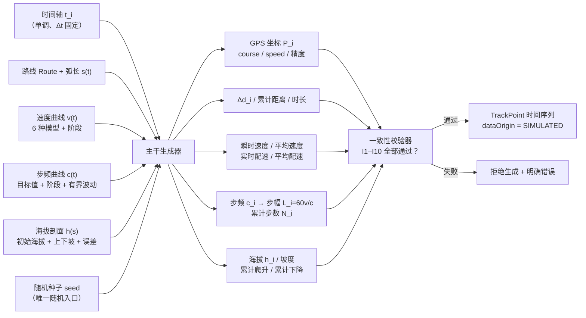
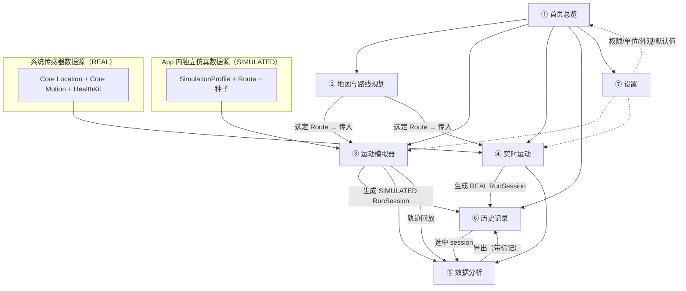
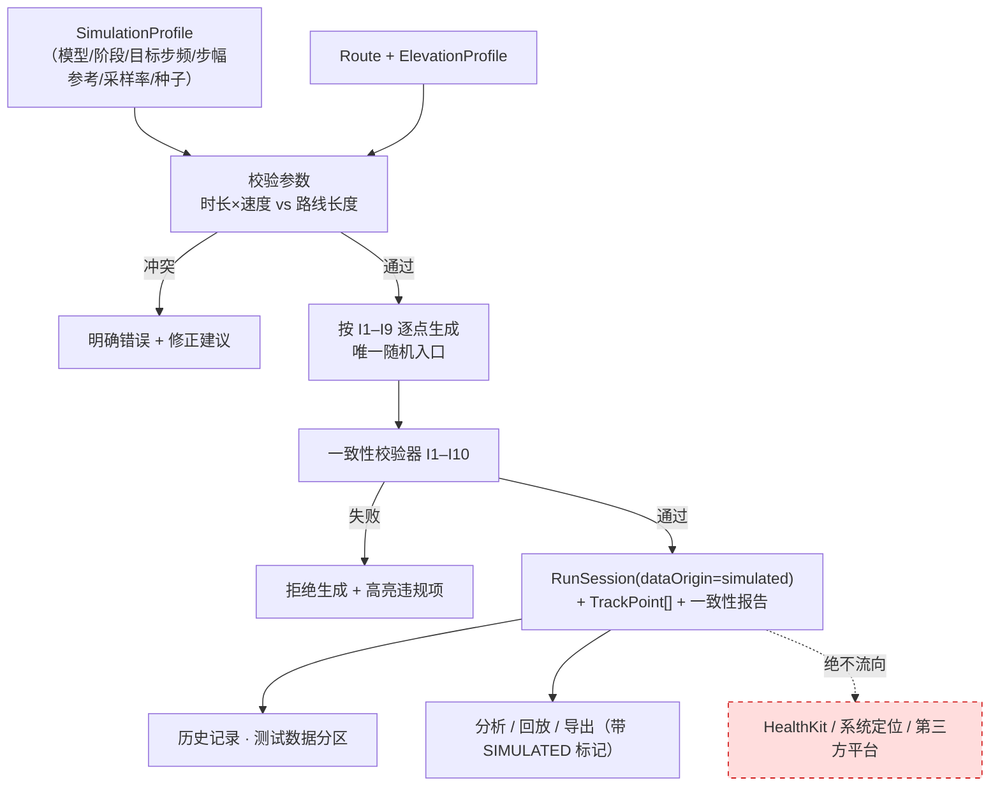
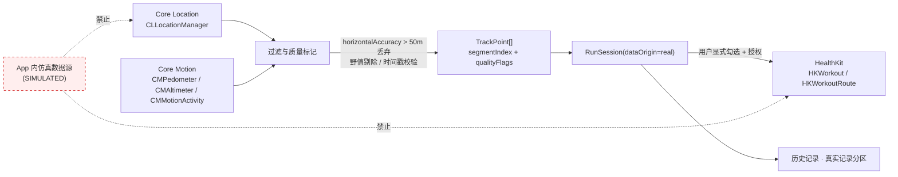
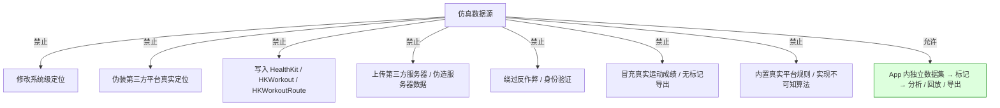

# Campus Run Simulator｜前期深度调研与产品需求文档（PRD）

| 项目 | 内容 |
| --- | --- |
| 项目代号 | Campus Run Simulator |
| 项目名（snake_case） | `campus_run_simulator` |
| 文档编号 | `01-Research-and-PRD` |
| 阶段 | 流水线中间产物：**前期深度调研 + PRD**；下游交接对象为**架构师** |
| 撰写人 | 许清楚（Xu）· 产品经理 |
| 文档语言 | 简体中文 |
| 联网检索日期 | 2026-11-08（WebSearch / WebFetch 真实检索） |
| 版本 | v1.0 |
| 技术前提 | **iOS 原生应用（Swift / SwiftUI）**，由项目定位指定，覆盖产品经理默认 Web 技术模板；本文不指定实现层技术选型 |
| 本文范围 | 只做调研与产品定义。**不写代码、不做架构设计、不做目录/文件清单设计、不做 UI 实现** |

> **交付说明**：本文是流水线中间产物，由主理人转交架构师。文中的「数据实体概念清单」「页面功能规格」「数据流向」均为**产品概念层描述**，不是实现层模型设计或架构设计。文中出现的 JSON 仅为**数据契约字段示意**，不是 Swift 代码。

---

## 0. 第一约束：合规红线（贯穿全文，不可偏离）

> **本节是本项目的第一约束，优先级高于一切功能、体验与性能目标。任何需求、任何页面、任何导出、任何验收标准与之冲突时，一律以本节为准。**

### 0.1 红线原文（任务书逐条落位）

| 编号 | 红线 | 全文落位 |
| --- | --- | --- |
| R1 | 本项目是「教学研究 / 个人自用 / 数据分析」工具 | §B.2 产品目标、§B.2 非目标、§B.3 用户故事 |
| R2 | 严禁破解任何第三方 App | §A.4 不可知清单、§B.2 非目标 |
| R3 | 严禁伪造第三方服务器数据 | §B.2 非目标、§B.11 禁止项 |
| R4 | 严禁绕过平台反作弊或身份验证机制 | §A.2.5、§A.4、§B.2 非目标 |
| R5 | 严禁把模拟记录冒充真实运动成绩 | §B.11 数据隔离、§B.10、§B.14 验收 |
| R6 | 所有仿真数据必须在 **UI 与导出文件**中明确标记为「测试数据 / SIMULATED」，并与真实运动记录**物理区分** | §B.4 需求池、§B.6 各页面、§B.11、§B.14 |
| R7 | 不得把未经证实的第三方检测规则当作事实陈述；所有推测必须显式标注 | §0.2 证据规范、§A.2 全节、§B.7 规则模块 |
| R8 | 虚拟轨迹仿真必须是 **app 内独立数据源**，不得修改系统级定位、不得伪装第三方平台的真实定位 | §B.9、§B.10、§B.11、§A.1.1 |

### 0.2 证据与表述规范（全文强制）

| 等级标记 | 含义 | 允许的表述方式 |
| --- | --- | --- |
| 【已证实（附来源 URL）】 | 有可访问的一手公开来源（Apple 官方文档、高校体育部/教务处官方通知、标准组织规范） | 可陈述该来源**明确写出**的内容；不得外推 |
| 【公开资料提及但未经证实】 | 第三方下载站、帮助文档汇编、客服/产品整理材料、用户公开讨论 | 必须写成「某公开资料提及……，未经独立证实」，**不得当作事实** |
| 【推测，仅用作本地建模假设】 | 本项目为建模自行设定的假设 | 必须显式标注「假设」，不得与任何第三方平台绑定 |
| 【不可知，不得编造】 | 第三方服务端/客户端内部算法、阈值、模型、反作弊规则 | 一律标注「不可知，不得编造」，**本项目不得实现、不得模拟其判定逻辑** |

> **关键区分**：高校官方通知中公布的「学校考核要求」（里程、配速区间、有效时段）属于【已证实】的**学校规则**；但「App 内部如何判定、如何检测作弊、如何生成点位」仍属于【不可知，不得编造】。二者不得混淆。

### 0.3 全文合规检查表（每个模块必须回答）

| 模块 | 必须满足的合规问题 |
| --- | --- |
| 仿真引擎 | 是否只生成 app 内独立数据源？是否未触碰系统定位？ |
| 轨迹回放 / 导出 | 是否带 SIMULATED 标记（文件名 + 文件内 + UI 常驻）？ |
| 真实运动记录 | 是否与模拟记录物理隔离？模拟数据是否**绝不**写入 HealthKit？ |
| 校园跑规则配置 | 是否全部标注「示例假设值」？是否未内置任何真实平台规则？ |
| 数据分析 / 历史 | 是否按来源分区展示、禁止混排冒充？ |
| 设置 / 权限 | 是否明确告知用户数据用途、是否可一键清除？ |
| 验收 | 是否有逐条可测的合规验收用例？ |

---

# 任务 A：前期深度调研

## A.0 检索方法与过程说明

按「3 组独立关键词 → 每组取前若干结果 → 去重 → 交叉验证 → 缺口如实标注」执行，全部来源为本次真实联网检索所得。

| 组 | 关键词组（真实使用的检索词方向） | 主要来源域 | 结果处理 |
| --- | --- | --- | --- |
| G1 | `Apple Developer Core Location CLLocationManager allowsBackgroundLocationUpdates / CLLocation distance(from:) / CMPedometerData currentCadence / CMAltimeter relativeAltitude / HealthKit requestAuthorization HKWorkoutBuilder HKWorkoutRoute / MapKit SwiftUI Map MKPolyline MKDirections elevation / Swift Charts SwiftData / Liquid Glass glassEffect GlassEffectContainer iOS 26` | `developer.apple.com` | 逐项核对 API 名称、单位、SDK 版本；去除 `?changes=` 参数与地区前缀，保留规范英文 URL |
| G2 | `运动世界校园 使用指南 GPS 轨迹 配速 必经点 随机点 终点 规则 site:edu.cn / 步道乐跑 校园跑 规则 配速 里程 点位 / 运动世界校园 常见问题 GPS 漂移 红线 定位中断 / 运动世界校园 帮助中心` | `*.edu.cn`、微信公众号、第三方软件站 | 区分「学校官方通知」与「第三方汇编」；只把前者规则参数列为已证实 |
| G3 | `Haversine formula great-circle distance / running speed cadence stride length formula / GPS trajectory smoothing Kalman filter outlier removal cumulative elevation gain / GPX 1.1 schema topografix trkpt ele time` | `movable-type.co.uk`、`topografix.com`、公开技术资料 | 提取公式、单位、误差、schema 定义 |

**已做真实性核验（WebFetch）的页面**：杭州医学院体育部通知、`developer.apple.com/documentation/swiftui/view/glasseffect(_:in:)`、运动世界校园常见问题（微信公众号）、`topografix.com/gpx/1/1/`、`movable-type.co.uk/scripts/latlong.html`。

**如实标注的检索缺口**：
- `developer.apple.com/forums/thread/739620`（MapKit 高程查询讨论）在 WebFetch 时返回 `Security Verification / Invalid connection`，**页面存在但本次未能抓取正文**；该结论以 WebSearch 返回摘要为准，并标注为「Apple 开发者论坛讨论，非官方文档承诺」。
- **未检索到 Apple 公开提供的「按经纬度查询高程数值」的官方 API 文档**；MapKit 高程可得性结论为「未检索到公开权威支持」，详见 §A.1.4。
- **未检索到任何公开权威来源披露第三方校园跑 App 的内部检测算法**；相关内容一律标注【不可知，不得编造】。

---

## A.1 Apple 官方能力核实（逐项给出真实文档 URL 与要点）

> 说明：以下 URL 均为本次检索到的 `developer.apple.com` 真实文档地址。个别属性/类（如 `showsBackgroundLocationIndicator`）未检索到独立页面时，指向其**所属类文档页**并注明「在该页 Topics / See also 中列出」，不编造 URL。

### A.1.1 Core Location

| 能力项 | 核实要点（单位 / 版本 / 语义） | 真实文档 URL |
| --- | --- | --- |
| `CLLocationManager` | 标准定位服务入口：`startUpdatingLocation()` / `stopUpdatingLocation()` / `requestLocation()`；含 `desiredAccuracy`、`distanceFilter`、`activityType`、`pausesLocationUpdatesAutomatically`、`allowsBackgroundLocationUpdates`、`showsBackgroundLocationIndicator` 等属性（后二者在该页 Topics 列出） | https://developer.apple.com/documentation/corelocation/cllocationmanager |
| 定位精度常量 | `CLLocationAccuracy = Double`，含义为「不确定半径（米）」；常量：`kCLLocationAccuracyBestForNavigation`、`kCLLocationAccuracyBest`、`kCLLocationAccuracyNearestTenMeters`、`kCLLocationAccuracyHundredMeters`、`kCLLocationAccuracyKilometer`、`kCLLocationAccuracyThreeKilometers`、`kCLLocationAccuracyReduced`。注意：`kCLLocationAccuracyBest` 与 `BestForNavigation` **仅在 `isAuthorizedForPreciseLocation == true` 时可用** | https://developer.apple.com/documentation/corelocation/cllocationaccuracy ；https://developer.apple.com/documentation/corelocation/kcllocationaccuracybest |
| 后台定位 `allowsBackgroundLocationUpdates` | 默认 `false`。App 必须在 `Info.plist` 包含 `UIBackgroundModes = location`，并把该属性置 `true`；且需**在前景启动时**开始定位更新，此后进入后台仍继续。系统按需显示后台定位指示（蓝条/药丸） | https://developer.apple.com/documentation/corelocation/cllocationmanager/allowsbackgroundlocationupdates |
| `UIBackgroundModes` | 属性列表键，值为字符串数组，合法值包含 `location`；官方说明「应谨慎使用，仅当 App 确实提供对应服务」 | https://developer.apple.com/documentation/bundleresources/information-property-list/uibackgroundmodes |
| `showsBackgroundLocationIndicator` | 布尔值，控制后台使用定位服务时状态栏外观是否改变。**未检索到独立页面 URL**，在 `CLLocationManager` 文档页及 `allowsBackgroundLocationUpdates` / `pausesLocationUpdatesAutomatically` 页的 See also 中列出 | https://developer.apple.com/documentation/corelocation/cllocationmanager |
| `pausesLocationUpdatesAutomatically` | 默认在受支持平台为 `true`；系统判断位置不太变化时暂停更新并关闭硬件，回调 `locationManagerDidPauseLocationUpdates(_:)`。**重要**：对「使用期间」授权，暂停会终止位置访问直到 App 再次启动并重启更新；官方建议若需全程连续记录，可禁用该属性并在进入后台时把精度降为 `kCLLocationAccuracyThreeKilometers` | https://developer.apple.com/documentation/corelocation/cllocationmanager/pauseslocationupdatesautomatically |
| 后台定位最佳实践 | 官方 Energy Guide：设置 `activityType = CLActivityTypeFitness`、启用自动暂停、`allowsBackgroundLocationUpdates = true`；另有 `allowDeferredLocationUpdatesUntilTraveled:timeout:` 延迟批量交付 | https://developer.apple.com/library/archive/documentation/Performance/Conceptual/EnergyGuide-iOS/LocationBestPractices.html |
| `CLLocation` 字段 | `coordinate`（WGS84 经纬度）、`altitude`（平均海平面以上，米）、`ellipsoidalAltitude`（WGS84 椭球高，米）、`course`（相对正北顺时针，度）、`courseAccuracy`（度）、`speed`（瞬时速度，**m/s**）、`speedAccuracy`（m/s）、`horizontalAccuracy`（不确定半径，米）、`verticalAccuracy`（海拔有效性/不确定度，米）、`timestamp`（`Date`）、`floor`、`sourceInformation`。精度字段为**负值表示无效** | https://developer.apple.com/documentation/corelocation/cllocation |
| 自定义构造 `CLLocation` | 官方文档明确可用 `init(coordinate:altitude:horizontalAccuracy:verticalAccuracy:course:speed:timestamp:)` 等构造器**创建非用户当前位置的位置对象**（例如表示目的地/地图上的任意点）；这正是本项目「app 内独立仿真数据源」的合规技术基础——**构造的是 app 内数据对象，不是系统定位** | https://developer.apple.com/documentation/corelocation/cllocation/init(coordinate:altitude:horizontalaccuracy:verticalaccuracy:course:speed:timestamp:) |
| `distance(from:)` | 实例方法 `distance(from:)`，返回类型为 `CLLocationDistance`，即两点间**米**为单位的距离；由系统实现，可用于统一真实与仿真的距离口径 | https://developer.apple.com/documentation/corelocation/cllocation |
| 精度过滤与轨迹平滑 | Apple《创建体能训练路线》明确要求：**丢弃 `horizontalAccuracy > 50 m` 的点**；**尽量保持相邻点时间间隔 ≤ 3 s**；「raw Core Location data can contain a significant amount of noise」，要求 App 自行 filter & smooth | https://developer.apple.com/documentation/healthkit/creating-a-workout-route |

**对本项目的结论**：真实记录可用系统定位；仿真记录只能用 app 内自建的 `CLLocation` 数据对象序列，**不得调用任何修改系统级定位、不得注入其他 App 的定位**。

### A.1.2 Core Motion

| 能力项 | 核实要点（**单位尤其重要**） | 真实文档 URL |
| --- | --- | --- |
| `CMPedometer` | 系统生成的步行数据；`queryPedometerData(from:to:withHandler:)` 查历史、`startUpdates(from:withHandler:)` 实时、`stopUpdates()`；能力探测：`isStepCountingAvailable()` / `isDistanceAvailable()` / `isFloorCountingAvailable()` / `isPaceAvailable()` / `isCadenceAvailable()` / `isPedometerEventTrackingAvailable()` / `authorizationStatus()`。**必须包含 `NSMotionUsageDescription`，否则调用即崩溃** | https://developer.apple.com/documentation/coremotion/cmpedometer |
| 实时更新语义 | handler 收到的是**从 start 日期到当前时刻的累计数据**；App 暂停时交付暂时停止，回前台或进入后台执行时恢复 | https://developer.apple.com/documentation/coremotion/cmpedometer/startupdates(from:withhandler:) |
| `CMPedometerData` 字段 | `startDate` / `endDate`；`numberOfSteps`（步数）；`distance`（估计距离，**米**，可选）；`averageActivePace`（**秒/米 s/m**，可选）；`currentPace`（**秒/米 s/m**，可选）；`currentCadence`（**步/秒 steps/s**，可选）；`floorsAscended` / `floorsDescended`（近似楼层数，可选）。**iOS 8.0+** | https://developer.apple.com/documentation/coremotion/cmpedometerdata |
| `CMAltimeter` / `CMAltitudeData` | `relativeAltitude`：**自首次报告事件以来的海拔变化，米**；首事件为 `0`。`pressure`：**千帕 kPa**。需先 `isRelativeAltitudeAvailable()`；`startRelativeAltitudeUpdates(to:withHandler:)`；`NSMotionUsageDescription` 必需。新版还提供 `isAbsoluteAltitudeAvailable()` / `startAbsoluteAltitudeUpdates` / `CMAbsoluteAltitudeData`（**绝对海拔**，需设备支持，按可用性分支） | https://developer.apple.com/documentation/coremotion/cmaltimeter ；https://developer.apple.com/documentation/coremotion/cmaltitudedata ；https://developer.apple.com/documentation/coremotion/cmaltitudedata/relativealtitude |
| `CMMotionActivity` / `CMMotionActivityManager` | `CMMotionActivity` 提供 `stationary` / `walking` / `running` / `automotive` / `cycling` / `unknown` 布尔量 + `startDate` + `confidence`（低/中/高）；各布尔量**不互斥**，也可能全为 `false`。`CMMotionActivityManager` 为管理器类（在该页 See also 中列出，**未检索到独立页面 URL**） | https://developer.apple.com/documentation/coremotion/cmmotionactivity |
| `CMMotionManager` 的授权差异 | Apple DTS 工程师在开发者论坛明确答复：`NSMotionUsageDescription` 对 `CMSensorRecorder` / `CMPedometer` / `CMMotionActivityManager` / `CMMovementDisorderManager` 是**必需**的；而 **`CMMotionManager` 目前不需要隐私授权**，且主要用于前景的设备运动/交互控制 | https://developer.apple.com/forums/thread/762886 |
| 传感器与用途描述键总表 | Apple《Device sensors》表格：加速度计/陀螺仪（Core Motion）— 用途描述键「Not required / 可选」；计步器、运动记录、摔倒检测（健康数据，Core Motion）— `NSMotionUsageDescription`；位置数据（Core Location）— `NSLocationWhenInUseUsageDescription` / `NSLocationAlwaysAndWhenInUseUsageDescription`；并强调「仅在需要时启用传感器，用完立即停用」 | https://developer.apple.com/documentation/technologyoverviews/device-sensors |
| 隐私键总表（归档，仍可访问） | Apple QA1937 列出 Motion → `NSMotionUsageDescription` → `CMMotionActivityManager` 等需用途描述，缺失会导致 App 退出 / 审核拒绝 | https://developer.apple.com/library/archive/qa/qa1937/ |

#### 「设备实测」vs「需自行推算」对照（本项目必须分清）

| 数据项 | 归类 | 说明 |
| --- | --- | --- |
| `numberOfSteps`、`distance`、`floorsAscended/Descended` | **设备实测（系统估算值）** | 由系统给出，App 不重算；`distance` 为「估计」值 |
| `currentPace` / `averageActivePace` | **设备实测，但单位需换算** | 系统给 **s/m**；App 需换算为常用 **min/km**（见 §A.3.3） |
| `currentCadence` | **设备实测，但单位需换算** | 系统给 **步/秒**；App 需换算为 **spm（步/分钟）**（见 §A.3.3） |
| `relativeAltitude` / `pressure` | **设备实测（相对量）** | 是「相对首次事件」的变化量，**不是绝对海拔**；绝对基准需另设 |
| `CMMotionActivity` 状态与 `confidence` | **设备实测（分类结果）** | 用于辅助判断运动状态，不能替代轨迹 |
| **步幅 stride length** | **需自行推算** | iOS 未提供直接「实时步幅」API（HealthKit 有 `runningStrideLength` 样本类型，但属 HealthKit 样本，非实时传感器流）；本项目用 `L = 60·v / cadence` 反算 |
| **累计爬升 / 累计下降** | **需自行推算** | 由海拔序列差分累加，需加噪声死区（见 §A.3.5） |
| **绝对海拔基准** | **需自行推算 / 用户给定 / 外部导入** | `relativeAltitude` 只是相对量；`CMAbsoluteAltitudeData` 需设备支持且需可用性判断 |
| **瞬时速度 / 实时配速 / 平均配速** | **需自行推算**（`CLLocation.speed` 除外） | `CLLocation.speed` 为系统给出的瞬时速度 **m/s**（设备实测）；其余由距离÷时间推导 |
| **轨迹平滑 / 漂移剔除 / 中断分段** | **需自行实现** | Apple 文档明确要求 App 自行 filter & smooth |
| **步数随时间的连续曲线** | **需自行推算** | `numberOfSteps` 为累计量，需差分得到每秒步数 |

### A.1.3 HealthKit

| 能力项 | 核实要点 | 真实文档 URL |
| --- | --- | --- |
| 授权模型 | `requestAuthorization(toShare:read:completion:)`：**写入（share）与读取（read）分别申请权限**，「Each data type has two separate permissions, one to read it and one to share it」；SwiftUI 可用 `healthDataAccessRequest(store:shareTypes:readTypes:trigger:completion:)`（iOS 17+）。用途描述键：`NSHealthShareUsageDescription`（读）、`NSHealthUpdateUsageDescription`（写），**缺失会崩溃** | https://developer.apple.com/documentation/healthkit/hkhealthstore/1614152-requestauthorization ；https://developer.apple.com/documentation/SwiftUI/View/healthDataAccessRequest(store:shareTypes:readTypes:trigger:completion:) |
| 授权细则与隐私 | 细粒度授权；需先 `isHealthDataAvailable()`；需开启 HealthKit capability；官方明确「**App 无法得知用户是否授予了读取权限**」，被拒时表现为「查不到数据」；还存在「仅授权近期时间窗」的 limited authorization，且 App 无法区分「完全授权」与「拒绝」 | https://developer.apple.com/documentation/healthkit/authorizing-access-to-health-data |
| `authorizationStatus(for:)` 语义 | **只反映写入（sharing）授权状态**（`notDetermined` / `sharingDenied` / `sharingAuthorized`），**不能用于判断读取权限** | https://developer.apple.com/documentation/healthkit/hkhealthstore/authorizationstatus(for:) ；https://developer.apple.com/documentation/healthkit/hkauthorizationstatus |
| `HKQuantityTypeIdentifier` | `stepCount`、`distanceWalkingRunning`、`heartRate`、`activeEnergyBurned`、`basalEnergyBurned`、`flightsClimbed`、`runningSpeed`、`runningStrideLength`、`runningPower`、`runningGroundContactTime`、`runningVerticalOscillation`、`distanceCycling` 等 | https://developer.apple.com/documentation/healthkit/hkquantitytypeidentifier |
| Workout 与 Route 体系 | `HKWorkout` / `HKWorkoutBuilder`（增量构建）/ `HKLiveWorkoutBuilder` + `HKLiveWorkoutBuilderDelegate` + `HKLiveWorkoutDataSource`（实时）；`HKWorkoutSession` / `HKWorkoutConfiguration`（`activityType = .running`、`locationType = .outdoor`）；`HKWorkoutRoute` / `HKWorkoutRouteBuilder` / `HKWorkoutRouteQuery` / `HKWorkoutRouteQueryDescriptor`；路线数据以 `CLLocation` 数组存储，用 `HKWorkoutRouteQuery` 分批异步读取 | https://developer.apple.com/documentation/healthkit/workouts_and_activity_rings ；https://developer.apple.com/documentation/healthkit/hkworkoutroute |
| 创建路线流程 | 需同时申请 HealthKit 与 Core Location 权限；`seriesBuilder(for:)` 创建 route builder；`insertRouteData(_:completion:)` 增量写入；`finishRoute(with:metadata:completion:)` 关联到**单个** workout；一条 route 只能关联一个 workout，创建后不可更改。**明确要求**：过滤 `horizontalAccuracy > 50 m` 的点、相邻点间隔尽量 ≤ 3 s | https://developer.apple.com/documentation/healthkit/creating-a-workout-route |
| 后台体能训练会话 | 有活跃 workout session 时 App 可在后台持续运行并继续接收 HealthKit / 传感器数据（主要针对 watchOS 场景）；iOS 侧后台定位仍依赖 `UIBackgroundModes=location` + `allowsBackgroundLocationUpdates` | https://developer.apple.com/documentation/HealthKit/running-workout-sessions |
| **后台读取限制** | `HKObserverQuery` **默认只在前景返回结果**；需 `enableBackgroundDelivery(for:frequency:withCompletion:)` 注册后台通知。iOS 15 / watchOS 8 起**必须**具备 `com.apple.developer.healthkit.background-delivery` entitlement，否则报 `HKErrorAuthorizationDenied`。系统按 frequency 节流，**部分类型（如 iOS 的 `stepCount`）最高仅 `HKUpdateFrequencyHourly`**；必须调用 update handler 的 completion，连续 3 次不响应则系统停止推送；**模拟器不支持后台查询，必须真机测试** | https://developer.apple.com/documentation/healthkit/executing-observer-queries ；https://developer.apple.com/documentation/healthkit/hkhealthstore/1614175-enablebackgrounddeliveryfortype |

> **合规推论（硬性）**：本项目**只允许把「真实运动记录」写入 HealthKit**（用户显式授权后）；**模拟/仿真数据一律禁止写入 HealthKit、`HKWorkout`、`HKWorkoutRoute` 及任何系统健康数据通道**，否则等同于「把模拟记录冒充真实运动成绩」，违反 R5。

### A.1.4 MapKit

| 能力项 | 核实要点 | 真实文档 URL |
| --- | --- | --- |
| SwiftUI `Map` | `MapKit for SwiftUI`（iOS 17+）提供 `Map`、`MapStyle`、`MapPolyline`、`MapCircle`、`MapPolygon`、`Marker`、`Annotation`、`UserAnnotation`、`MapCameraPosition`、`MapReader`、`MapSelection`、`MapScaleView`、`MapCompass`、`MapUserLocationButton`、`LookAroundPreview` 等 | https://developer.apple.com/documentation/mapkit/mapkit-for-swiftui |
| `MapStyle` | `standard(elevation:emphasis:pointsOfInterest:showsTraffic:)` / `imagery(elevation:)` / `hybrid(...)`；`MapStyle.Elevation` 控制**是否渲染高程视觉效果**（flat / realistic），**不返回高程数值** | https://developer.apple.com/documentation/mapkit/mapstyle |
| `MKPolyline` / `MKPolylineRenderer` | `MKPolyline` 由坐标序列构成开放折线（首尾不自动连接）；`MKPolylineRenderer` 只描边不填充，提供 `strokeStart` / `strokeEnd`（**可用于轨迹回放的渐进绘制**）；另有 `MKGradientPolylineRenderer` 支持渐变 | https://developer.apple.com/documentation/mapkit/mkpolyline ；https://developer.apple.com/documentation/mapkit/mkpolylinerenderer |
| `MKDirections` | 向 Apple 服务器请求步行/驾车路线与预计行程时间；`MKDirections.Request`、`MKDirections.RoutePreference`、`calculate(completionHandler:)`、`calculateETA(completionHandler:)`；**短时间过多请求会收到 `MKError.Code.loadingThrottled`** | https://developer.apple.com/documentation/mapkit/mkdirections |
| 地图选点 | 可用 `MapReader`（把屏幕点转换为地图坐标）+ 点击手势实现点选；`MapSelection` / `MapFeature` 支持可点击地图要素 | https://developer.apple.com/documentation/mapkit/mapkit-for-swiftui |
| 3D 地形渲染 | iOS 16 起 MapKit 提供 3D City Experience，可指定 `elevationStyle = realistic` 呈现 3D 地形，并自动把 annotation / route line 贴到地形上；深色模式随系统切换。**这是渲染能力，不是数值查询 API** | https://developer.apple.com/videos/play/wwdc2022/102/ |

#### 地图地形 / 海拔参考数据在 iOS 上的可得性（任务书明确要求核实）

| 结论 | 证据等级 | 来源 |
| --- | --- | --- |
| **未检索到 Apple 官方公开提供的「按经纬度查询高程数值」的 MapKit API**；Apple 开发者论坛中开发者提问「能否从 `MKRoute` 获取 elevation / elevation gain」，回复为「doesn't seem like apple has opened this altitude api or elevation data up to developers」 | 【公开资料提及但未经证实】（开发者论坛讨论，**非官方文档承诺**） | https://developer.apple.com/forums/thread/739620 （WebFetch 被 Security Verification 拦截，以 WebSearch 摘要为准） |
| 开发者询问「Apple 地图上某点的 altitude」，答复「Your iOS device does not contain a global DEM database. You'll have to use some web service for that」；用 `CLLocation(latitude:longitude:).altitude` 取到的是 `0.0` | 【公开资料提及但未经证实】（论坛答复） | https://developer.apple.com/forums/thread/8446 |
| 开发者询问「如何显示地形图（topographic maps）」，Apple DTS 工程师答复「There's no supported way for you to display topographic maps in your app through MapKit with the APIs currently available」 | 【已证实（Apple DTS 工程师在官方论坛答复）】 | https://developer.apple.com/forums/thread/757396 |
| `MapStyle.Elevation` / `elevationStyle realistic` 只控制**渲染**，不提供高程数值 | 【已证实】 | https://developer.apple.com/documentation/mapkit/mapstyle ；https://developer.apple.com/videos/play/wwdc2022/102/ |

**替代方案（本项目可合规采用，均为产品层建议，非架构决策）**：

| 方案 | 数据来源 | 是否联网 | 合规注意 |
| --- | --- | --- | --- |
| S1 用户自定义初始海拔 + 手工编辑高程剖面 | 用户输入 | 否 | 必须标注「用户自定义，非真实地形实测」 |
| S2 导入含 `<ele>` 的 GPX 1.1 轨迹作为参考剖面 | 用户导入文件 | 否 | GPX 1.1 中 `ele` 为可选字段，单位米、WGS84 基准；缺失时不得臆造，需提示用户 | https://www.topografix.com/gpx/1/1/ |
| S3 第三方 DEM / 高程服务 | 外部服务 | 是 | 需用户显式知情、需标注数据出处与采集时间、需评估服务条款与隐私；本项目**不默认启用、不静默上传轨迹** |
| S4 真实运动时以 `CMAltimeter.relativeAltitude` 叠加自定义基准 `h0` 得到绝对海拔曲线 | 设备气压计 | 否 | 属「设备实测相对量 + 用户给定基准」，须在 UI 明示基准来源 |
| S5 支持 `CMAbsoluteAltitudeData`（若设备与系统支持） | 设备 | 否 | 必须走 `isAbsoluteAltitudeAvailable()` 可用性分支，不可用时降级到 S4 |
| S6 公开工程做法：气压计相对变化 + DEM 绝对基准融合生成剖面 | 混合 | 视情况 | 【推测，仅用作本地建模假设】；参考公开技术资料 https://www.xiaobuwq.com/blog/?p=5798 |

> **产品结论**：本项目的「坡度/海拔展示」能力不得依赖不存在的 MapKit 高程查询 API；P0 采用 S1 + S2 + S4，P1 评估 S3/S5/S6。所有海拔参考数据必须标注**来源与是否为实测**。

### A.1.5 SwiftUI / Swift Charts / SwiftData 能力边界

| 框架 | 能力与版本 | 能力边界（产品需知） | 真实文档 URL |
| --- | --- | --- | --- |
| SwiftUI | 声明式 UI；`@State` / `@Observable`；与 MapKit for SwiftUI 深度集成；`glassEffect` 等（iOS 26+） | 不提供内置高精度大规模轨迹渲染；不提供高程数值查询；不提供后台保活；不提供传感器访问 | https://developer.apple.com/documentation/swiftui/view/glasseffect(_:in:) （示例）；框架总览见 https://developer.apple.com/documentation/swiftui |
| Swift Charts | **iOS 16.0+**。`Chart` + `LineMark` / `AreaMark` / `PointMark` / `RuleMark` / `BarMark` / `RectangleMark` / `SectorMark`；自动刻度与坐标轴；支持本地化、无障碍、动画、图例；`Chart3D` / `SurfacePlot` 等 | 定位是**声明式图表构建**，不是高频流式实时绘图引擎；长序列（数万 TrackPoint）需降采样/窗口化后再绘图；不负责持久化 | https://developer.apple.com/documentation/charts |
| SwiftData | **iOS 17.0+**。`@Model` / `@Attribute` / `@Relationship` / `@Unique` / `@Index`（含 R-tree 索引）/ `@Transient` / `@Query`；`ModelContainer` / `ModelContext` / `FetchDescriptor`；支持历史事务、撤销、iCloud 同步（需额外能力） | 通用对象持久化，**不是时序数据库**；海量 `TrackPoint` 需批量写入/分页读取/关系级联删除策略；iCloud 同步需显式开启能力且涉及合规评审 | https://developer.apple.com/documentation/SwiftData ；https://developer.apple.com/xcode/swiftdata/ |

**版本矩阵（影响最低支持系统版本的决策，见 §B.15 Q1）**：

| 能力 | 最低 iOS |
| --- | --- |
| Swift Charts | 16.0 |
| SwiftUI `Map` / `MapPolyline` / `MapStyle` | 17.0 |
| SwiftData | 17.0 |
| `healthDataAccessRequest` (SwiftUI) | 17.0 |
| Liquid Glass `glassEffect` / `GlassEffectContainer` | **26.0** |

### A.1.6 Liquid Glass（iOS 26 / Xcode 26）与低版本兼容回退

| API / 概念 | 核实要点 | 真实文档 URL |
| --- | --- | --- |
| `glassEffect(_:in:)` | **iOS 26.0+ / iPadOS 26.0+ / Mac Catalyst 26.0+ / macOS 26.0+ / tvOS 26.0+ / watchOS 26.0+**。文档中的方法声明为：接收一个 `Glass` 参数（默认 `regular` 变体）与一个 `Shape` 参数（默认 `DefaultGlassEffectShape`，即 Capsule 胶囊形），返回 `some View`。系统「在视图背后渲染玻璃材质形状 + 在视图之上叠加前景效果」。通常配合 `GlassEffectContainer` 使用 | https://developer.apple.com/documentation/swiftui/view/glasseffect(_:in:) （**已 WebFetch 核实**） |
| `GlassEffectContainer` | **iOS 26.0+**。`init(spacing: CGFloat?, content:)`；把多个 Liquid Glass 形状合并渲染以提升性能并允许形状相互融合/形变；`spacing` 越大越早开始融合。官方说明「玻璃不能采样另一块玻璃」，故需容器统一渲染 | https://developer.apple.com/documentation/swiftui/glasseffectcontainer |
| 相关修饰符 | `glassEffectID(_:in:)`（配合 `Namespace.ID` 做形变过渡）、`glassEffectTransition(_:)`（`identity` / `matchedGeometry` / `materialize`）、`glassEffectUnion(id:namespace:)`、`Glass.interactive(_:)`、`GlassButtonStyle` / `GlassProminentButtonStyle`、`DefaultGlassEffectShape` | https://developer.apple.com/documentation/swiftui/glasseffectcontainer ；https://developer.apple.com/documentation/swiftui/glasseffecttransition |
| UIKit 侧 | `UIVisualEffectView` + `UIGlassEffect` + `UIGlassContainerEffect`；官方建议「使用 Xcode 26 构建」「Liquid Glass 应节制用于最重要的元素」 | https://developer.apple.com/videos/play/wwdc2025/284/ |
| 设计指南 | WWDC25「Build a SwiftUI app with the new design」：标准控件自动获得新设计；自定义视图用 `glassEffect`；用 `GlassEffectContainer` 分组；用 `glassEffectID` 做流体形变 | https://developer.apple.com/kr/videos/play/wwdc2025/323/ |

**低版本系统兼容回退策略（产品层要求，非实现方案）**：

| 项 | 要求 |
| --- | --- |
| 版本门控 | 所有 Liquid Glass API 必须走 `@available(iOS 26, *)`（及对应平台版本）分支；**不得**在低版本系统上调用或运行时崩溃 |
| 回退视觉 | 低版本使用系统材质与自定义模糊：`.ultraThinMaterial` / `.thinMaterial` / `.regularMaterial` / `.thickMaterial` 配合 `blur`、形状圆角、描边、阴影，保持与玻璃版**相同的信息层级与可点击区域** |
| 功能等价 | 回退**不得**导致功能缺失：所有按钮、滑块、卡片、图表交互在回退版本必须可用；禁止「玻璃版有、低版本没有」的功能差异 |
| 一致性 | 深色模式 / 浅色模式、动态类型（Dynamic Type）、提高对比度、减少动态效果（Reduce Motion）在两套视觉下都要通过无障碍检查 |
| 禁止项 | 不得使用私有 API、不得伪造系统玻璃效果、不得因回退引入第三方 UI 依赖而带来隐私/合规风险 |
| 验收 | 需在同一份功能用例上分别于 iOS 26 与最低支持版本各跑一遍（见 §B.14） |

### A.1.7 能力-来源汇总（设备实测 / 需推算）

| 数据 | 设备/系统实测 | 需 App 自行推算 | 备注 |
| --- | --- | --- | --- |
| 经纬度、海拔、`horizontalAccuracy`、`verticalAccuracy`、`course`、`speed`、`timestamp` | ✅ `CLLocation` | — | 负值表示无效 |
| 步数、估计距离、楼层数 | ✅ `CMPedometerData` | — | 系统估算值 |
| 实时配速 / 平均配速（s/m） | ✅ `CMPedometerData` | ✅ 换算为 min/km | 单位换算是 App 责任 |
| 步频（步/秒） | ✅ `CMPedometerData` | ✅ 换算为 spm | 单位换算是 App 责任 |
| 相对海拔 / 气压 | ✅ `CMAltitudeData` | ✅ 绝对基准、累计爬升/下降 | 首事件为 0 |
| 运动状态分类 | ✅ `CMMotionActivity` | — | 布尔量不互斥 |
| 步幅 | ❌ | ✅ `L = 60v / cadence` | 见 §A.3.4 |
| 累计距离、时长、平均速度、平均配速 | 部分（系统给 `distance`） | ✅ 由轨迹/时间统一推导 | 必须与轨迹一致 |
| 累计爬升 / 累计下降 | ❌ | ✅ 海拔差分 + 死区 | 见 §A.3.5 |
| 轨迹平滑 / 漂移剔除 / 中断分段 | ❌ | ✅ App 实现 | Apple 明确要求 filter & smooth |
| 高程数值查询（任意坐标） | ❌ MapKit 不提供 | ✅ 导入 / 用户给定 / 外部服务 | 见 §A.1.4 |

---

## A.2 运动世界校园版及其他校园跑 App 的公开运动监测机制

### A.2.1 证据分级定义（本节强制使用）

- 【已证实（附来源 URL）】：**高校官方通知 / 学校体育部文件 / Apple 官方文档 / 标准组织规范**中明确写出的内容。
- 【公开资料提及但未经证实】：第三方下载站、软件站、客服与产品整理材料、微信公众号汇编、用户公开讨论。
- 【推测，仅用作本地建模假设】：本项目为研究建模自行设定。
- 【不可知，不得编造】：第三方 App 的服务端/客户端内部判定算法、阈值、模型、点位生成策略、反作弊实现。

### A.2.2 本次检索到的来源清单

| # | 来源 | 类型 | 等级 | URL |
| --- | --- | --- | --- | --- |
| S1 | 杭州医学院体育部《关于开展2025-2026学年"运动世界校园"APP跑步的通知》 | 高校官方 | 【已证实】 | https://tyb.hmc.edu.cn/sy/tzgg/202603/t20260325_7150205.shtml （**已 WebFetch 核实全文**） |
| S2 | 江苏卫生健康职业学院《2025-2026学年第二学期阳光跑活动的通知》 | 高校官方 | 【已证实】 | https://www.jshvc.edu.cn/xyh/2026/0305/c22352980a28039209/page.htm |
| S3 | 云南农业大学《关于启用"运动世界校园"手机 APP 的通知》(PDF) | 高校官方 | 【已证实】 | https://ty.ynau.edu.cn/__local/7/73/99/42550B7A619F8C36DFB3A5EC38F_80E0713D_22856.pdf |
| S4 | 北京工商大学体育部《"运动世界校园版APP"二维码及使用流程指南》(DOCX) | 高校官方 | 【已证实】 | https://sports.btbu.edu.cn/docs/2023-09/e151d6eae26e4dd9ac6daa70c90a2a2c.docx |
| S5 | 北京工商大学《运动世界校园操作指南》(PDF) | 高校官方 | 【已证实】 | https://sports.btbu.edu.cn/docs/2024-09/d3017cba646d4c7a968b67fe2e95fb1a.pdf |
| S6 | 濮阳石油化工职业技术学院《@同学们，校园跑来了》 | 学校公众号 | 【已证实（学校发布）】 | http://mp.weixin.qq.com/s?__biz=MzkzMDMyNzQ2Mg==&mid=2247499663&idx=1&sn=fde9c5a362f8ab18ac2622e32524310c |
| S7 | 上海财经大学浙江学院公共基础部《跑步APP问题解析》 | 高校官方 | 【已证实】 | https://ggjcb.shufe-zj.edu.cn/info/1280/2697.htm |
| S8 | 南京财经大学体育部《课外体育锻炼的通知》（步道乐跑） | 高校官方 | 【已证实】 | https://tyb.nufe.edu.cn/info/1117/2872.htm |
| S9 | 河北师范大学公共体育教学部《步道乐跑实施细则》 | 高校官方 | 【已证实】 | https://sdgtb.hebtu.edu.cn/a/2025/03/19/1B99F34922814B788EBA4EC1327249CE.html |
| S10 | 常州工程职业技术学院《26-27-1学期学生步道乐跑通知》 | 学校公众号 | 【已证实（学校发布）】 | http://mp.weixin.qq.com/s?__biz=MzE5OTE0NTEwMg==&mid=2247545559&idx=1&sn=7ec1d0b1ade10db15a3d2b6cad3a4ff4 |
| S11 | 「运动世界校园---常见问题」（SJQU运动世界校园，2017） | 客服/产品整理汇编 | 【公开资料提及但未经证实】 | http://mp.weixin.qq.com/s?__biz=MzIxMDc4OTU0OA==&mid=2247483715&idx=1&sn=af84220eac8c438a007498504ca6c054 （**已 WebFetch 核实全文**） |
| S12 | 各软件下载站「运动世界校园」使用说明 | 第三方软件站 | 【公开资料提及但未经证实】 | https://m.gzgztx.com/soft/8809.html ；https://www.paopaoche.net/app/2509226.html ；https://m.pc6.com/s/1705769 ；https://www.cl0579.com/app/586927.html ；https://wap.cisis.com.cn/rjxz/502.html ；https://www.beihangsoft.cn/app/3145.html |
| S13 | 运动世界校园官网（由第三方页面提及） | 官网（未直接核实内容） | 【公开资料提及但未经证实】 | https://www.iydsj.com/ （仅记录，不作为结论依据） |

### A.2.3 逐条结论表

| 主题 | 结论 | 证据等级 | 来源 URL |
| --- | --- | --- | --- |
| **GPS 轨迹记录原理（1）** | 学校通知明确要求：跑步时打开 GPS 与定位权限、保持联网，App 记录跑步轨迹；「网络不稳定时，所经过的路线会画红线，此段路线不记录成绩」 | 【已证实（学校公布的操作要求）】 | S3 https://ty.ynau.edu.cn/__local/7/73/99/42550B7A619F8C36DFB3A5EC38F_80E0713D_22856.pdf |
| **GPS 轨迹记录原理（2）** | 「需先获取到用户的精确定位才可以获取本次跑步的点位并开始跑步」；「为保证点位生成的合理性」 | 【公开资料提及但未经证实】 | S11 http://mp.weixin.qq.com/s?__biz=MzIxMDc4OTU0OA==&mid=2247483715&idx=1&sn=af84220eac8c438a007498504ca6c054 |
| **GPS 轨迹记录原理（3）** | 学校通知提到「后台会根据跑步分段配速、轨迹信息以及手机 ID 变更等情况分析作弊行为」「后台针对步频和配速已开启分段分析」——**学校层面确认存在事后分析，但分析算法不可知** | 【已证实（存在性）】＋【不可知，不得编造】（算法） | S1 https://tyb.hmc.edu.cn/sy/tzgg/202603/t20260325_7150205.shtml ；S6 http://mp.weixin.qq.com/s?__biz=MzkzMDMyNzQ2Mg==&mid=2247499663&idx=1&sn=fde9c5a362f8ab18ac2622e32524310c |
| **距离 / 时长 / 配速区间（1）** | 不同学校参数显著不同，见 §A.2.4。例如杭州医学院：男 2.5 km / 女 2.0 km，配速 3′00″–8′30″/km，步频 40–300 步/分钟，有效时段 6:00–22:00，暂停 ≤1 分钟，每天仅 1 次有效成绩 | 【已证实】 | S1 https://tyb.hmc.edu.cn/sy/tzgg/202603/t20260325_7150205.shtml |
| **距离 / 时长 / 配速区间（2）** | 部分学校设置「单次里程上限」「每日上限」「学期目标」「每日有效次数上限」；超过上限只记录总里程、不关联成绩 | 【已证实】＋【公开资料提及但未经证实】 | S3 https://ty.ynau.edu.cn/__local/7/73/99/42550B7A619F8C36DFB3A5EC38F_80E0713D_22856.pdf ；S11 http://mp.weixin.qq.com/s?__biz=MzIxMDc4OTU0OA==&mid=2247483715&idx=1&sn=af84220eac8c438a007498504ca6c054 |
| **距离 / 时长 / 配速区间（3）** | 第三方软件站普遍提及「配速 2′11″–10′/km」「步频 40/60–300」「暂停累计上限」等数值，**各站互相不一致**（步频下限有 40 与 60 两种说法） | 【公开资料提及但未经证实】 | S12 https://m.gzgztx.com/soft/8809.html ；https://www.paopaoche.net/app/2509226.html ；https://m.pc6.com/s/1705769 |
| **必经点 / 随机点 / 终点机制（1）** | 学校通知描述「系统随机分配 4 个途径点、1 个必经点，须经过 1 个必经点和任选 2 个途径点完成规定里程」；另有学校要求「按顺序依次经过 5 个点」「按点位顺序跑完全部点位」 | 【已证实（学校公布的规则描述）】 | S1 https://tyb.hmc.edu.cn/sy/tzgg/202603/t20260325_7150205.shtml ；S2 https://www.jshvc.edu.cn/xyh/2026/0305/c22352980a28039209/page.htm ；S4 https://sports.btbu.edu.cn/docs/2023-09/e151d6eae26e4dd9ac6daa70c90a2a2c.docx |
| **必经点 / 随机点 / 终点机制（2）** | 点位类型被描述为「必经点位 / 终点点位（约定终点）/ 普通点位」三种；「自由跑没有点位」；「计分跑 / 一起跑（约跑）/ 自由跑」三种模式，**只有计分跑计入成绩** | 【公开资料提及但未经证实】（与 S4 学校指南部分吻合） | S11 http://mp.weixin.qq.com/s?__biz=MzIxMDc4OTU0OA==&mid=2247483715&idx=1&sn=af84220eac8c438a007498504ca6c054 ；S4 https://sports.btbu.edu.cn/docs/2023-09/e151d6eae26e4dd9ac6daa70c90a2a2c.docx |
| **必经点 / 随机点 / 终点机制（3）** | 「点位感应以 GPS 定位为中心、50 米为半径自动感应」；「苹果手机跑步精度设置为小于 100，大于 100 无法记录轨迹」 | 【公开资料提及但未经证实】，**不得当作事实** | S11 http://mp.weixin.qq.com/s?__biz=MzIxMDc4OTU0OA==&mid=2247483715&idx=1&sn=af84220eac8c438a007498504ca6c054 |
| **有效记录判定（1）** | 学校通知列出的有效性条件（多条件同时满足）：规定时段内、校园范围内、达到单次里程、配速与步频在区间内、经过规定点位、指定跑步模式、暂停不超时、每天有效次数上限 | 【已证实（学校公布）】 | S1 https://tyb.hmc.edu.cn/sy/tzgg/202603/t20260325_7150205.shtml ；S9 https://sdgtb.hebtu.edu.cn/a/2025/03/19/1B99F34922814B788EBA4EC1327249CE.html |
| **有效记录判定（2）** | 部分学校要求「人脸识别 30 秒内完成」「指定跑区」「须沿跑道逆时针、不得抄近道」「跑步中不得切换应用（会造成陀螺仪数据测算偏差）」「24 小时内二次监测分析，异常加入黑名单 7 天」 | 【已证实（学校公布）】 | S9 https://sdgtb.hebtu.edu.cn/a/2025/03/19/1B99F34922814B788EBA4EC1327249CE.html ；S10 http://mp.weixin.qq.com/s?__biz=MzE5OTE0NTEwMg==&mid=2247545559&idx=1&sn=7ec1d0b1ade10db15a3d2b6cad3a4ff4 |
| **有效记录判定（3）** | 「成绩异常（速度异常 / 步频异常 / 步频曲线波动异常）」被提及为无效原因；「步频曲线波动异常」的**判定阈值与算法不可知** | 【公开资料提及但未经证实】＋【不可知，不得编造】 | S12 https://m.gzgztx.com/soft/8809.html ；S11 http://mp.weixin.qq.com/s?__biz=MzIxMDc4OTU0OA==&mid=2247483715&idx=1&sn=af84220eac8c438a007498504ca6c054 |
| **GPS 漂移与定位中断（1）** | 学校材料明确描述「红色实线 = 暂停期间路线，不记录里程和时间」「红色虚线 = 借用交通工具超速或 GPS 产生漂移，不记录里程」「APP 被系统关闭后恢复，中间经过路线画红色实线」 | 【已证实（学校发布的问题解析）】 | S7 https://ggjcb.shufe-zj.edu.cn/info/1280/2697.htm （与 S11 汇编相互印证，但 S11 单独为【未经证实】） |
| **GPS 漂移与定位中断（2）** | 「信号差 / 节电状态 / 权限未开 / 未开无线网络」「点位附近适当转转以完成打点」「GPS 与无线网络都需正常打开」；「定位慢」「正在努力定位中」「需在室外开阔处」 | 【已证实】＋【公开资料提及但未经证实】 | S7 https://ggjcb.shufe-zj.edu.cn/info/1280/2697.htm ；S5 https://sports.btbu.edu.cn/docs/2024-09/d3017cba646d4c7a968b67fe2e95fb1a.pdf ；S11 http://mp.weixin.qq.com/s?__biz=MzIxMDc4OTU0OA==&mid=2247483715&idx=1&sn=af84220eac8c438a007498504ca6c054 |
| **GPS 漂移与定位中断（3）** | 网络不佳时成绩先保存在手机本地，需在限定天数内（学校通知写「三天内」）手动上传；期间不得卸载/清理缓存；可下载离线地图断网跑但保存成绩时需联网 | 【已证实】 | S2 https://www.jshvc.edu.cn/xyh/2026/0305/c22352980a28039209/page.htm ；S4 https://sports.btbu.edu.cn/docs/2023-09/e151d6eae26e4dd9ac6daa70c90a2a2c.docx ；S5 https://sports.btbu.edu.cn/docs/2024-09/d3017cba646d4c7a968b67fe2e95fb1a.pdf |
| **定位权限（iOS 侧）** | 学校通知要求「定位与身体传感器权限设置为始终允许」「不设置会导致息屏不记录」；另有材料给出 iOS 定位蓝圈半径与精度对照的经验分级 | 【已证实】＋【公开资料提及但未经证实】 | S8 https://tyb.nufe.edu.cn/info/1117/2872.htm ；S5 https://sports.btbu.edu.cn/docs/2024-09/d3017cba646d4c7a968b67fe2e95fb1a.pdf |
| **第三方内部检测算法** | 分段配速分析、步频曲线异常判定、轨迹与手机 ID 关联分析、点位随机生成策略、电子围栏精确边界、作弊评分模型、服务端二次监测模型——**均不可知** | 【不可知，不得编造】 | S1 / S6 / S9 / S10 只提到「存在」，未披露算法；**未检索到公开权威来源披露实现** |

### A.2.4 不同学校规则差异对比表（全部来自学校官方/学校发布来源）

| 学校 / App | 单次里程 | 配速区间 | 步频区间 | 点位要求 | 时段 / 次数 / 暂停 | 来源 |
| --- | --- | --- | --- | --- | --- | --- |
| 杭州医学院 / 运动世界校园 | 男 2.5 km、女 2.0 km | 3′00″–8′30″/km | 40–300 spm | 随机 4 途径点 + 1 必经点；须过 1 必经 + 任选 2 途径点 | 每天 6:00–22:00；每天 1 次有效；暂停 ≤1 min；校园内电子围栏 | S1 |
| 江苏卫生健康职业学院 / 运动世界校园 | 学校规定最低距离 | 3–10 min/km | 未列出 | 系统逐次随机给出打卡点，至少完成 5 个点；未达距离则继续自由跑动 | 3 天内手动上传本地记录 | S2 |
| 云南农业大学 / 运动世界校园 | 自选公里数；每次最多上传 5 km | 未列出 | 未列出 | 随机分配路线及点位，经过全部点位；可不按顺序 | 每天 1 次；需全程联网 | S3 |
| 北京工商大学 / 运动世界校园 | 男 2 km、女 1 km | 3–10 min/km | 未列出 | 随机 5 点；须过 1 必经点 + 2 普通点；有序号时需按序 | 计分跑有效；自由跑只记总里程；可离线地图断网跑、保存需联网 | S4 |
| 濮阳石油化工职业技术学院 / 运动世界校园 | 男 ≥1.5 km（当日最多 2 km）、女 ≥1.0 km（当日最多 1.5 km） | 男 3.30–8.30、女 4.0–9.0 min/km | 40–300 spm | 必经点 + 2 普通点 | 6:00–22:00；仅计分跑；暂停 8 min；每天最多 1 次关联成绩 | S6 |
| 南京财经大学 / 步道乐跑 | 男 1.4 km、女 1.2 km | 3–9 min/km | 未列出 | 按分配要求完成打卡点；穿行/无规则跑动可能判无效 | 6:00–8:00 / 10:00–21:30；每天最多 2 次有效；定位需「始终允许」 | S8 |
| 河北师范大学 / 步道乐跑 | 男 ≥2 km、女 ≥1.5 km | 男 3–6′30″、女 3–8 min/km | 未列出 | 全程 3 个 GPS 打卡点，按顺序依次跑完 | 6:00–22:00；每天 1 次；指定跑区；人脸识别 30 s；须逆时针、不得抄近道 | S9 |
| 常州工程职业技术学院 / 步道乐跑 | 男 2 km、女 1.5 km；单次上限 10 km | 3–9 min/km | 未列出 | 2 个打卡点 | 6:00–21:00（晨跑 6:00–7:40）；每天 1 次；24 h 内二次监测；异常黑名单 7 天 | S10 |

> **结论**：规则参数**逐校、逐学期、逐 App 差异极大**，不存在统一的「平台真实规则」。因此本项目的规则配置模块必须是**完全用户自定义、多预设、显式标注假设**的（见 §B.7）。

### A.2.5 第三方内部算法 = 不可知、本项目不得实现（明确清单）

| # | 不可知项 | 标注 | 本项目处置 |
| --- | --- | --- | --- |
| U1 | 服务端成绩有效性判定算法与阈值 | 【不可知，不得编造】 | 不得实现、不得声称还原 |
| U2 | 分段配速 / 步频曲线「异常波动」检测模型与阈值 | 【不可知，不得编造】 | 不得实现 |
| U3 | 反作弊评分模型、代步工具识别、人脸识别比对逻辑 | 【不可知，不得编造】 | 不得实现 |
| U4 | 随机点位 / 必经点 / 终点的生成算法与地理约束 | 【不可知，不得编造】 | 本项目点位由**用户自己放置**，不复制任何平台生成逻辑 |
| U5 | 电子围栏精确边界与越界判定 | 【不可知，不得编造】 | 只做用户自定义多边形，不声称与任何平台一致 |
| U6 | 点位感应半径、GPS 精度阈值的真实取值 | 【公开资料提及但未经证实】+【不可知】 | 只作为「用户可配置假设参数」，不作为事实 |
| U7 | 轨迹红线/漂移判定的内部实现 | 【不可知，不得编造】 | 本项目只做**通用工程意义**上的漂移标注，不模仿其判定 |
| U8 | 账号/设备/网络异常关联分析（一账号多设备等） | 【不可知，不得编造】 | 不得实现 |
| U9 | 成绩上传协议、接口、鉴权与数据格式 | 【不可知，不得编造】 | **不得探测、不得实现、不得上传** |
| U10 | 身份验证 / 登录 / 学号绑定机制 | 【不可知，不得编造】 | 本项目不提供、不接触 |
| U11 | 任何第三方 App 的私有数据、本地存储、通信内容 | 【不可知，不得编造】 | 不读取、不解析、不兼容 |

> **合规声明**：本项目**不复制、不内置、不默认填充、不宣称还原**任何第三方平台的真实规则。§B.7 中所有默认值均为【推测，仅用作本地建模假设】，并在 UI 与导出中显著标注。

---

## A.3 运动数据计算原理（公式与单位）

> 本节为**数学定义与工程常识**，不依赖第三方平台规则；公式来源与推导均给出处或标明为定义式。

### A.3.1 Haversine 大圆距离

来源：https://www.movable-type.co.uk/scripts/latlong.html （**已 WebFetch 核实**）

设两点纬度 `φ1, φ2`、经度 `λ1, λ2`（**输入为度，代入三角函数前必须转为弧度**），地球平均半径 `R = 6 371 km = 6 371 000 m`：

```
Δφ = φ2 − φ1        Δλ = λ2 − λ1
a   = sin²(Δφ/2) + cos φ1 · cos φ2 · sin²(Δλ/2)
c   = 2 · atan2( √a, √(1 − a) )
d   = R · c                         // 单位：米 (m)
```

- `c` 为角距离（弧度）；`a` 为两点间弦长一半的平方。
- 无 `atan2` 时可用 `c = 2·asin(min(1, √a))`。
- **近似误差**：该页面说明「基于球面地球模型，忽略椭球效应，误差通常最高约 **0.3%**」。
- 同页还给出：球面余弦定律 `d = acos(sinφ1·sinφ2 + cosφ1·cosφ2·cosΔλ)·R`；等距矩形近似 `x = Δλ·cos φm, y = Δφ, d = R·√(x²+y²)`（短距离快速近似）。
- 方位角（初始 bearing）：`θ = atan2( sinΔλ·cosφ2 , cosφ1·sinφ2 − sinφ1·cosφ2·cosΔλ )`，归一化到 0–360°；可用于仿真中推导 `course`。

### A.3.2 `CLLocation.distance(from:)`

- Apple 定义：`CLLocation` 的实例方法 `distance(from:)`，返回 `CLLocationDistance`（即**米**为单位的距离）（https://developer.apple.com/documentation/corelocation/cllocation ）。
- 产品口径：**真实记录与仿真记录的累计距离应使用同一距离口径**（建议统一以系统 `distance(from:)` 为准，避免 Haversine 自实现与系统口径产生系统性偏差）；Haversine 用于**仿真阶段生成坐标**与**离线导出文件的自检**。

### A.3.3 速度、配速及其换算

设相邻两点（或相邻采样时刻）间隔距离 `Δd`（m）、时间 `Δt`（s）：

| 量 | 公式 | 单位 |
| --- | --- | --- |
| 瞬时 / 分段速度 | `v = Δd / Δt` | m/s |
| 千米时速 | `v_kmh = 3.6 · v` | km/h |
| 配速（秒每米） | `p_sm = Δt / Δd` | s/m |
| 配速（分每公里） | `p_min_km = 1000 · Δt / (60 · Δd) = (1000/60) · p_sm ≈ 16.6667 · p_sm` | min/km |
| 由速度求配速 | `p_min_km = 60 / v_kmh = 1000 / (60 · v)` | min/km |
| 平均速度 | `v̄ = ΣΔd / ΣΔt` | m/s |
| 平均配速 | `p̄_min_km = 总时长(min) / 总距离(km)` | min/km |

**与 Core Motion 单位换算（关键）**：

| 系统字段 | 系统单位 | 换算到常用单位 |
| --- | --- | --- |
| `currentPace` / `averageActivePace` | s/m | `p_min_km = p_sm × 1000 / 60 ≈ 16.6667 × p_sm` |
| `currentCadence` | 步/秒 | `c_spm = c × 60` |

> 定义式交叉印证：公开资料明确「配速是跑步每公里所需要的时间」「配速：时间/里程数」（S11 http://mp.weixin.qq.com/s?__biz=MzIxMDc4OTU0OA==&mid=2247483715&idx=1&sn=af84220eac8c438a007498504ca6c054 ，【公开资料提及但未经证实】）；该式为**定义式**，本项目按数学定义实现，不引用任何平台判定逻辑。

### A.3.4 步频 × 步幅 × 速度

来源：中国军网 https://www.81.cn/yw_208727/10163267.html 、人民日报人民号 https://www.peopleapp.com/rmharticle/30022304230 、公开运动科学资料 https://marathonireland.com/blog/stride-rate-vs-stride-length/ （均明确「速度 = 步频 × 步幅」）。

设 `c` = 步频（**spm，步/分钟**），`L` = 步幅（**m/步**），`v` = 速度（**m/s**）：

```
v (m/min) = c (spm) × L (m)
v (m/s)   = c (spm) × L (m) / 60
L (m)     = 60 · v (m/s) / c (spm)          ← 本项目「由速度÷步频反算步幅」
Δd        = Δsteps × L
Δsteps    = c · Δt / 60
累计步数   N = Σ (c_i · Δt_i / 60)
```

**数值校验示例**：`c = 180 spm`、`L = 1.0 m` → `v = 180 m/min = 3.0 m/s = 10.8 km/h` → 配速 `= 1000/(60×3.0) ≈ 5.56 min/km ≈ 5′33″/km`。（与公开资料中「180 spm × 1.0 m = 180 m/min」一致）

> **一致性红线**：仿真中**步幅不得独立随机生成**，必须由 `L = 60v/c` 反算；否则会出现「步频×步幅 ≠ 速度」「累计步数×步幅 ≠ 累计距离」的自相矛盾数据，直接违反项目核心目标。

### A.3.5 累计爬升 / 累计下降

设海拔序列 `h_i`（m，`i = 0…n`），噪声死区 `ε`（建议 1–3 m，【推测，仅用作本地建模假设】）：

```
Δh_i      = h_i − h_{i−1}
gain      = Σ max(0,  Δh_i)   ，仅当 |Δh_i| > ε 才计入
loss      = Σ max(0, −Δh_i)   ，仅当 |Δh_i| > ε 才计入
净高差     = h_n − h_0 = gain − loss
坡度(%)    = 100 · Δh / 水平距离 Δd_horizontal
```

- 若只有相对海拔 `r_i`（`CMAltitudeData.relativeAltitude`，首事件为 0），需用户给定初始绝对海拔 `h0`：`h_i = h0 + r_i`。
- 死区 `ε` 的目的：气压计噪声会让静止时的 `h` 抖动，若无死区会虚增大量爬升。
- 真实运动时海拔可来自 `CLLocation.altitude`（米，平均海平面以上）或气压计相对量 + 基准；两者需标注来源。

### A.3.6 GPS 漂移与定位中断的常见工程处理思路

| 现象 | 常见工程处理 | 来源性质 |
| --- | --- | --- |
| 低精度点 | 按 `horizontalAccuracy` 门限丢弃；Apple 官方建议 **> 50 m 的点不加入路线** | 【已证实】 https://developer.apple.com/documentation/healthkit/creating-a-workout-route |
| 采样间隔过大 | 尽量保持相邻点 ≤ 3 s；不足时标记「数据稀疏」而非插值冒充实测 | 【已证实】同上 |
| 时间戳异常 | 校验时间戳单调递增；乱序点丢弃或重排；防止 `Δt = 0` 除零 | 工程定义 |
| 瞬时跳变（漂移） | 中值滤波剔除孤立野值；移动平均/滑动窗口平滑；速度物理上限门限（如步跑不可能达到的瞬时速度）；马氏距离/卡方门限的鲁棒卡尔曼 | 【公开资料提及但未经证实】 https://www.xiaobuwq.com/blog/?p=4995 ；https://blog.csdn.net/weixin_34221654/article/details/164197961 ；https://blog.51cto.com/u_17396770/13904322 |
| 短期丢失 | 卡尔曼滤波用运动模型预测、传感器融合（加速度计/陀螺仪）平滑轨迹 | 【公开资料提及但未经证实】 https://www.xiaobuwq.com/blog/?p=5798 |
| 轨迹偏离道路 | 地图匹配（Map Matching）把点吸附到路网 | 【公开资料提及但未经证实】 https://www.xiaobuwq.com/blog/?p=5798 |
| 长时间中断 | **新建轨迹段（segment）**，不跨段连线计距 | 【已证实（标准规范）】GPX 1.1 `trksegType`：「To represent a single GPS track where GPS reception was lost, or the GPS receiver was turned off, start a new Track Segment for each continuous span of track data」 https://www.topografix.com/gpx/1/1/ |
| 暂停段 | 暂停期间的位移不计入距离与时长，轨迹分段标记 | 工程定义；与 S7「红实线不记录里程和时间」的现象描述一致但**不模仿其判定** |
| 海拔噪声 | 气压计相对变化 + DEM/已知基准融合；死区阈值抑制噪声 | 【公开资料提及但未经证实】 https://www.xiaobuwq.com/blog/?p=5798 |
| 后台被系统暂停 | `pausesLocationUpdatesAutomatically` 语义、`locationManagerDidPauseLocationUpdates` 回调；必要时禁用自动暂停并降低精度 | 【已证实】 https://developer.apple.com/documentation/corelocation/cllocationmanager/pauseslocationupdatesautomatically |

### A.3.7 仿真引擎的数学不变量（本项目核心约束）

> **「所有数据相互关联，禁止独立随机」必须落实为可校验的不变量。**架构师与后续实现需以此为验收基线。

| ID | 不变量 | 表达式 / 校验 |
| --- | --- | --- |
| I1 | 时间序列严格单调 | `t_i = t_0 + i·Δt`，`Δt` 恒定且 > 0；无重复、无倒退 |
| I2 | 位置由沿路线弧长决定 | `s(t) = ∫₀ᵗ v(τ)dτ`；`P_i = Route.pointAtArcLength(s_i)`；坐标序列必须落在用户选定路线上 |
| I3 | 距离与轨迹一致 | `Δd_i = distance(P_{i−1}, P_i)`（米）；`累计距离 D_i = ΣΔd`；闭合环形路线起点=终点 |
| I4 | 速度与距离/时间一致 | `v_i = Δd_i / Δt_i`；`CLLocation.speed` 字段写 `v_i`；不得单独随机 |
| I5 | 平均量一致 | `v̄ = D_total / T_total`；`平均配速 = T_total(min) / D_total(km)` |
| I6 | 配速一致 | `实时配速_i = 1000·Δt_i/(60·Δd_i)`；`平均配速` 由总量推得；二者与速度互为倒数关系 |
| I7 | 步频—步幅—速度一致 | `c_i` 由阶段模型给出；**`L_i = 60·v_i / c_i`（反算，禁止独立随机）**；`Δsteps_i = c_i·Δt_i/60`；`N_i = ΣΔsteps`；校验 `|N_i·L̄_i − D_i|` 在容差内 |
| I8 | 海拔—坡度—运动反馈一致 | `h_i = h0 + 剖面(s_i) + 传感器误差_i`；`gain/loss` 由 `h` 差分累加；坡度可作为 `v_i`/`c_i` 的反馈输入（上下坡模型），但反馈必须单向可追溯 |
| I9 | 单一真值源 | 所有派生量只能由**主干量**（时间轴、路线弧长、速度曲线、步频曲线、海拔剖面、误差模型）推导；**禁止为任何单项单独生成随机数** |
| I10 | 可复现性 | 同一 `SimulationProfile` + 同一随机种子 → 输出逐点完全一致；种子需持久化 |



---

## A.4 明确列出「第三方内部算法 = 不可知、本项目不得实现」

> 汇总自 §A.2.5，作为**给架构师的硬性排除项**。任何需求评审中出现下列条目，一律驳回。

| # | 禁止实现项 | 理由 |
| --- | --- | --- |
| 1 | 复现/猜测第三方成绩有效性判定 | 不可知 + R2/R4 |
| 2 | 分段配速、步频曲线异常检测模型 | 不可知 + R7 |
| 3 | 反作弊评分、代步识别、设备/账号关联分析 | 不可知 + R4 |
| 4 | 随机点位/必经点/终点生成算法 | 不可知；本项目点位由用户自放 |
| 5 | 电子围栏精确边界 | 不可知；只用用户自定义多边形 |
| 6 | 点位感应半径、GPS 精度阈值的「真实值」 | 未经证实；仅作可配置假设参数 |
| 7 | 成绩上传协议、接口、鉴权、数据格式 | R3 + 不可知 |
| 8 | 第三方登录 / 学号绑定 / 身份验证绕过 | R4 |
| 9 | 读取第三方 App 私有数据、缓存、通信 | R2 |
| 10 | 修改系统级定位 / 注入其他 App 定位 / 模拟位置欺骗 | R8 |
| 11 | 把仿真数据写入 HealthKit 或任何系统健康/运动数据通道 | R5 |
| 12 | 把仿真数据导出为不带 SIMULATED 标记的「成绩文件」 | R6 |
| 13 | 在 UI/文案中把假设规则称为「某平台真实规则」 | R7 |
| 14 | 任何「过检 / 刷成绩 / 提分」导向的功能或文案 | R1/R5 |

---

# 任务 B：产品需求文档（PRD）

## B.1 项目信息

| 项 | 内容 |
| --- | --- |
| Language | 简体中文（UI 文案、文档、导出元信息默认简体中文） |
| Programming Language | **iOS 原生（Swift + SwiftUI）**，由项目定位指定；本项目不适用 PM 默认 Web 模板 |
| Project Name | `campus_run_simulator` |
| 目标平台 | iPhone（iOS 原生）；Apple Watch 支持与否见 §B.15 Q6 |
| 原始需求复述 | 一款面向「校园跑」场景的 iOS 原生应用，四大用途：**运动数据仿真研究、个人真实运动记录、校园路线规划、运动数据分析**。核心是**高度真实且各项数据相互匹配**的跑步仿真（GPS 轨迹、步频、步幅、配速、速度、海拔、完整时间过程），并提供**真实运动记录** |
| 第一约束 | 见 §0；本项目是「教学研究 / 个人自用 / 数据分析」工具，**不作弊** |

## B.2 产品定义

### B.2.1 产品目标（3 个正交目标）

| ID | 目标 | 可衡量结果 |
| --- | --- | --- |
| G1 | **生成可复现、内部一致的高真实度跑步仿真数据集**，服务运动数据仿真研究 | 单次仿真输出 ≥ 10 类相互关联的时间序列；通过 §A.3.7 全部 10 条不变量校验；同种子复现逐点一致 |
| G2 | **提供合规可信的个人真实运动记录与数据分析** | 真实记录完整记录 GPS / 步频 / 海拔 / 时间；后台连续记录；与模拟记录**物理隔离且可一眼区分** |
| G3 | **提供校园路线规划与可配置规则研究工作台** | 支持环形/往返/自由路线、地图选点、GPX 导入导出、坡度海拔展示、规则预设与差异对比 |

### B.2.2 明确的非目标（Non-Goals）

| ID | 非目标 | 对应红线 |
| --- | --- | --- |
| N1 | **不作弊**：不提供任何帮助用户在第三方平台获得无效/虚假成绩的能力 | R1/R4/R5 |
| N2 | **不上传第三方平台**：不实现任何第三方成绩上传、账号绑定、成绩对接 | R3 |
| N3 | **不伪装系统定位**：不修改系统级定位、不注入其他 App 定位、不提供虚拟定位给系统 | R8 |
| N4 | 不破解、不逆向、不读取任何第三方 App 的私有数据或通信 | R2 |
| N5 | 不伪造第三方服务器数据、不模拟其接口响应 | R3 |
| N6 | 不绕过任何平台反作弊、身份验证、人脸识别机制 | R4 |
| N7 | 不把模拟记录冒充真实运动成绩；不写入 HealthKit 模拟数据 | R5 |
| N8 | 不内置、不默认填充、不宣称还原任何第三方平台真实规则 | R7 |
| N9 | 不实现 §A.4 中任何「不可知」算法 | R7 |
| N10 | 不做社交、排行榜、学期成绩对接、约跑组队、学分计算 | 范围控制 |
| N11 | 不默认静默联网上传轨迹；不在未经用户知情下请求外部高程服务 | 隐私 / R8 |
| N12 | 不提供「过检/刷数据/提分」类功能、文案、引导 | R1 |

### B.2.3 成功衡量

- 仿真数据集可被第三方工具（GPX/CSV/JSON）解析，且解析后重新计算的 `v / pace / L / gain / loss` 与 App 内显示一致（容差见 §B.14）。
- 任一界面、任一导出文件均能在 1 秒内判断「这是测试数据还是真实记录」。
- 真机后台 30 分钟连续记录，轨迹不丢失、不出现跨中断直线连线。

## B.3 用户角色与用户故事（12 条）

| # | 角色 | 用户故事 | 验收要点 | 合规 |
| --- | --- | --- | --- | --- |
| US1 | 运动数据研究者 | 作为运动数据研究者，我希望设定目标步频、平均步幅与 6 种速度模型生成一次完整跑步仿真，以便获得**各字段相互匹配**的研究用数据集 | 导出后重算全部不变量通过 | 全程 SIMULATED 标记 |
| US2 | 运动数据研究者 | 作为运动数据研究者，我希望用固定随机种子重复生成完全相同的轨迹，以便做可复现对照实验 | 同种子两次输出逐点一致 | SIMULATED |
| US3 | 算法/数据学习者 | 作为学习者，我希望实时看到步频、步幅、配速、速度、海拔曲线随时间同步变化，以便理解它们之间的数学关系 | 曲线同源、无字段单独跳动 | SIMULATED |
| US4 | 路线规划者 | 作为校园跑路线规划者，我希望在地图上点选生成环形/往返/自由路线并查看里程与坡度，以便规划训练路线 | 选点即更新里程/海拔剖面；可保存编辑历史 | 路线为用户自建 |
| US5 | 路线规划者 | 作为路线规划者，我希望导入/导出 GPX 并在地图与海拔剖面中核对，以便复用已有路线 | 导入含 `ele`/`time` 的 GPX 1.1；导出带标记 | 导出 SIMULATED 或 REAL 依来源 |
| US6 | 学生（个人自用） | 作为学生，我希望开启一次真实跑步记录并看到实时距离、配速、步频、海拔，以便记录自己的锻炼 | 授权后可后台连续记录；拒绝权限时明确降级 | 真实记录独立分区 |
| US7 | 学生（个人自用） | 作为学生，我希望 GPS 丢失/漂移/中断被明确标注而不是被悄悄填补，以便信任自己的记录 | 中断新建 segment，UI 明示「信号中断段」 | 不得插值冒充实测 |
| US8 | 学生（个人自用） | 作为学生，我希望真实记录在授权后写入/读取 HealthKit，以便在健康 App 中查看自己的运动 | 仅真实记录可写；模拟记录永不可写 | R5 |
| US9 | 体育教师 / 教学研究者 | 作为教学研究者，我希望用**自定义假设规则**评估一次仿真记录是否符合我设定的参数，以便讲解数据判定原理 | 规则全部标注「示例假设值」；结果标注「本地模拟评估，非任何平台判定」 | R7 |
| US10 | 体育教师 / 教学研究者 | 作为教学研究者，我希望并列对比多套规则预设（不同学校差异）在**同一条模拟轨迹**上的差异，以便做规则差异教学 | 多预设对比视图，来源标注 | 不引用真实平台规则为默认值 |
| US11 | 数据分析爱好者 | 作为分析爱好者，我希望在历史记录中按「真实 / 模拟」筛选并查看配速、步频、步幅、海拔曲线，以便做长期分析 | 两类记录默认分区、禁止混排冒充 | R6 |
| US12 | 合规/审核者 & 无障碍用户 | 作为审核者/无障碍用户，我希望在任何页面、任何导出物上都能明确、不依赖颜色地识别「测试数据 / SIMULATED」，并支持深色模式与动态类型，以便安全、可访问地使用 | 文字 + 图标双通道标记；两套视觉均通过无障碍检查 | R6 |

## B.4 需求池（P0 / P1 / P2）

> 优先级：**P0 = Must have，P1 = Should have，P2 = Nice to have**。「合规约束」列对所有优先级同等强制。

### B.4.1 地图与路线

| ID | 需求 | 优先级 | 验收要点 | 合规约束 |
| --- | --- | --- | --- | --- |
| M-01 | 三种路线类型：**环形 / 往返 / 自由**；按类型约束首尾关系 | P0 | 环形首尾闭合；往返去回可镜像；自由折线 | 路线由用户自建 |
| M-02 | 地图选点：点击/长按增删点、拖动调整、撤销重做 | P0 | 每次操作即时重算里程、海拔剖面、坡度 | — |
| M-03 | 路线保存、编辑历史（版本快照、回溯、另存副本） | P0 | 每次编辑生成可回溯版本 | 历史不得丢失来源标记 |
| M-04 | GPX 1.1 **导入**（`trk`/`trkseg`/`trkpt` + `ele` + `time`，兼容仅 `rte`/`wpt` 的文件） | P0 | 缺失 `ele`/`time` 时明确提示，不臆造；多 segment 正确分段 | 导入文件来源标注 |
| M-05 | GPX **导出**（轨迹、海拔、时间；扩展字段承载步频/步幅/速度/配速） | P0 | 导出文件名与文件内均含 SIMULATED/REAL 标记 | R6 |
| M-06 | 坡度 / 海拔展示：剖面图 + 分段坡度 + 累计爬升/下降 | P0 | 数据来源（用户自定义 / GPX / 设备实测）必须标注 | 见 §A.1.4 替代方案 |
| M-07 | `MKDirections` 步行路径参考（可选辅助） | P1 | 请求节流，失败可降级为手工连线 | 不得静默联网上传轨迹 |
| M-08 | 第三方 DEM / 高程服务接入（显式开关 + 来源与采集时间标注） | P2 | 默认关闭；用户知情后才请求 | 隐私 / R8 |
| M-09 | 路线收藏、标签、搜索 | P2 | — | — |

### B.4.2 步频模拟

| ID | 需求 | 优先级 | 验收要点 | 合规约束 |
| --- | --- | --- | --- | --- |
| C-01 | 目标步频设定（spm，范围与合法性校验） | P0 | 非法值（≤0、超生理范围）拒绝并提示 | — |
| C-02 | 动态变化：起跑 / 匀速 / 加速 / 减速 / 结束 **5 阶段**可分别设定步频 | P0 | 阶段边界连续、无阶跃突变（可配置过渡长度） | — |
| C-03 | 正常波动：有界、时间相关的平滑噪声（**非独立逐点白噪声**） | P0 | 波动幅度可配；曲线连续；同种子可复现 | 波动由唯一随机入口产生 |
| C-04 | 连续时间序列输出 + 实时曲线 | P0 | 每采样点均有步频值；与速度/步幅同步 | — |
| C-05 | 步频与坡度联动（上下坡模型下自动微调，可调强度） | P1 | 反馈可追溯、不破坏 I7 | — |
| C-06 | 步频曲线模板库（自定义导入/保存） | P2 | — | 模板标注「假设」 |

### B.4.3 步幅模拟

| ID | 需求 | 优先级 | 验收要点 | 合规约束 |
| --- | --- | --- | --- | --- |
| S-01 | 自定义平均步幅（m）并作为速度/步频一致性校验的参考基线 | P0 | 与反算值偏差超阈值时给出提示（不静默覆盖） | — |
| S-02 | **由速度÷步频反算步幅** `L = 60v/c`，每点计算 | P0 | 逐点满足 I7；禁止独立随机 | 项目核心 |
| S-03 | 阶段变化：起跑/加速/减速阶段步幅随速度自然变化 | P0 | 由同一主干量推导，无独立曲线 | — |
| S-04 | 上下坡对步幅的影响（可配系数） | P1 | 影响经 `v/c` 链路传导，可追溯 | — |
| S-05 | 数学一致性报告（步频×步幅、累计步数×步幅 vs 累计距离） | P0 | 报告随仿真结果一起导出 | 报告含 SIMULATED 标记 |

### B.4.4 海拔地形

| ID | 需求 | 优先级 | 验收要点 | 合规约束 |
| --- | --- | --- | --- | --- |
| E-01 | 真实参考数据获取：自定义 / GPX `ele` / 设备气压计相对量（+基准）三类来源，来源必标注 | P0 | 不臆造；缺失字段明确提示 | 见 §A.1.4 |
| E-02 | 自定义初始海拔 `h0`（m） | P0 | 影响全程绝对海拔与剖面 | 标注「用户假设」 |
| E-03 | 上坡 / 下坡 / 平路段落编辑 | P0 | 段落与路线弧长绑定 | — |
| E-04 | 海拔连续变化（无突变）+ 曲线 | P0 | 相邻点变化在物理合理范围 | — |
| E-05 | 传感器误差模型（偏置、慢漂移、噪声、死区 ε） | P0 | 误差参数可配、可关闭 | 误差模型标注「假设」 |
| E-06 | 实时海拔 / 累计爬升 / 累计下降 / 曲线 | P0 | 由 `h` 序列按 §A.3.5 推导 | — |
| E-07 | 绝对海拔（`CMAbsoluteAltitudeData`）可用性分支 | P2 | 不可用时自动降级到相对量+基准 | 不得假装实测 |
| E-08 | 第三方 DEM 融合 | P2 | 见 M-08 | 来源标注 |

### B.4.5 仿真引擎

| ID | 需求 | 优先级 | 验收要点 | 合规约束 |
| --- | --- | --- | --- | --- |
| SIM-01 | 统一生成 **GPS 轨迹 + 时间戳 + 瞬时/平均速度 + 实时/平均配速 + 步频 + 步幅 + 累计步数 + 海拔 + 累计距离 + 时长** | P0 | 每个 TrackPoint 全字段齐备 | 全部标记 SIMULATED |
| SIM-02 | **所有数据相互关联，禁止独立随机**（I1–I10） | P0 | 一致性校验器逐点校验，失败拒绝生成 | 项目核心 |
| SIM-03 | 6 种模型：**稳定匀速 / 间歇 / 渐加速 / 渐减速 / 上下坡 / 自定义曲线** | P0 | 每种模型可配参数、可预览、可导出 | — |
| SIM-04 | 阶段编排（起跑/匀速/加速/减速/结束）+ 过渡平滑 | P0 | 阶段可增删改、时长可配 | — |
| SIM-05 | 采样率可配（默认 1 Hz，支持更高）与总时长/总距离双约束 | P0 | 两者冲突时明确报错 | — |
| SIM-06 | 随机种子持久化 + 可复现 | P0 | 同种子输出逐点一致 | — |
| SIM-07 | 精度/误差字段生成（`horizontalAccuracy` / `verticalAccuracy` / `speedAccuracy`） | P1 | 字段语义与 `CLLocation` 一致，负值表示无效 | 仿真对象，非系统定位 |
| SIM-08 | 仿真数据源为 **app 内独立数据源**，不触碰系统定位 | P0 | 代码/权限/运行时三重确认 | **R8 强制** |
| SIM-09 | 批量生成（多组参数对照实验） | P2 | — | 批量结果均带标记 |

### B.4.6 轨迹回放

| ID | 需求 | 优先级 | 验收要点 | 合规约束 |
| --- | --- | --- | --- | --- |
| R-01 | 地图动态轨迹（渐进绘制） | P0 | 位置随时间轴推进 | 常驻 SIMULATED/REAL 徽标 |
| R-02 | 按时间播放 / 暂停 / 继续 / 快进 / 倍速（0.5×–8×）/ 拖动定位 | P0 | 所有控件真实生效，无假按钮 | — |
| R-03 | 回放时同步显示当前点全字段与曲线游标 | P0 | 地图位置与数值严格对应同一时间戳 | — |
| R-04 | 数据分析入口（跳转到 §B.6.5） | P0 | 携带 session id 与来源标记 | — |
| R-05 | 导出（GPX / CSV / JSON） | P0 | 文件名 + 文件内双标记 | R6 |
| R-06 | **测试数据标记**在回放页常驻且不依赖颜色 | P0 | 文字「测试数据 / SIMULATED」+ 图标 | R6 |

### B.4.7 真实运动记录

| ID | 需求 | 优先级 | 验收要点 | 合规约束 |
| --- | --- | --- | --- | --- |
| L-01 | `CLLocationManager` 前台/后台连续记录（含 `UIBackgroundModes=location`、`allowsBackgroundLocationUpdates`、`activityType=Fitness`） | P0 | 真机 30 min 后台不丢轨迹 | 仅真实记录 |
| L-02 | `CMPedometer` 步数/距离/配速/步频（**单位换算**） | P0 | s/m→min/km、步/秒→spm 正确 | — |
| L-03 | `CMAltimeter` 相对海拔 + 初始基准 → 海拔曲线、累计爬升/下降 | P0 | 不可用时降级并标注 | — |
| L-04 | `CMMotionActivity` 辅助状态标注 | P1 | 状态不互斥时如实展示 | — |
| L-05 | HealthKit **授权后读写**（读/写分别申请；仅真实记录可写） | P0 | 用途描述齐全；读取权限不可查询时按「无数据」处理 | **模拟数据永不写入**（R5） |
| L-06 | GPS 丢失 / 漂移 / 中断处理：精度门限、野值剔除、新建 segment、暂停段不计距 | P0 | 中断不连线、不插值冒充实测 | 不模仿第三方判定 |
| L-07 | 与模拟记录**明确区分**（独立分区、独立 id 空间、双通道标记） | P0 | 见 §B.11 | **R6 强制** |
| L-08 | HKObserverQuery 后台读取 + entitlement + 频率限制说明 | P2 | 模拟器不支持时明确提示需真机 | — |

### B.4.8 校园跑规则配置模块

| ID | 需求 | 优先级 | 验收要点 | 合规约束 |
| --- | --- | --- | --- | --- |
| RULE-01 | 完整参数配置（见 §B.7）+ 多预设保存/切换/复制 | P0 | 参数合法性校验与冲突提示 | **全部标注示例假设值** |
| RULE-02 | 不同学校规则差异的**并列对比**视图 | P1 | 对比的是用户自建预设，不引用真实平台规则 | R7 |
| RULE-03 | 本地「规则符合性评估」：对用户指定的**模拟记录**给出逐项通过/不通过 | P0 | 结果页显著标注「本地模拟评估，非任何平台判定，不产生成绩」 | R5/R7 |
| RULE-04 | 规则预设 JSON 导入/导出 | P1 | 导出含 `isHypothetical: true` 与免责声明字段 | R7 |
| RULE-05 | 参数填写引导与「假设值」提示 | P0 | 每个字段旁可见提示 | R7 |
| RULE-06 | 禁止内置真实平台默认规则 | P0 | 逐项评审 | R7/§A.4 |

### B.4.9 数据分析 / 历史 / 设置

| ID | 需求 | 优先级 | 验收要点 | 合规约束 |
| --- | --- | --- | --- | --- |
| D-01 | 配速 / 步频 / 步幅 / 海拔 4 类曲线（Swift Charts） | P0 | 同源时间轴、可联动游标、可缩放 | 模拟数据带标记 |
| D-02 | 分段统计、极值、均值、区间分布 | P1 | 统计口径说明 | — |
| D-03 | 一致性报告（I1–I10）查看与导出 | P0 | 报告含 SIMULATED 标记 | — |
| H-01 | 历史记录：列表、筛选（真实/模拟）、搜索、详情、删除 | P0 | **默认按来源分区**；禁止混排冒充 | R6 |
| H-02 | 记录详情 → 回放 / 分析 / 导出 | P0 | 来源标记全程透传 | R6 |
| H-03 | 批量删除 / 存储占用查看 | P1 | 删除需二次确认 | — |
| SET-01 | 权限管理（定位 / 运动 / HealthKit 状态与跳转设置） | P0 | 拒绝时说明降级影响 | — |
| SET-02 | 单位（公制/英制、配速格式、步频单位） | P0 | 全局生效 | — |
| SET-03 | 数据管理（清除模拟数据 / 清除真实数据 / 导出全部 / 存储位置说明） | P0 | 两类数据可分别清除 | R6 |
| SET-04 | 模拟参数默认值、采样率、种子策略、噪声幅度 | P0 | 修改立即生效 | — |
| SET-05 | 外观（浅色/深色/跟随系统）、动态类型、减少动态效果 | P0 | 全页面生效 | — |
| SET-06 | 关于 / 合规声明 / 数据来源与引用致谢 | P0 | 展示 §0 红线摘要与来源清单 | R1 |

### B.4.10 UI / 兼容 / 后台 / 权限 / 异常 / 持久化

| ID | 需求 | 优先级 | 验收要点 | 合规约束 |
| --- | --- | --- | --- | --- |
| U-01 | Liquid Glass UI（`glassEffect` / `GlassEffectContainer` / 玻璃按钮样式） | P1 | 仅 iOS 26+ 生效 | 不得因视觉牺牲标记可见性 |
| U-02 | 深色模式全页面 | P0 | 地图、图表、标记在深色下可读 | R6 |
| U-03 | **低版本兼容回退**（`@available` + 自定义 blur/material） | P0 | 最低支持版本功能与 iOS 26 完全等价 | 见 §A.1.6 |
| U-04 | 无障碍：动态类型、对比度、Reduce Motion、VoiceOver 标签 | P1 | 「SIMULATED」标记可被 VoiceOver 读出 | R6 |
| B-01 | 后台定位与后台记录（含自动暂停策略） | P0 | 真机验证 | — |
| B-02 | HealthKit 后台读取（entitlement / 频率 / completion 处理） | P2 | 见 §A.1.3 | — |
| P-01 | 权限请求时机与用途说明（Info.plist 键齐全） | P0 | 缺失键不得崩溃 | — |
| ERR-01 | 异常与错误状态全覆盖（见 §B.13） | P0 | 每种状态有明确文案与可操作出口 | 错误态不得隐藏来源标记 |
| PER-01 | 持久化（会话 / 轨迹点 / 路线 / 预设 / 设置 / 导出记录） | P0 | 重启后数据完整；中断可恢复 | 两类数据物理分离 |
| CMP-01 | **合规与数据隔离**（§B.11 全部条款） | P0 | 合规验收用例逐条通过 | **R1–R8** |

## B.5 页面导航与数据流总览



> **合规要点**：两条数据源在图中**永不汇合**，分别落到历史记录的独立分区。

## B.6 七个页面完整功能规格

> 每页均写明：真实交互、数据流入、数据流出、状态与异常、合规标记、跳转。**禁止静态占位与假按钮**——下表所有控件必须绑定真实动作。

### B.6.1 ① 首页总览

| 项 | 规格 |
| --- | --- |
| 页面目标 | 一屏看清「我是谁的数据」：真实记录概览 + 模拟研究概览 + 四个主入口 + 合规声明 |
| 真实交互 | ① 卡片「开始真实跑步」→ 检查权限 → 进入④；② 卡片「新建仿真」→ 进入③；③ 卡片「路线规划」→ 进入②；④ 卡片「历史记录」→ 进入⑥；⑤ 最近记录列表项 → 进入⑤/⑥详情；⑥ 下拉刷新统计；⑦ 顶部「合规声明」入口 → 展示 §0 摘要；⑧ 权限异常横幅 → 点击跳转系统设置 |
| 数据流入 | 历史记录汇总（**真实 / 模拟分别统计，不合并成一个「总里程」冒充成绩**）；路线数量；规则预设数量；权限状态；设置中的单位/外观 |
| 数据流出 | 选中 `sessionId` / `routeId` 传给目标页；权限修复动作 |
| 状态与异常 | 无记录空态（分别给真实/模拟两个空态引导）；权限被拒降级横幅；首次启动合规确认；数据迁移/加载中；存储不足提示 |
| 合规标记 | 顶部常驻「本 App 为教学研究 / 个人自用 / 数据分析工具」；任何模拟数据卡片带「测试数据 / SIMULATED」文字+图标；真实数据卡片带「真实记录」 |
| 跳转 | ②/③/④/⑤/⑥/⑦ |

### B.6.2 ② 地图与路线规划

| 项 | 规格 |
| --- | --- |
| 页面目标 | 创建 / 编辑 / 导入 / 导出校园路线，并查看里程与坡度海拔 |
| 真实交互 | ① 地图点选增点；② 长按拖动点位；③ 撤销/重做；④ 切换路线类型（环形/往返/自由，切换时按类型约束首尾并即时重算）；⑤ 删除点 / 清空；⑥ 保存路线 / 另存副本；⑦ 编辑历史列表 → 选中回溯；⑧ GPX 导入（文件选择器 → 解析 → 预览 → 确认）；⑨ GPX 导出（选择来源标记 → 生成文件 → 系统分享面板）；⑩ 海拔剖面图拖动查看对应地图位置；⑪ 手动编辑上坡/下坡/平路段落与初始海拔；⑫ `MKDirections` 步行路径参考（P1，可开关） |
| 数据流入 | 地图点击坐标（MapReader 转换）、导入的 GPX 1.1 数据、用户设定的 `h0` 与坡度段落、已保存路线与版本历史、设置中的单位 |
| 数据流出 | `Route` + `RoutePoint[]` + `ElevationProfile` + `Waypoint[]`；保存到历史/持久化；传给③作为仿真路线、传给④作为参考路线；导出 GPX/JSON |
| 状态与异常 | 点位不足（<2）时禁用保存并说明；GPX 版本非法 / 缺 `ele` / 缺 `time` / 无 `trk` 仅 `rte` 或 `wpt` 的分级提示；多 `trkseg` 正确分段展示；坐标越界；文件读取失败；`MKDirections.loadingThrottled` 节流提示；离线状态；DEM 服务未启用/失败（P2） |
| 合规标记 | 导入文件来源与采集时间标注；海拔参考数据标注来源（用户自定义 / GPX / 设备实测 / 第三方服务）；导出的**仿真路线** GPX 带 SIMULATED 标记；路线页不得出现任何第三方平台点位生成逻辑 |
| 跳转 | →③「用此路线生成仿真」；→④「参考此路线实跑」；→⑥ 路线版本历史；→⑦ 单位/高程来源设置 |

### B.6.3 ③ 运动模拟器

| 项 | 规格 |
| --- | --- |
| 页面目标 | 配置并生成一次内部完全一致的 SIMULATED 跑步数据集 |
| 真实交互 | ① 选择/更换 Route；② 选择 6 种模型之一并配置其参数；③ 编辑 5 阶段（起跑/匀速/加速/减速/结束）的时长与速度目标；④ 设定目标步频、平均步幅参考值、上下坡影响系数；⑤ 设定初始海拔与海拔剖面、传感器误差参数（偏置/漂移/噪声/死区）；⑥ 设定采样率、总时长或总距离、随机种子；⑦ 点击「预览」→ 生成并进入实时曲线/地图预览；⑧ 点击「一致性校验」→ 显示 I1–I10 逐项结果；⑨ 点击「生成并保存」→ 写入 SIMULATED 分区；⑩ 保存为 `SimulationProfile` 模板；⑪ 「按当前规则预评估」（跳转 RULE-03，标注本地模拟评估）；⑫ 自定义曲线模型下可绘制/导入速度曲线 |
| 数据流入 | Route / ElevationProfile（②）、SimulationProfile 模板、RulePreset（⑦/§B.7）、设置中的默认参数与单位 |
| 数据流出 | `RunSession(dataOrigin=SIMULATED)` + `TrackPoint[]`（全字段时间序列）+ 一致性报告；传给⑤分析、传给回放、传给⑥历史；导出 GPX/CSV/JSON |
| 状态与异常 | 参数冲突（总时长×速度 与 路线长度不匹配）明确报错并给出可解建议；一致性校验失败**拒绝生成**并高亮违规项；步幅反算值偏离用户参考基线过大时提示（不静默覆盖）；采样率过高导致点数过大提示；种子为空时自动生成并持久化；存储不足 |
| 合规标记 | **页面顶部常驻「测试数据 / SIMULATED」**；所有预览曲线、地图、导出按钮均继承标记；页脚固定文案「本数据由 App 内独立数据源生成，不代表真实运动，不上传任何第三方平台，不写入健康数据」；不得出现「成绩」「达标上传」「过检」等文案 |
| 跳转 | →② 改路线；→⑤ 分析；→⑥ 历史；→回放页；→⑦ 默认参数 |

### B.6.4 ④ 实时运动（真实记录）

| 项 | 规格 |
| --- | --- |
| 页面目标 | 授权后完成一次**真实**跑步记录，实时展示数据并可靠落盘 |
| 真实交互 | ① 开始前权限自检（定位/运动/HealthKit）→ 缺失项逐一说明并可调起授权；② 「开始」→ 实时显示距离、时长、实时/平均配速、速度、步频、海拔、累计爬升/下降、GPS 精度指示；③ 地图实时轨迹；④ 暂停 / 继续 / 结束（结束需二次确认）；⑤ 结束后输入备注、选择是否写入 HealthKit（**默认由用户显式勾选**）；⑥ 保存 → 写入 REAL 分区；⑦ 中断/漂移事件实时提示条（可展开查看时间段）；⑧ 切换参考路线（来自②）但不影响真实轨迹 |
| 数据流入 | `CLLocationManager` 连续定位、`CMPedometer` 实时数据（含单位换算）、`CMAltimeter` 相对海拔 + `h0`、`CMMotionActivity` 状态、HealthKit 授权状态、设置（单位/后台策略） |
| 数据流出 | `RunSession(dataOrigin=REAL)` + `TrackPoint[]`（带 segment 编号与质量标记）；用户勾选后写入 HealthKit（HKWorkout / HKWorkoutRoute / 相关 quantity samples）；传给⑤/⑥ |
| 状态与异常 | 定位未授权 / 精确位置关闭 / GPS 信号弱 / 长时间无更新 / `horizontalAccuracy > 50 m` 点被丢弃 / 时间戳乱序 / 系统自动暂停（`locationManagerDidPauseLocationUpdates`）/ 后台被杀后恢复 / 气压计不可用 / 计步器不可用 / HealthKit 不可用或未授权 / HealthKit 写入失败 / 低电量 / 存储不足 / 用户主动放弃记录（不落盘） |
| 合规标记 | 页面常驻「真实记录」；**与模拟器页视觉明确区分**；明确文案「此页数据来自设备传感器，与测试数据物理隔离」；**任何情况下不得从此页把 SIMULATED 数据写入 HealthKit**；不得提供虚拟定位入口 |
| 跳转 | →⑤ 分析；→⑥ 历史；→⑦ 权限/HealthKit 设置 |

### B.6.5 ⑤ 数据分析

| 项 | 规格 |
| --- | --- |
| 页面目标 | 对**指定来源**的一条记录做曲线分析与一致性/规则评估 |
| 真实交互 | ① 顶部来源徽标（SIMULATED/REAL）+ 记录标题；② 四类曲线（配速 / 步频 / 步幅 / 海拔）联动游标，拖动任一条其余同步；③ 时间轴 ↔ 距离轴切换；④ 区间选择 → 显示分段统计（均值/极值/累计爬升下降）；⑤ 「一致性报告」入口（仅 SIMULATED 有完整 I1–I10，REAL 显示数据质量报告）；⑥ 「规则符合性评估」→ 选择用户自建 RulePreset → 逐项通过/不通过；⑦ 导出（GPX/CSV/JSON/报告）；⑧ 曲线降采样档位切换；⑨ 返回回放并定位到当前时间点 |
| 数据流入 | 指定 `sessionId` 的 TrackPoint[]、Route、RulePreset、SimulationProfile（若 SIMULATED）、设置单位 |
| 数据流出 | 导出文件（含来源标记）、报告、回放到指定时间戳、跳转到⑥ |
| 状态与异常 | 无数据 / 数据稀疏 / 缺 `time` / 缺 `ele` / 中断段（跨段不连线、统计分段说明）/ 点数过大需降采样 / 规则参数冲突 / 导出失败 / 报告生成失败 |
| 合规标记 | 来源徽标常驻；**规则符合性评估结果页必须显示**：「本结果为基于用户自定义假设参数的本地模拟评估，非任何平台判定，不产生、不上传任何成绩」；SIMULATED 曲线与 REAL 曲线不得在同一图表混画而不加区分（如需对比必须显式双色 + 双标签 + 双通道文字） |
| 跳转 | →回放；→⑥ 历史；→⑦ 规则预设编辑（跳转至 §B.7 配置入口） |

### B.6.6 ⑥ 历史记录

| 项 | 规格 |
| --- | --- |
| 页面目标 | 分区管理两类记录与路线/预设，杜绝混排冒充 |
| 真实交互 | ① **默认两个分区**：「真实记录」/「测试数据 SIMULATED」；② 筛选（来源/日期/路线/模型/预设）、搜索、排序；③ 列表项显示来源徽标、日期、距离、时长、平均配速、关键摘要；④ 点击进入详情 → 回放 / 分析 / 导出 / 删除 / 备注；⑤ 多选批量删除（二次确认）；⑥ 路线版本历史与规则预设列表；⑦ 存储占用；⑧ 「另存为副本」必须保留原始来源链（**不得把 SIMULATED 转成 REAL**） |
| 数据流入 | 全部持久化 RunSession / Route / RulePreset / SimulationProfile / 导出记录 |
| 数据流出 | 选中 session/route/preset → ⑤/回放/③/②；导出文件；删除操作 |
| 状态与异常 | 空态（分区分别引导）；删除确认；导入/导出失败；存储不足；来源标记缺失的脏数据 → **隔离并提示，不得默认显示为真实**；迁移中的旧数据 |
| 合规标记 | 分区标题固定带「测试数据 / SIMULATED」与「真实记录」；列表项文字+图标双通道；**禁止「全部记录」默认视图把两类混排成一个成绩单**；导出时按来源分别生成带标记文件 |
| 跳转 | →⑤；→回放；→③（用模板再生成）；→②（编辑路线）；→⑦（数据管理/清除） |

### B.6.7 ⑦ 设置

| 项 | 规格 |
| --- | --- |
| 页面目标 | 权限、单位、数据、仿真默认参数、外观、合规声明的统一管理 |
| 真实交互 | ① 权限状态列表（定位 / 精确位置 / 运动 / HealthKit 读 / HealthKit 写）→ 点击可调起授权或跳系统设置；② 单位切换（km/mi、min/km、spm）；③ 外观（跟随系统/浅色/深色）、动态类型、减少动态效果；④ 仿真默认值（采样率、种子策略、噪声幅度、默认模型、ε）；⑤ 数据管理：**分别**「清除全部测试数据」「清除全部真实记录」「导出全部数据」「查看存储占用与说明」；⑥ 高程数据来源开关（含第三方 DEM 显式开关，默认关）；⑦ 规则预设管理入口（§B.7）；⑧ 关于 / 合规声明 / 引用来源与致谢；⑨ 版本与最低支持系统信息、Liquid Glass 当前是否启用说明 |
| 数据流入 | 系统权限状态、AppSettings、存储统计、引用来源清单（静态文案） |
| 数据流出 | 全局设置（所有页面即时生效）、清除/导出动作、规则预设编辑入口 |
| 状态与异常 | 权限被拒降级说明；HealthKit 不可用；清除操作的二次确认与不可逆提示；导出失败；低版本系统下 Liquid Glass 相关项显示为「当前系统不支持，已启用兼容外观」而非隐藏或禁用功能 |
| 合规标记 | 「关于」页完整展示 §0 红线摘要；数据管理页明确「测试数据与真实记录分别存储、不可互相转换」；引用来源页列出 §附录 A 的 URL 与证据分级说明 |
| 跳转 | →④ 权限修复；→③ 默认参数生效；→⑥ 数据管理结果 |

## B.7 校园跑规则配置模块（完整规格）

> ### ⚠️ 显著标注（必须在 UI 中同样显著展示）
> **以下所有参数与默认值均为「示例假设值」，非任何平台真实规则，仅供本地模拟研究使用。**
> 本模块**不内置、不默认填充、不宣称还原**任何第三方 App 或学校的真实规则；不会把评估结果产生/上传为任何成绩；不涉及、不实现、不猜测任何第三方内部算法（§A.4）。规则差异对比只针对**用户自建预设**。
> 评估结论固定文案：**「本结果为基于用户自定义假设参数的本地模拟评估，非任何平台判定，不产生、不上传任何成绩」**。

### B.7.1 完整可配置参数清单

| 分类 | 参数 | 类型（JSON 类型） | 说明 | 示例假设值 |
| --- | --- | --- | --- | --- |
| 标识 | `presetId` | string | 预设唯一 id | `"hypo_default_a"` |
| 标识 | `displayName` | string | 用户自定名称（**禁止使用真实平台/学校名称作为默认**） | `"假设规则 A"` |
| 标识 | `note` | string | 用户备注 | `"课堂演示用"` |
| 合规 | `isHypothetical` | boolean | **固定 true**，不可由用户改为 false | `true` |
| 合规 | `disclaimer` | string | 免责声明，评估结果页必须展示 | 固定文案 |
| 距离 | `minDistanceMeters` | number | 最低距离（m） | `2000` |
| 距离 | `maxDistanceMeters` | number | 单次计入上限（m，0 表示不限） | `10000` |
| 距离 | `dailyCapMeters` | number | 每日计入上限（m，0 表示不限） | `0` |
| 时长 | `minDurationSeconds` | number | 最低时长（s） | `0` |
| 时长 | `maxDurationSeconds` | number | 最长时长（s，0 表示不限） | `0` |
| 时长 | `maxPauseSeconds` | number | 累计暂停上限（s） | `480` |
| 时段 | `validTimeWindows` | array | 有效时段（本地时间 HH:mm，支持多段） | `[{"start":"06:00","end":"22:00"}]` |
| 时段 | `validDateRange` | object | 有效日期范围（可选） | `{"start":null,"end":null}` |
| 配速 | `minPaceSecPerKm` | number | 配速下限（**最快**，s/km） | `180` |
| 配速 | `maxPaceSecPerKm` | number | 配速上限（**最慢**，s/km） | `600` |
| 配速 | `paceBasis` | string | `average` / `perSegment` | `"average"` |
| 配速 | `segmentLengthMeters` | number | 分段长度（m，仅 perSegment 用） | `500` |
| 步频 | `minCadenceSpm` | number | 步频下限（spm） | `40` |
| 步频 | `maxCadenceSpm` | number | 步频上限（spm） | `300` |
| 步频 | `cadenceFluctuationCheck` | boolean | 是否启用「曲线波动」检查（**本项目仅做用户自定义统计阈值，不模拟任何平台算法**） | `false` |
| 步频 | `cadenceFluctuationThreshold` | number | 自定义波动阈值（相对标准差），仅当上面为 true 生效 | `0.35` |
| 路线 | `routeType` | string | `loop` / `outAndBack` / `free` | `"loop"` |
| 路线 | `requireClosedLoop` | boolean | 是否要求首尾闭合 | `true` |
| 路线 | `geofencePolygon` | array | 用户自定义多边形坐标点（可空） | `[]` |
| 点位 | `waypointPolicy` | object | 见下 `WaypointPolicy` | 见示例 |
| 点位 | `finishPointRequired` | boolean | 是否要求终点点 | `false` |
| 点位 | `orderStrict` | boolean | 是否要求按序经过 | `false` |
| 点位 | `waypointRadiusMeters` | number | 判定半径（m，**假设值**） | `50` |
| 有效性 | `recordValidity` | object | 见下 `RecordValidity` | 见示例 |
| 有效性 | `dailyValidRecordCap` | number | 每天有效记录数上限 | `1` |
| 差异 | `schoolProfileLabel` | string | 用户自填的差异标签（如「示例：偏严格」） | `"示例：偏严格"` |
| 差异 | `comparisonGroup` | string | 用于多预设并列对比的分组名 | `"课堂对比组 1"` |

**`WaypointPolicy` 子字段**

| 字段 | 类型 | 说明 | 示例假设值 |
| --- | --- | --- | --- |
| `requiredMandatoryCount` | number | 必经点数量 | `1` |
| `requiredRandomCount` | number | 需经过的随机/普通点数量 | `2` |
| `totalGeneratedCount` | number | 场景内点位总数 | `5` |
| `ordered` | boolean | 是否带序号按序 | `false` |
| `mandatoryPointIds` | array | 用户放置的必经点 id | `["wp_1"]` |
| `randomPointIds` | array | 用户放置的普通点 id | `["wp_2","wp_3","wp_4","wp_5"]` |
| `finishPointId` | string \| null | 终点点 id | `null` |

**`RecordValidity` 子字段**

| 字段 | 类型 | 说明 | 示例假设值 |
| --- | --- | --- | --- |
| `requireAllConditions` | boolean | 是否要求全部条件同时满足 | `true` |
| `conditions` | array | 参与评估的条件名枚举 | `["minDistance","pace","cadence","waypoints","timeWindow","pause","geofence"]` |
| `resultIsScore` | boolean | **固定 false**：本模块不产生成绩/分数 | `false` |
| `producesExternalRecord` | boolean | **固定 false**：不产生、不上传外部记录 | `false` |

### B.7.2 建议的数据契约字段（JSON 字段表，非 Swift 代码）

> 下表是**数据契约字段示意**，用于架构师定义持久化/导入导出格式；**不是实现代码、不是目录结构、不是架构设计**。所有数值均为示例假设值。

| 顶层字段 | JSON 类型 | 必填 | 说明 |
| --- | --- | --- | --- |
| `schemaVersion` | string | 是 | 例如 `"1.0"` |
| `presetId` / `displayName` / `note` | string | 是 | 标识 |
| `isHypothetical` | boolean | 是 | 恒为 `true` |
| `disclaimer` | string | 是 | 免责声明 |
| `distance` | object | 是 | `minDistanceMeters` / `maxDistanceMeters` / `dailyCapMeters` |
| `duration` | object | 是 | `minDurationSeconds` / `maxDurationSeconds` / `maxPauseSeconds` |
| `timeWindows` | array | 是 | 每项 `{ "start": "HH:mm", "end": "HH:mm" }` |
| `dateRange` | object | 否 | `{ "start": ISO8601 \| null, "end": ISO8601 \| null }` |
| `pace` | object | 是 | `minPaceSecPerKm` / `maxPaceSecPerKm` / `paceBasis` / `segmentLengthMeters` |
| `cadence` | object | 是 | `minCadenceSpm` / `maxCadenceSpm` / `cadenceFluctuationCheck` / `cadenceFluctuationThreshold` |
| `route` | object | 是 | `routeType` / `requireClosedLoop` / `geofencePolygon` |
| `waypoints` | object | 是 | `WaypointPolicy` 子结构 |
| `validity` | object | 是 | `RecordValidity` 子结构 |
| `meta` | object | 是 | `schoolProfileLabel` / `comparisonGroup` / `createdAt` / `updatedAt` / `source: "user_defined"` |

**JSON 示例（示例假设值，非任何平台真实规则；非 Swift 代码）**

```json
{
  "schemaVersion": "1.0",
  "presetId": "hypo_default_a",
  "displayName": "假设规则 A",
  "note": "课堂演示用，全部为示例假设值",
  "isHypothetical": true,
  "disclaimer": "以下均为示例假设值，非任何平台真实规则，仅供本地模拟研究；本评估不产生、不上传任何成绩。",
  "distance": {
    "minDistanceMeters": 2000,
    "maxDistanceMeters": 10000,
    "dailyCapMeters": 0
  },
  "duration": {
    "minDurationSeconds": 0,
    "maxDurationSeconds": 0,
    "maxPauseSeconds": 480
  },
  "timeWindows": [
    { "start": "06:00", "end": "22:00" }
  ],
  "dateRange": { "start": null, "end": null },
  "pace": {
    "minPaceSecPerKm": 180,
    "maxPaceSecPerKm": 600,
    "paceBasis": "average",
    "segmentLengthMeters": 500
  },
  "cadence": {
    "minCadenceSpm": 40,
    "maxCadenceSpm": 300,
    "cadenceFluctuationCheck": false,
    "cadenceFluctuationThreshold": 0.35
  },
  "route": {
    "routeType": "loop",
    "requireClosedLoop": true,
    "geofencePolygon": []
  },
  "waypoints": {
    "requiredMandatoryCount": 1,
    "requiredRandomCount": 2,
    "totalGeneratedCount": 5,
    "ordered": false,
    "mandatoryPointIds": ["wp_1"],
    "randomPointIds": ["wp_2", "wp_3", "wp_4", "wp_5"],
    "finishPointId": null,
    "waypointRadiusMeters": 50,
    "finishPointRequired": false,
    "orderStrict": false
  },
  "validity": {
    "requireAllConditions": true,
    "conditions": ["minDistance", "pace", "cadence", "waypoints", "timeWindow", "pause", "geofence"],
    "dailyValidRecordCap": 1,
    "resultIsScore": false,
    "producesExternalRecord": false
  },
  "meta": {
    "schoolProfileLabel": "示例：偏严格",
    "comparisonGroup": "课堂对比组 1",
    "source": "user_defined",
    "createdAt": "2026-11-08T00:00:00Z",
    "updatedAt": "2026-11-08T00:00:00Z"
  }
}
```

### B.7.3 不同学校规则差异的产品化支持

- 支持**多个 RulePreset** 并列保存，每个预设带 `comparisonGroup` 标签；评估页可选择「对同一条 SIMULATED 记录同时套用 N 套预设」并输出逐项对照表。
- 对照表**只显示用户自建预设名称**，不显示任何真实平台/学校名称作为默认；若用户自行填写，需自行承担标注责任，App 仍显示「示例假设值」提示。
- 差异维度覆盖 §B.7.1 全部参数（最低距离、最低/最长时长、配速上下限、步频上下限、路线类型、必经点/随机点/终点、记录有效性、时段、每日上限、暂停上限、电子围栏）。
- 所有预设导出 JSON 时强制携带 `isHypothetical: true` 与 `disclaimer`。

### B.7.4 评估输出规格

| 项 | 规格 |
| --- | --- |
| 输入 | 一条 **SIMULATED** RunSession + 1..N 个用户自建 RulePreset |
| 输出 | 逐条件「通过 / 不通过 / 数据不足」三态 + 实测值 + 假设阈值 + 差异说明 |
| 禁止输出 | 分数、等级、成绩、是否计入学期、排名、任何「有效成绩」断言 |
| 固定文案 | 页首与导出文件内均含 §B.7 免责声明 |
| 数据来源标注 | 「评估对象：测试数据 / SIMULATED」 |

## B.8 数据实体概念清单（概念层，非实现层模型设计）

> 仅列出产品概念与关键字段，供架构师据此设计持久化模型。**不是目录/文件清单、不是架构设计、不是代码**。
> **`dataOrigin` 为所有记录类实体的强制字段**，取值只允许 `simulated` / `real`。

| 实体 | 关键字段（概念） | 关系 | 合规字段 |
| --- | --- | --- | --- |
| `RunSession` | `sessionId`、`dataOrigin`、`startTime`、`endTime`、`durationSeconds`、`totalDistanceMeters`、`avgSpeedMps`、`avgPaceSecPerKm`、`totalSteps`、`elevationGainM`、`elevationLossM`、`routeId?`、`simulationProfileId?`、`rulePresetId?`、`note`、`createdAt`、`schemaVersion` | 拥有 `TrackPoint[]`；可引用 `Route` / `SimulationProfile` / `RulePreset` | `dataOrigin`（**强制**）、`isSimulated` 冗余只读标记 |
| `TrackPoint` | `pointId`、`sessionId`、`timestamp`、`elapsedSeconds`、`latitude`、`longitude`、`altitudeM`、`horizontalAccuracyM`、`verticalAccuracyM`、`courseDegrees`、`speedMps`、`speedAccuracyMps`、`instantPaceSecPerKm`、`avgPaceSecPerKm`、`cadenceSpm`、`strideLengthM`、`cumulativeSteps`、`cumulativeDistanceM`、`elevationGainSoFarM`、`elevationLossSoFarM`、`segmentIndex`、`qualityFlags[]` | 属于 `RunSession` | 继承 session 的 `dataOrigin`；`qualityFlags` 记录 `lowAccuracy` / `driftSuspect` / `gap` / `paused` / `interpolated:false` |
| `Route` | `routeId`、`name`、`routeType`（loop/outAndBack/free）、`totalDistanceM`、`createdAt`、`updatedAt`、`currentVersionId` | 拥有 `RoutePoint[]` / `Waypoint[]` / `ElevationProfile` / `RouteVersion[]` | `elevationSource`（user_defined / gpx / device / external_service）、`externalServiceAttribution?` |
| `RoutePoint` | `routePointId`、`orderIndex`、`latitude`、`longitude`、`altitudeM?`、`arcLengthFromStartM` | 属于 `Route` | 同上 |
| `RouteVersion` | `versionId`、`routeId`、`snapshot`、`createdAt`、`changeNote` | 属于 `Route` | — |
| `Waypoint` | `waypointId`、`routeId`、`kind`（mandatory / random / finish）、`latitude`、`longitude`、`radiusMeters`（**假设值**）、`orderIndex?` | 属于 `Route` | UI 标注「用户放置，非任何平台点位」 |
| `ElevationProfile` | `profileId`、`routeId`、`initialAltitudeM`、`segments[]`（startArcLengthM / endArcLengthM / slopePercent / kind: uphill/downhill/flat）、`source`、`errorModel`（bias / drift / noise / deadbandMeters） | 属于 `Route` | `source` + 「假设/实测」标注 |
| `RulePreset` | 见 §B.7.2 全字段 | 被评估引用 | `isHypothetical=true`、`disclaimer`、`source:"user_defined"` |
| `SimulationProfile` | `profileId`、`name`、`modelType`（6 种之一）、`phases[]`（kind / durationSeconds / targetSpeedMps / targetCadenceSpm）、`targetCadenceSpm`、`referenceStrideLengthM`、`noiseAmplitude`、`slopeInfluence`、`sampleRateHz`、`seed`、`totalDurationSeconds?`、`totalDistanceMeters?`、`customCurve?` | 生成 `RunSession` | 所有输出继承 `simulated` |
| `SimulationPhase` | `phaseId`、`kind`（start / steady / accelerate / decelerate / finish）、`durationSeconds`、`speedFromMps`、`speedToMps`、`cadenceFromSpm`、`cadenceToSpm`、`transitionSeconds` | 属于 `SimulationProfile` | — |
| `ReplayState` | `sessionId`、`currentElapsedSeconds`、`playbackRate`、`isPlaying` | 引用 `RunSession` | 显示来源徽标 |
| `AppSettings` | `unitSystem`、`paceFormat`、`appearance`、`dynamicTypeOverride?`、`reduceMotion`、`defaultSampleRateHz`、`seedPolicy`、`defaultNoiseAmplitude`、`elevationDeadbandMeters`、`externalElevationEnabled`、`healthKitWriteEnabled` | 全局 | `healthKitWriteEnabled` 仅对 `real` 生效 |
| `PermissionState` | `locationStatus`、`preciseLocationEnabled`、`motionStatus`、`healthKitReadRequested`、`healthKitShareStatus`、`lastCheckedAt` | 全局 | 读取权限不可判定，按「无数据」呈现 |
| `ExportRecord` | `exportId`、`sessionId`、`dataOrigin`、`format`（gpx/csv/json）、`fileName`、`createdAt`、`markersIncluded[]` | 引用 `RunSession` | **必须记录已包含 SIMULATED/REAL 标记**，用于合规审计 |
| `ErrorEvent` | `eventId`、`sessionId?`、`kind`、`timestamp`、`messageKey`、`recoverable` | 可关联 `RunSession` | — |

**关键约束**：`RunSession` 的 `dataOrigin` 与 `TrackPoint` 的来源**必须一致且不可变**；不提供任何把 `simulated` 改为 `real` 的操作（「另存副本」保留原链）。

## B.9 仿真引擎规格

### B.9.1 六种模型

| 模型 | 速度曲线 `v(t)` 定义（假设，可配） | 关键参数 | 一致性关注 |
| --- | --- | --- | --- |
| 稳定匀速 | `v(t) = v0`，叠加小幅度有界平滑波动 | `v0`、波动幅度、波动相关时间 | 配速恒定；累计距离线性 |
| 间歇 | 快段/慢段交替（方波需**平滑过渡**） | 段数、快/慢速度、各段时长、过渡长度 | 过渡段 `v/c/L` 同步变化 |
| 渐加速 | `v(t)` 从 `vStart` 单调平滑增至 `vEnd` | 起止速度、时长、缓动曲线 | 步幅随 `v/c` 增大 |
| 渐减速 | `v(t)` 从 `vStart` 单调平滑降至 `vEnd` | 同上 | 同上 |
| 上下坡 | `v(t)` 由坡度剖面反馈（上坡降速、下坡升速，系数可配） | 坡度系数组、基准速度 | 坡度 → 速度 → 步幅 → 海拔变化闭环可追溯 |
| 自定义曲线 | 用户绘制/导入 `v(t)` 或 `v(s)` 采样曲线，插值后使用 | 曲线点集、插值方式、端点约束 | 需额外校验曲线与总时长/总距离约束不冲突 |

### B.9.2 五阶段与波动

| 阶段 | 作用 | 可配项 |
| --- | --- | --- |
| 起跑 | 从 0 或低速平滑进入目标速度 | 时长、起始/目标速度、步频爬升 |
| 匀速 | 维持主体段 | 时长、目标速度、目标步频 |
| 加速 | 速度抬升 | 时长、起止速度、步频变化 |
| 减速 | 速度回落 | 时长、起止速度、步频变化 |
| 结束 | 减速至停止 | 时长、收尾速度 |

- **正常波动**：使用**单一随机入口**（种子）产生的**时间相关有界平滑噪声**（如低通/ Ornstein-Uhlenbeck 风格），同时作用于 `v` 与 `c` 的相关扰动；**禁止**对每个字段独立逐点随机。
- 所有模型输出统一 `TrackPoint[]`，字段清单见 §B.8。

### B.9.3 生成流程



## B.10 真实运动记录规格



| 环节 | 规格 |
| --- | --- |
| 授权 | 读/写分别申请；用途描述键齐全；`isHealthDataAvailable()`；读取权限不可判定，按「无数据」呈现 |
| 后台 | `UIBackgroundModes=location` + `allowsBackgroundLocationUpdates=true` + `activityType=Fitness`；按 §A.1.1 处理自动暂停 |
| 单位换算 | `currentPace` s/m → min/km；`currentCadence` 步/秒 → spm；`relativeAltitude` + `h0` → 绝对海拔 |
| GPS 丢失 / 漂移 / 中断 | 精度门限丢弃；野值剔除；**中断新建 `segmentIndex`，跨段不连线、不计距**；暂停段不计距；质量标记随点持久化；**不插值冒充实测** |
| HealthKit | 仅 `real` 可写；`HKWorkoutRouteBuilder` 过滤 ≤50 m、间隔 ≤3 s；写入失败有明确错误态 |
| 物理隔离 | 与 SIMULATED 使用独立分区、独立 id 空间；见 §B.11 |

## B.11 合规与数据隔离设计（产品层硬约束）

### B.11.1 标记规范

| 场景 | 强制标记 |
| --- | --- |
| UI（所有页面） | 常驻文字「测试数据 / SIMULATED」+ 图标（**不依赖颜色**）；真实记录显示「真实记录」；VoiceOver 可读 |
| 列表 / 图表 | 默认按来源分区；如需同图对比，必须双标签 + 双通道文字 + 图例 |
| 导出文件名 | 前缀 `SIMULATED_` / `REAL_`，例如 `SIMULATED_20261108_083000.gpx` |
| GPX 文件内 | `<metadata>` 的 `<name>`/`<desc>` 含 `SIMULATED / 测试数据`；`<extensions>` 中写入 `dataOrigin`、`isHypothetical`、`disclaimer`、`generator`；轨迹 `<trk><name>` 含标记 |
| CSV | 首行注释含 `dataOrigin=SIMULATED` 与免责声明；每行可带 `dataOrigin` 列 |
| JSON | 顶层 `dataOrigin`、`isHypothetical`、`disclaimer`、`schemaVersion`、`generator` |
| 规则预设 JSON | `isHypothetical: true` + `disclaimer`（§B.7.2） |
| 评估报告 | 页首固定免责声明 + 「评估对象：测试数据 / SIMULATED」 |

### B.11.2 物理区分

| 要求 | 说明 |
| --- | --- |
| 独立持久化域 | 模拟数据与真实数据在**概念上使用相互独立的存储域 / 集合 / 命名空间**（由架构师决定实现），不共用 id 空间 |
| 不可转换 | 不提供 `simulated → real` 转换；「另存副本」保留原始来源链并仍标记 SIMULATED |
| 权限隔离 | 仿真功能**不申请**后台定位 / HealthKit 写入权限即可完整使用；真实记录才触发相关授权 |
| 导出隔离 | 一次导出只含单一来源；混合导出被禁止 |
| 清除隔离 | 设置页可分别清除两类数据 |
| 审计 | `ExportRecord.markersIncluded` 记录每次导出的标记情况，可追溯 |

### B.11.3 禁止项（逐条验收）



## B.12 UI 设计规范（非实现）

| 项 | 规格 |
| --- | --- |
| Liquid Glass 适用范围 | 悬浮控制条、回放控制、卡片容器、按钮组（节制使用于最重要元素）；用 `GlassEffectContainer` 分组，`.glassEffect(.regular, in: Capsule())` 风格；`glassEffectID` 做形变过渡 |
| 标记优先级 | **合规标记不得被玻璃效果弱化**：SIMULATED 徽标保持高对比度、常驻、不被模糊遮挡 |
| 深色模式 | 全页面（含地图样式、图表轴与网格、玻璃/材质回退）适配；地图随系统切换 |
| 兼容回退 | iOS < 26 使用 `.regularMaterial` / `.ultraThinMaterial` + blur + 圆角 + 描边；功能与信息层级完全等价 |
| 动态类型 | 数值卡片与控制按钮支持放大；布局不截断「测试数据 / SIMULATED」文字 |
| 减少动态效果 | 回放动画、玻璃形变在 Reduce Motion 下改为静态/淡入淡出 |
| 无障碍 | 所有标记有 VoiceOver 标签；颜色不是唯一区分手段；图表提供数值摘要文本 |
| 禁止 | 静态占位、假按钮、点击无反馈、把玻璃效果用于隐藏合规信息 |

## B.13 权限 / 后台 / 异常状态 / 持久化

### B.13.1 权限表

| 权限 / 键 | 用途 | 拒绝时降级 |
| --- | --- | --- |
| `NSLocationWhenInUseUsageDescription` / `NSLocationAlwaysAndWhenInUseUsageDescription` | 真实记录定位 | ④ 页禁用开始，说明需前台/后台定位；③ 仿真**不受影响** |
| 精确位置（`isAuthorizedForPreciseLocation`） | 高精度轨迹 | 提示精度受限，记录中标注 `lowAccuracy` |
| `NSMotionUsageDescription` | `CMPedometer` / `CMAltimeter` / `CMMotionActivityManager` | 步频/海拔标注「不可用」，仍可记录 GPS 轨迹 |
| `NSHealthShareUsageDescription`（读） | 读取健康数据 | 按「无数据」呈现，不提示「被拒绝」（Apple 隐私语义） |
| `NSHealthUpdateUsageDescription`（写） | 写入真实 workout/route | 不写入，明确提示 |
| HealthKit capability + `com.apple.developer.healthkit.background-delivery` | 后台读取 | 后台读取功能不可用并说明 |

### B.13.2 后台与状态

| 项 | 规格 |
| --- | --- |
| 后台定位 | `UIBackgroundModes=location`；前景启动更新；`allowsBackgroundLocationUpdates`；`activityType=Fitness`；按需禁用 `pausesLocationUpdatesAutomatically` 并在后台降精度 |
| 自动暂停 | `locationManagerDidPauseLocationUpdates` → 记录 `gap` 质量标记 + 提示用户；恢复后新建 segment |
| HealthKit 后台读取 | `HKObserverQuery` + `enableBackgroundDelivery`；遵守频率上限、必须调用 completion；模拟器不支持，提示真机测试 |
| 计步器暂停语义 | App 暂停时实时交付停止、恢复后继续（§A.1.2），UI 需说明 |

### B.13.3 异常与错误状态（全覆盖）

| # | 状态 | UI 文案方向 | 可操作出口 |
| --- | --- | --- | --- |
| 1 | 定位未授权 / 精确位置关闭 | 说明影响，跳转系统设置 | 设置 / 仍进入仿真 |
| 2 | GPS 信号弱 / 长时间无更新 | 显示精度指示与「信号中断段」 | 继续等待 / 结束并保存已有段 |
| 3 | 点被精度门限丢弃 | 数据质量报告列出丢弃数量 | 查看报告 |
| 4 | 后台被系统暂停 | 提示中断段已分段，不连线 | 继续记录 |
| 5 | 气压计 / 计步器不可用 | 标注该字段不可用，不臆造 | 关闭该字段采集 |
| 6 | HealthKit 不可用 / 未授权 / 写入失败 | 明确原因，不静默重试 | 重试 / 跳过写入 |
| 7 | GPX 导入非法版本 / 缺 `ele` / 缺 `time` / 无 `trk` | 分级提示，说明可导入部分 | 仍导入可用部分 / 取消 |
| 8 | 导出失败 / 存储不足 | 明确原因 | 换格式 / 清理空间 |
| 9 | 仿真参数冲突（时长×速度 vs 路线长度） | 给出可解建议 | 修改参数 |
| 10 | 一致性校验失败 | 高亮违规不变量编号 | 返回修改 / 拒绝生成 |
| 11 | 规则参数冲突（如最快配速 > 最慢配速） | 指出冲突字段 | 修正 |
| 12 | 脏数据缺 `dataOrigin` | **隔离为「未分类」，绝不默认显示为真实** | 手动归档或删除 |
| 13 | 低版本系统无 Liquid Glass | 「当前系统不支持，已启用兼容外观」 | 正常使用全部功能 |
| 14 | 第三方 DEM 服务失败 / 未启用 | 说明海拔来源降级 | 改用自定义/GPX |
| 15 | 外部高程服务联网提示 | 显式告知将发送的坐标范围 | 同意 / 取消 |

> **错误态合规**：任何错误态下，SIMULATED / REAL 徽标**不得消失**。

### B.13.4 持久化

| 数据 | 要求 |
| --- | --- |
| RunSession / TrackPoint | 批量写入、分页读取；中断可恢复；`dataOrigin` 不可变 |
| Route / RouteVersion | 版本快照可回溯；删除需确认 |
| RulePreset / SimulationProfile | 可导入导出；含 `isHypothetical` / `disclaimer` |
| AppSettings / PermissionState | 重启后保持 |
| ExportRecord / ErrorEvent | 用于合规审计与问题排查 |
| 两类数据 | **独立存储域、独立 id 空间、可分别清除** |

## B.14 验收标准

### B.14.1 合规验收（P0，一票否决）

| # | 验收用例 | 通过标准 |
| --- | --- | --- |
| AC-C1 | 遍历 7 个页面 + 所有弹窗 + 所有错误态 | 100% 可见「测试数据 / SIMULATED」或「真实记录」文字标记，且 VoiceOver 可读 |
| AC-C2 | 导出 GPX / CSV / JSON 各一次（模拟记录） | 文件名含 `SIMULATED_`；文件内 `metadata/desc`、首行注释或顶层字段均含 `SIMULATED` 与免责声明 |
| AC-C3 | 尝试将模拟记录写入 HealthKit | 无任何写入路径；`HKWorkout` / `HKWorkoutRoute` 中不存在来源为 simulated 的样本 |
| AC-C4 | 检查权限申请与运行时行为 | 仿真功能不申请后台定位；不出现任何修改系统定位 / 注入其他 App 定位的行为 |
| AC-C5 | 全局检索文案 | 无「过检 / 刷成绩 / 上传成绩 / 有效成绩 / 第三方平台真实规则」等断言；所有假设值均带标注 |
| AC-C6 | 规则模块默认值与评估结果 | 全部标注「示例假设值」；评估页含固定免责声明；不产生分数/成绩 |
| AC-C7 | 历史记录默认视图 | 两类数据分区展示，无混排成绩单；无 `simulated → real` 转换入口 |
| AC-C8 | §A.4 禁止项评审 | 14 条逐条确认未实现 |

### B.14.2 数据一致性验收（P0）

| # | 验收用例 | 通过标准 |
| --- | --- | --- |
| AC-D1 | 生成 1 Hz × 30 min 仿真，导出 CSV 后用外部工具重算 | `v_i = Δd_i/Δt_i` 误差 < 0.5%；`p_min_km = 1000Δt/(60Δd)` 误差 < 0.5% |
| AC-D2 | 步频/步幅校验 | 每个点满足 `L_i = 60·v_i / c_i`，误差 < 0.5%；`ΣΔsteps·L` 与累计距离偏差 < 1% |
| AC-D3 | 累计距离 | `Σ distance(P_{i-1}, P_i)` 与 `RunSession.totalDistanceMeters` 偏差 < 0.5% |
| AC-D4 | 海拔 | `gain − loss = h_end − h_0`（容差 ε 内）；死区生效时静止记录不产生虚假爬升 |
| AC-D5 | 可复现性 | 同 `seed` + 同 `SimulationProfile` 两次生成，全部 TrackPoint 逐字段完全一致 |
| AC-D6 | 时间戳 | 严格单调递增、无重复、`Δt` 恒定；无 `Δt=0` |
| AC-D7 | 一致性校验器 | I1–I10 逐项输出通过/失败；人为注入矛盾数据时**拒绝生成** |
| AC-D8 | 6 种模型 | 每种均能生成、预览、保存、导出；曲线形态符合各模型定义 |

### B.14.3 功能与体验验收

| # | 验收用例 | 通过标准 |
| --- | --- | --- |
| AC-F1 | 7 个页面所有控件 | 无静态占位、无假按钮；每个控件触发真实动作或明确禁用原因 |
| AC-F2 | 地图与路线 | 环形/往返/自由均可创建、编辑、撤销重做、保存版本、回溯；GPX 1.1 导入导出往返一致（含 `ele`/`time`、多 `trkseg`） |
| AC-F3 | GPX 容错 | 缺 `ele` / 缺 `time` / 仅 `rte` / 非法版本均有明确提示且不臆造数据 |
| AC-F4 | 轨迹回放 | 播放/暂停/继续/快进/倍速/拖动全部生效；地图位置与数值游标同一时间戳 |
| AC-F5 | 真机真实记录 | 后台 30 min 连续记录，轨迹不丢失；人为遮挡 GPS 后产生独立 segment，跨段无直线连线、距离不虚增 |
| AC-F6 | HealthKit | 用户授权并勾选后，真实记录成功写入 workout + route；拒绝或未勾选时不写入且无崩溃 |
| AC-F7 | 数据分析 | 4 类曲线同源联动；区间统计正确；SIMULATED/REAL 不无标记混画 |
| AC-F8 | 规则模块 | 多预设对比、JSON 导入导出、逐条件三态评估、固定免责声明 |
| AC-F9 | Liquid Glass 与回退 | iOS 26 与最低支持版本各跑一遍完整功能用例，功能等价、无崩溃、无功能缺失 |
| AC-F10 | 深色模式 / 动态类型 / Reduce Motion | 全页面通过；SIMULATED 标记在最大字号下不截断 |
| AC-F11 | 持久化 | 强杀 App 后重启，会话/路线/预设/设置完整；写入中断可恢复 |
| AC-F12 | 异常状态 | §B.13.3 共 15 类状态逐条触发，均有文案与可操作出口 |

## B.15 待确认问题清单

| # | 问题 | 影响 | 建议决策人 |
| --- | --- | --- | --- |
| Q1 | **最低支持 iOS 版本**是多少？（Swift Charts 16 / MapKit SwiftUI 17 / SwiftData 17 / Liquid Glass 26） | 决定回退范围、持久化与图表选型 | 主理人 + 架构师 |
| Q2 | Apple Watch 是否在本期范围？ | 影响 `HKWorkoutSession` / 后台会话设计 | 主理人 |
| Q3 | 默认采样率与单次仿真最大点数上限？ | 性能、存储、图表降采样 | 架构师 |
| Q4 | 高程参考数据是否允许接入第三方 DEM 服务？若允许，服务选型、隐私评估、离线缓存策略？ | §A.1.4 S3 | 主理人 + 合规 |
| Q5 | HealthKit 写入是否默认开启？（建议默认关闭、由用户逐次显式勾选） | R5 合规 | 主理人 |
| Q6 | 导出格式优先级与扩展字段命名规范（自定义 `extensions` 命名空间）？ | 与第三方工具兼容性 | 架构师 |
| Q7 | 规则模块是否允许「一次评估套用 N 套预设」的上限？ | 交互复杂度 | 产品 + 架构师 |
| Q8 | 「自定义曲线」模型的输入方式（手绘 / CSV 导入 / 函数表达式）？ | 仿真引擎范围 | 主理人 |
| Q9 | 是否需要 iCloud 同步？若需要，SIMULATED 与 REAL 的同步策略与合规评估？ | 隐私、持久化 | 主理人 + 合规 |
| Q10 | 是否需要「真实记录」也支持导入外部 GPX（来源如何标注、如何防冒充）？ | R6 物理隔离 | 主理人 + 合规 |
| Q11 | 定位授权是否申请 Always？（学校材料提及「始终允许」，本项目应评估最小必要权限） | 隐私、审核 | 主理人 + 合规 |
| Q12 | 合规声明是否在首次启动强制确认并可随时查看？ | R1 落地 | 产品 |
| Q13 | 一致性校验的容差数值（0.5% / 1%）是否需按不同量级细化？ | 验收标准 | 架构师 |
| Q14 | 是否需要导出「引用来源与证据分级」清单作为 App 内可查看内容？ | §A 落地 | 产品 |
| Q15 | 低版本回退的视觉基线（材质档位、圆角、描边）由谁定？ | UI 一致性 | 设计 + 架构师 |

---

# 附录 A：引用来源索引（全部为本次真实联网检索所得）

## A.1 Apple 官方文档

| 主题 | URL |
| --- | --- |
| CLLocationManager | https://developer.apple.com/documentation/corelocation/cllocationmanager |
| allowsBackgroundLocationUpdates | https://developer.apple.com/documentation/corelocation/cllocationmanager/allowsbackgroundlocationupdates |
| pausesLocationUpdatesAutomatically | https://developer.apple.com/documentation/corelocation/cllocationmanager/pauseslocationupdatesautomatically |
| CLLocation（字段 / distance(from:)） | https://developer.apple.com/documentation/corelocation/cllocation |
| CLLocation 自定义构造器 | https://developer.apple.com/documentation/corelocation/cllocation/init(coordinate:altitude:horizontalaccuracy:verticalaccuracy:course:speed:timestamp:) |
| CLLocationAccuracy 常量 | https://developer.apple.com/documentation/corelocation/cllocationaccuracy |
| kCLLocationAccuracyBest | https://developer.apple.com/documentation/corelocation/kcllocationaccuracybest |
| kCLLocationAccuracyBestForNavigation | https://developer.apple.com/documentation/corelocation/kcllocationaccuracybestfornavigation |
| UIBackgroundModes | https://developer.apple.com/documentation/bundleresources/information-property-list/uibackgroundmodes |
| 定位与后台最佳实践（Energy Guide） | https://developer.apple.com/library/archive/documentation/Performance/Conceptual/EnergyGuide-iOS/LocationBestPractices.html |
| CMPedometer | https://developer.apple.com/documentation/coremotion/cmpedometer |
| startUpdates(from:withHandler:) | https://developer.apple.com/documentation/coremotion/cmpedometer/startupdates(from:withhandler:) |
| CMPedometerData | https://developer.apple.com/documentation/coremotion/cmpedometerdata |
| CMAltimeter | https://developer.apple.com/documentation/coremotion/cmaltimeter |
| CMAltitudeData / relativeAltitude | https://developer.apple.com/documentation/coremotion/cmaltitudedata ；https://developer.apple.com/documentation/coremotion/cmaltitudedata/relativealtitude |
| CMMotionActivity | https://developer.apple.com/documentation/coremotion/cmmotionactivity |
| Device sensors（用途描述键总表） | https://developer.apple.com/documentation/technologyoverviews/device-sensors |
| NSMotionUsageDescription 适用范围（DTS 答复） | https://developer.apple.com/forums/thread/762886 |
| QA1937 隐私敏感数据键 | https://developer.apple.com/library/archive/qa/qa1937/ |
| HealthKit 授权 requestAuthorization | https://developer.apple.com/documentation/healthkit/hkhealthstore/1614152-requestauthorization |
| healthDataAccessRequest (SwiftUI) | https://developer.apple.com/documentation/SwiftUI/View/healthDataAccessRequest(store:shareTypes:readTypes:trigger:completion:) |
| Authorizing access to health data | https://developer.apple.com/documentation/healthkit/authorizing-access-to-health-data |
| authorizationStatus(for:) | https://developer.apple.com/documentation/healthkit/hkhealthstore/authorizationstatus(for:) |
| HKAuthorizationStatus | https://developer.apple.com/documentation/healthkit/hkauthorizationstatus |
| HKQuantityTypeIdentifier | https://developer.apple.com/documentation/healthkit/hkquantitytypeidentifier |
| Workouts and activity rings | https://developer.apple.com/documentation/healthkit/workouts_and_activity_rings |
| Creating a workout route（精度过滤 ≤50 m / ≤3 s） | https://developer.apple.com/documentation/healthkit/creating-a-workout-route |
| HKWorkoutRoute | https://developer.apple.com/documentation/healthkit/hkworkoutroute |
| Running workout sessions | https://developer.apple.com/documentation/HealthKit/running-workout-sessions |
| Executing Observer Queries | https://developer.apple.com/documentation/healthkit/executing-observer-queries |
| enableBackgroundDeliveryForType | https://developer.apple.com/documentation/healthkit/hkhealthstore/1614175-enablebackgrounddeliveryfortype |
| MapKit for SwiftUI | https://developer.apple.com/documentation/mapkit/mapkit-for-swiftui |
| MapStyle | https://developer.apple.com/documentation/mapkit/mapstyle |
| MapStyle imagery(elevation:) | https://developer.apple.com/documentation/mapkit/mapstyle/imagery(elevation:) |
| MKPolyline | https://developer.apple.com/documentation/mapkit/mkpolyline |
| MKPolylineRenderer | https://developer.apple.com/documentation/mapkit/mkpolylinerenderer |
| MKDirections | https://developer.apple.com/documentation/mapkit/mkdirections |
| WWDC22 Platforms State of the Union（3D 地形渲染） | https://developer.apple.com/videos/play/wwdc2022/102/ |
| MapKit 高程查询讨论（未开放 API） | https://developer.apple.com/forums/thread/739620 （WebFetch 被 Security Verification 拦截，以 WebSearch 摘要为准） |
| MapKit 指定坐标海拔讨论 | https://developer.apple.com/forums/thread/8446 |
| 地形图支持（DTS 答复：无支持的显示方式） | https://developer.apple.com/forums/thread/757396 |
| Swift Charts | https://developer.apple.com/documentation/charts |
| SwiftData | https://developer.apple.com/documentation/SwiftData ；https://developer.apple.com/xcode/swiftdata/ |
| glassEffect(_:in:)（**已 WebFetch 核实 iOS 26+**） | https://developer.apple.com/documentation/swiftui/view/glasseffect(_:in:) |
| GlassEffectContainer | https://developer.apple.com/documentation/swiftui/glasseffectcontainer |
| GlassEffectTransition | https://developer.apple.com/documentation/swiftui/glasseffecttransition |
| WWDC25 Build a SwiftUI app with the new design | https://developer.apple.com/kr/videos/play/wwdc2025/323/ |
| WWDC25 UIKit 新设计 / UIGlassEffect | https://developer.apple.com/videos/play/wwdc2025/284/ |

## A.2 校园跑公开机制来源

| 来源 | URL | 等级 |
| --- | --- | --- |
| 杭州医学院体育部通知（**已 WebFetch 核实**） | https://tyb.hmc.edu.cn/sy/tzgg/202603/t20260325_7150205.shtml | 【已证实】 |
| 江苏卫生健康职业学院通知 | https://www.jshvc.edu.cn/xyh/2026/0305/c22352980a28039209/page.htm | 【已证实】 |
| 云南农业大学通知 PDF | https://ty.ynau.edu.cn/__local/7/73/99/42550B7A619F8C36DFB3A5EC38F_80E0713D_22856.pdf | 【已证实】 |
| 北京工商大学使用流程指南 DOCX | https://sports.btbu.edu.cn/docs/2023-09/e151d6eae26e4dd9ac6daa70c90a2a2c.docx | 【已证实】 |
| 北京工商大学操作指南 PDF | https://sports.btbu.edu.cn/docs/2024-09/d3017cba646d4c7a968b67fe2e95fb1a.pdf | 【已证实】 |
| 濮阳石油化工职业技术学院公众号通知 | http://mp.weixin.qq.com/s?__biz=MzkzMDMyNzQ2Mg==&mid=2247499663&idx=1&sn=fde9c5a362f8ab18ac2622e32524310c | 【已证实（学校发布）】 |
| 上海财经大学浙江学院《跑步APP问题解析》 | https://ggjcb.shufe-zj.edu.cn/info/1280/2697.htm | 【已证实】 |
| 南京财经大学体育部通知（步道乐跑） | https://tyb.nufe.edu.cn/info/1117/2872.htm | 【已证实】 |
| 河北师范大学步道乐跑实施细则 | https://sdgtb.hebtu.edu.cn/a/2025/03/19/1B99F34922814B788EBA4EC1327249CE.html | 【已证实】 |
| 常州工程职业技术学院公众号通知（步道乐跑） | http://mp.weixin.qq.com/s?__biz=MzE5OTE0NTEwMg==&mid=2247545559&idx=1&sn=7ec1d0b1ade10db15a3d2b6cad3a4ff4 | 【已证实（学校发布）】 |
| 运动世界校园常见问题（**已 WebFetch 核实**） | http://mp.weixin.qq.com/s?__biz=MzIxMDc4OTU0OA==&mid=2247483715&idx=1&sn=af84220eac8c438a007498504ca6c054 | 【公开资料提及但未经证实】 |
| 第三方软件站（gzgztx / paopaoche / pc6 / cl0579 / cisis / beihangsoft） | https://m.gzgztx.com/soft/8809.html ；https://www.paopaoche.net/app/2509226.html ；https://m.pc6.com/s/1705769 ；https://www.cl0579.com/app/586927.html ；https://wap.cisis.com.cn/rjxz/502.html ；https://www.beihangsoft.cn/app/3145.html | 【公开资料提及但未经证实】 |
| 运动世界校园官网（仅记录，未核实内容） | https://www.iydsj.com/ | 【公开资料提及但未经证实】 |

## A.3 数学 / 标准 / 工程资料

| 来源 | URL | 用途 |
| --- | --- | --- |
| Movable Type Scripts（**已 WebFetch 核实**） | https://www.movable-type.co.uk/scripts/latlong.html | Haversine 公式、R=6371 km、球面误差约 0.3%、方位角、等距矩形近似 |
| TopoGrafix GPX 1.1 Schema（**已 WebFetch 核实**） | https://www.topografix.com/gpx/1/1/ | `wptType` 的 `ele`/`time`、`trkseg` 丢失信号时新建段、WGS84、公制 |
| GPX 文件格式开发者参考 | https://gpxviewer.app/gpx-file-format | GPX 1.0/1.1 差异、`extensions`、多 segment 不跨段计距、速度由距离/时间推导 |
| ViewMyGPX GPX 格式说明 | https://www.viewmygpx.com/gpx-file-format | 元素顺序、Garmin TrackPointExtension（`hr`/`cad`/`atemp`） |
| 中国军网《提升跑步步频的技巧》 | https://www.81.cn/yw_208727/10163267.html | 速度 = 步频 × 步幅；步频 spm、步幅 m/步定义 |
| 人民日报人民号《三公里要跑得快…》 | https://www.peopleapp.com/rmharticle/30022304230 | 速度 = 步频 × 步幅 |
| Marathon Ireland（步频/步幅/速度） | https://marathonireland.com/blog/stride-rate-vs-stride-length/ | `Running Speed = Stride Rate × Stride Length`，180 spm × 1.0 m = 180 m/min 示例 |
| 小步外勤：GPS/传感器/算法协同 | https://www.xiaobuwq.com/blog/?p=5798 | 移动平均、卡尔曼融合、地图匹配、DEM + 气压计融合 |
| 小步外勤：定位准确性工程技巧 | https://www.xiaobuwq.com/blog/?p=4995 | 中值滤波、RANSAC、速度/路径/时间戳校验 |
| CSDN 卡尔曼滤波实战 | https://blog.csdn.net/weixin_34221654/article/details/164197961 | 野值门限、转弯削平、GPS 中断切换数据源 |
| 51CTO 鲁棒卡尔曼 | https://blog.51cto.com/u_17396770/13904322 | 马氏距离野值剔除 |
| 跑滴答 GPX 查看器说明（中文） | https://rundida.com/zh/tools/gpx-viewer/ | GPX `ele`/`time` 可选、UTC、扩展字段、步频单脚/双脚口径差异 |

---

# 附录 B：如实标注的检索缺口与限制

| 项 | 说明 |
| --- | --- |
| MapKit 高程查询 API | **未检索到 Apple 公开提供的按坐标查询高程数值的官方 API 文档**。§A.1.4 的结论基于 Apple 开发者论坛讨论串（739620 / 8446 / 757396）与官方文档中 `MapStyle.Elevation` 仅控制渲染的事实；739620 在 WebFetch 时被 `Security Verification` 拦截，正文以 WebSearch 摘要为准，故标注为【公开资料提及但未经证实】而非官方承诺 |
| 第三方内部算法 | **未检索到任何公开权威来源**披露运动世界校园 / 步道乐跑的服务端判定、分段分析、点位生成、反作弊模型实现；全部标注【不可知，不得编造】 |
| 部分第三方数值不一致 | 不同软件站对配速下限（2′11″ vs 3′）、步频下限（40 vs 60 spm）、点位数量、暂停上限说法互相矛盾；本文不采纳任何一方为「事实」，仅标注为【公开资料提及但未经证实】 |
| 学校规则的时效性 | 学校通知按学期发布、参数会调整；本文引用的是检索当日可访问的页面内容，不代表任何平台当前规则，也不作为本项目默认参数 |
| 官方来源覆盖范围 | 本调研以中文公开资料为主；未检索付费/需登录内容、未检索非公开文档、未做任何逆向或抓包 |
| 合规立场 | 本文所有关于「机制」的描述仅用于**教学研究与本地建模**；不构成、不暗示任何绕过或伪装建议 |

---

> **文档结束。** 本文件为流水线中间产物，请主理人转交架构师。任何与 §0 合规红线冲突的实现方案均需退回产品侧重新评审。
