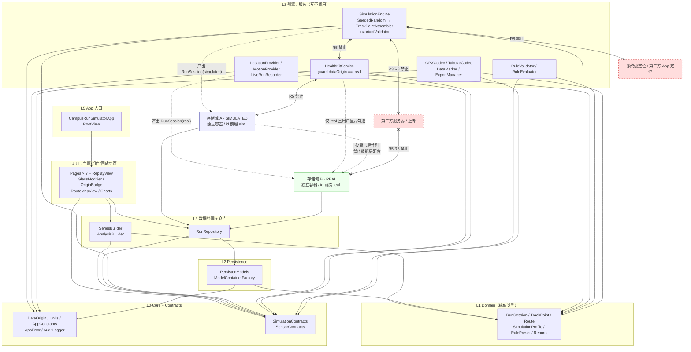
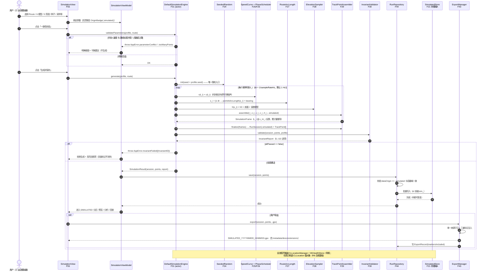
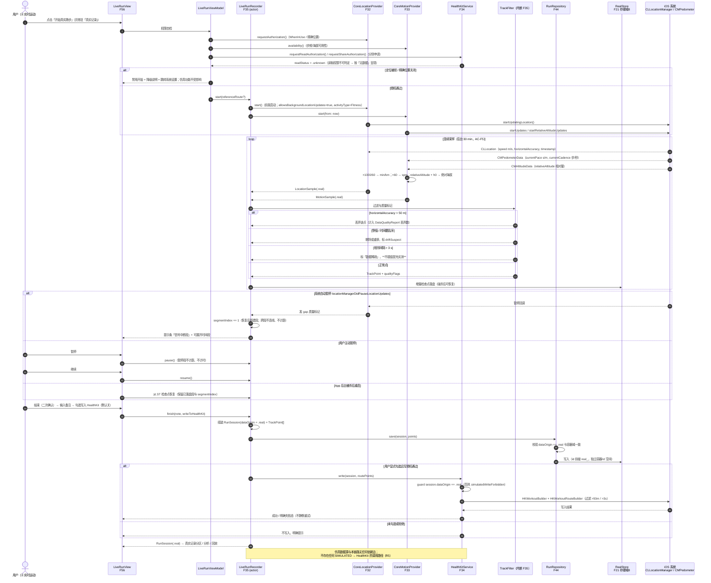
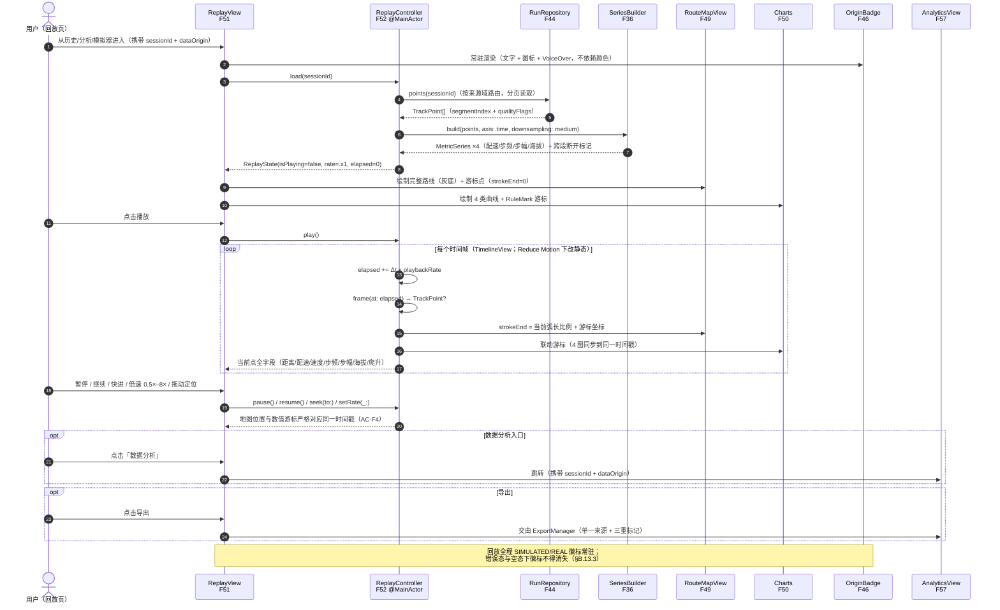
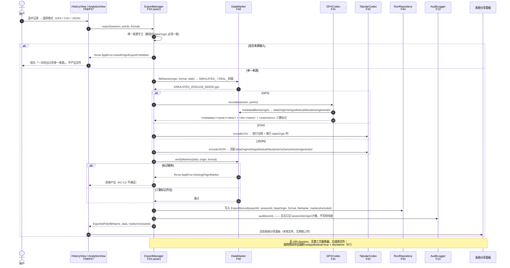

# Campus Run Simulator｜系统架构设计

| 项目 | 内容 |
| --- | --- |
| 文档编号 | `02-Architecture` |
| 阶段 | 流水线中间产物：**系统架构设计 + 完整文件清单 + 核心接口 + 调用流程 + 跨文件约定**；下游交接对象为**工程师** |
| 撰写人 | 高见远（Gao）· 架构师 |
| 唯一需求基线 | `docs/01-Research-and-PRD.md`（许清楚 · 产品经理，v1.0，1360 行，已完整读取） |
| 配套文档 | `docs/03-TaskList.md`（任务分解）；`docs/class-diagram.mermaid`、`docs/sequence-diagram.mermaid`（图抽取副本） |
| 文档语言 | 简体中文 |
| 本文范围 | 只做架构设计、文件清单、接口签名与调用流程。**不写实现代码、不写 PRD、不写测试用例正文、不产出可编译工程文件** |

---

## 0. 本文定位与合规基线声明

本文所有设计以 PRD §0「合规红线」为第一约束，优先级高于功能、体验与性能。R1–R8 与 §A.4「14 条禁止实现项」在架构层被翻译为**依赖方向禁令、类型不可变约束、编译期守卫与审计记录**，而不是仅靠 UI 文案约束。

> **一票否决基线**：`dataOrigin = simulated | real` 是所有记录类实体的**强制不可变字段**；两类数据使用**独立持久化域与独立 id 空间**；**不存在** `simulated → real` 的任何类型转换、复制或导出路径；仿真数据**绝不**写入 HealthKit / `HKWorkout` / `HKWorkoutRoute`，**绝不**修改系统级定位，**绝不**注入第三方 App 定位，**绝不**上传任何第三方服务器。

本文中出现的所有 Swift 片段均为**类型/协议签名示意**（方法体一律省略），不是可编译源码；唯一的例外说明是 §1.7 的 `project.pbxproj` 必需键清单（按任务书要求给出键级说明，仍非工程文件本体）。

---

# 1. 实现方案与框架选型

## 1.1 需求难点与对策总表

| # | 难点（来源） | 架构对策 | 落地文件 |
| --- | --- | --- | --- |
| D1 | 沙箱为 Linux、无 Xcode，却要交付 macOS Runner 上 `xcodebuild` 可 archive 的完整 Xcode 工程（主理人硬约束） | 手写 `project.pbxproj`，采用 Xcode 16 `PBXFileSystemSynchronizedRootGroup`（`objectVersion = 77`），源文件按目录落盘即自动纳入 target，避免手写几十个 `PBXFileReference`/`PBXBuildFile` 导致工程损坏 | F01 |
| D2 | 合规隔离 R1–R8 必须可验收，不能只靠自觉 | 双 `ModelContainer` 物理分域 + `DataOrigin` 不可变值类型 + `Contracts` 层协议守卫 + `HealthKitService` 写入前置 `guard` + `ExportManager` 单一来源守卫 + `OriginBadge` 常驻 + `ExportRecord` 审计 | F10/F20/F21/F23/F34/F43/F46 |
| D3 | 「所有数据相互关联、禁止独立随机」（I1–I10） | 主干量单一真值源（时间轴 / 弧长 / 速度曲线 / 步频曲线 / 海拔剖面 / 单一随机种子），全部字段由 `TrackPointAssembler` 派生；`InvariantValidator` 逐点校验，**失败即拒绝生成** | F24–F31 |
| D4 | 同种子逐点可复现（AC-D5） | 唯一随机入口 `SeededRandom`（种子持久化于 `SimulationProfile.seed`），时间相关有界平滑噪声亦由同一 RNG 驱动；禁止 `Double.random`/`Int.random`/`UUID` 参与数值生成 | F24/F17/F31 |
| D5 | Core Motion 单位陷阱（PRD §A.1.2） | 集中式 `Units` 换算表，任何传感器原始值在进入领域模型前必须过换算函数；`currentPace` s/m、`currentCadence` 步/秒、`relativeAltitude` 相对量 + `h0` | F11/F33 |
| D6 | MapKit 无「按坐标查高程数值」API（PRD §A.1.4） | P0 只走 S1 自定义 `h0` + S2 GPX `<ele>` + S4 气压计相对量叠加基准；`ElevationSource` 枚举强制标注来源；缺失字段不臆造 | F16/F28/F41 |
| D7 | 后台 30 min 连续记录不丢轨迹（AC-F5） | `UIBackgroundModes=location` + `allowsBackgroundLocationUpdates=true` + `activityType=Fitness`，前景启动更新；显式处理 `pausesLocationUpdatesAutomatically` 与 `locationManagerDidPauseLocationUpdates`；中断新建 `segmentIndex`，跨段不连线不计距 | F04/F05/F32/F35 |
| D8 | HealthKit 读写权限语义复杂且 R5 敏感 | 读/写分别申请；读取权限不可判定 → 一律按「无数据」呈现；`authorizationStatus(for:)` 只用于写授权；`HKObserverQuery` 后台 delivery 需 entitlement、遵守 hourly 上限、必须调用 completion、模拟器不支持需提示真机；**写入方法只对 `DataOrigin.real` 开放** | F05/F34 |
| D9 | iOS 26 Liquid Glass 与低版本功能等价（AC-F9） | 统一 `glassCard(...)` 入口 + `@available(iOS 26, *)` 双分支；回退用系统 Material/blur/圆角/描边；**两套路径共享同一套交互与标记组件**，无功能差异 | F45/F47/F46 |
| D10 | 规则模块全部假设值、不得产生分数（R7） | `RulePreset.isHypothetical` 在初始化器中强制为 `true`（不可被 JSON 覆盖）；评估输出为三态枚举，类型系统层面不存在「分数/成绩」字段 | F18/F38/F39 |
| D11 | 7 页禁止静态占位与假按钮（AC-F1） | 每个 View 由 `@Observable` 视图模型驱动，控件绑定真实 action；`RouteMapView`/`Charts`/回放控件均接收真实 `TrackPoint[]`；空态与错误态用 `MetricCards` 中的真实组件 | F48–F59 |
| D12 | 手写工程在 CI 上可 `xcodebuild test` 与 archive | 三个 target（App / UnitTests / UITests）+ shared scheme + `Config/App.xcconfig`；单元测试纯逻辑 + `ModelConfiguration(isStoredInMemoryOnly: true)`，不依赖硬件 | F01/F02/F03/F20/F21/F60–F65/F71 |

## 1.2 技术栈与框架选型

| 层 | 选型 | 理由 | 版本下限 |
| --- | --- | --- | --- |
| 语言 | Swift 5.10+（Xcode 16 工具链，Swift 6 兼容模式） | 与 SwiftData / `@Observable` / Swift Concurrency 匹配；零第三方 | — |
| UI | SwiftUI（声明式）+ `@Observable` / `@State` / `@Query` | PRD 指定 iOS 原生 SwiftUI；MapKit for SwiftUI 深度集成 | iOS 17 |
| 地图 | MapKit for SwiftUI：`Map` / `MapPolyline` / `MapReader` / `MapCameraPosition` / `MapStyle`；渐进绘制用 `MKPolylineRenderer.strokeEnd`（UIViewRepresentable 桥接） | 渲染能力与数值查询分离；不依赖不存在的高程 API | iOS 17 |
| 图表 | Swift Charts（`LineMark` / `AreaMark` / `RuleMark` / `PointMark`） | 声明式、支持无障碍与本地化；长序列由 `SeriesBuilder` 降采样后再绘 | iOS 16（被 17 覆盖） |
| 持久化 | SwiftData `@Model` + 双 `ModelContainer` | 原生、零依赖；两个独立容器天然实现「独立存储域 / 独立 id 空间」 | iOS 17 |
| 定位 | Core Location `CLLocationManager` / `CLLocation` | 真实记录唯一位置来源；仿真只构造 `CLLocation` **值对象**，不触碰 `CLLocationManager` | — |
| 运动传感器 | Core Motion：`CMPedometer` / `CMAltimeter` + `CMAltitudeData` / `CMMotionActivityManager` | 步频、相对海拔、运动状态；`NSMotionUsageDescription` 必需 | — |
| 健康 | HealthKit（仅 `real` 写入） | `HKWorkoutBuilder` / `HKWorkoutRouteBuilder` / `HKObserverQuery` | iOS 17 |
| XML/GPX | Foundation `XMLParser` + `XMLDocument`（手写 GPX 1.1 编解码） | GPX 1.1 schema 简单；避免任何第三方 XML/GPX 依赖 | — |
| 并发 | Swift Concurrency：`@MainActor` / `actor` / `AsyncStream` / `Sendable` | 传感器回调流与重计算隔离，避免主线程卡顿；值类型跨 actor 安全 | — |
| 构建 | 手写 Xcode 工程（Xcode 16 同步根组）+ `xcodebuild` | Linux 沙箱无法运行 Xcode，同步根组把「文件入 target」交给 Xcode 自动完成 | Xcode 16 / objectVersion 77 |
| 架构模式 | 分层 + 依赖倒置（Contracts 协议层）+ MVVM（每页 ViewModel） | 层间单向依赖、可独立测试、便于替换传感器实现为真机/模拟器注入 | — |

**明确不引入**：XcodeGen、Tuist、CocoaPods、SwiftPM 第三方包、任何网络 SDK / DEM SDK / 统计 / 广告 / 崩溃上报 SDK（后者亦违反 R3/R8 与「不默认静默联网」）。

## 1.3 Q1 决策：最低支持 iOS 版本 = **17.0**

> **结论（Q1 已定，纳入工程硬约束）：最低支持 iOS 版本 = iOS 17.0**：`IPHONEOS_DEPLOYMENT_TARGET = 17.0`；`SDKROOT = iphoneos`；`SUPPORTED_PLATFORMS = iphoneos iphonesimulator`；`TARGETED_DEVICE_FAMILY = 1,2`。

**决策理由（逐条对照 PRD §A.1.5 版本矩阵）**：

| 能力 | 最低 iOS | 对 17.0 的影响 |
| --- | --- | --- |
| Swift Charts | 16.0 | 已被 17.0 覆盖，无需回退 |
| MapKit for SwiftUI `Map` / `MapPolyline` / `MapReader` / `MapStyle` | 17.0 | **决策下限的决定性因素** |
| SwiftData | 17.0 | **决策下限的决定性因素** |
| `healthDataAccessRequest`（SwiftUI 授权） | 17.0 | 可用 |
| Liquid Glass `glassEffect` / `GlassEffectContainer` | 26.0 | `@available(iOS 26, *)` 双路径 + 功能等价回退 |

- **不降到 16**：SwiftData 不可用 → 持久化层需退化为 Core Data，「双容器物理分域」「in-memory 单元测试」全部重写；MapKit SwiftUI 不可用 → 需 `UIViewRepresentable` 包 `MKMapView`，`MapPolyline`/`MapReader` 全数重做，`MKPolylineRenderer.strokeEnd` 回放方案也需重写。成本远超覆盖收益。
- **不升到 26**：Liquid Glass 原生可用，但设备覆盖骤减；且 AC-F9 明确要求「iOS 26 与最低支持版本各跑一遍完整功能用例」，若最低版本即 26，回退机制失去验收对象，与 U-03 冲突。
- **17.0 是满足全部 P0 框架的最小公共下界**，回退范围被压缩为「仅视觉材质层」，而非「持久化/地图/图表全层回退」，风险最小。

**版本门控总表**：

| 位置 | 门控方式 |
| --- | --- |
| `GlassModifier.swift` | `@available(iOS 26, *)` 分支 + `else` 回退；同一 `glassCard` API 两路径信息层级一致 |
| `CMAbsoluteAltitudeData`（E-07 / P2） | `CMAltimeter.isAbsoluteAltitudeAvailable()` 可用性分支，不可用时降级到相对量 + `h0`，不得假装实测 |
| `HKObserverQuery` 后台 delivery（L-08 / P2） | entitlement + 模拟器不支持时明确提示需真机，不隐藏功能 |
| `MKDirections`（M-07 / P1） | `loadingThrottled` 错误降级为手工连线，不静默重试 |

## 1.4 架构分层与单向依赖

模块化严格按主理人要求的 8 个功能域分层，并补上 `Core` / `Contracts` / `App` 三个结构层。**依赖只允许自下而上（低层不知道高层）**，`Contracts` 是唯一允许被所有层引用的倒置契约层。

| 层 | 目录 | 职责 | 允许依赖 |
| --- | --- | --- | --- |
| L0 Core | `Core/` | 单位、常量、错误、`DataOrigin`、审计格式 | 无（仅 Foundation） |
| L0 Contracts | `Contracts/` | 全部跨层协议（依赖倒置） | L0 + 领域模型签名 |
| L1 Domain | `Models/Domain/` | 纯值类型实体（§B.8 全部 15 类） | L0 |
| L2 Persistence | `Models/Persistence/` | SwiftData `@Model` + 双容器 + 迁移 | L0/L1 |
| L2 SimulationEngine | `Modules/SimulationEngine/` | 6 模型 / 5 阶段 / 真值源 / I1–I10 | L0/L1/Contracts |
| L2 Sensors | `Modules/LocationAndSensors/` | 系统传感器与 HealthKit（**仅 real 链路**） | L0/L1/Contracts + Apple framework |
| L2 Rules | `Modules/Rules/` | 假设规则校验、三态评估、预设存储 | L0/L1/Contracts |
| L2 ImportExport | `Modules/ImportExport/` | GPX/CSV/JSON 编解码、三重标记、导出审计 | L0/L1/Contracts |
| L3 DataProcessing | `Modules/DataProcessing/` | 曲线序列、降采样、统计、报告 | L0/L1/Contracts |
| L3 Repository | `Modules/Repository/` | 双存储域路由与 CRUD | L0/L1/L2 Persistence/Contracts |
| L4 UI | `UI/Theme/` `UI/Components/` `UI/Replay/` `UI/Pages/` | 7 页 + 回放 + 主题 + 图表 | L0/L1/Contracts/L3（**禁止直接 import HealthKit / CLLocationManager 实现细节**） |
| L5 App | `App/` `RootView.swift` | `@main` 入口、TabView/路由、ModelContainer 注入 | 全部下层 |

### 1.4.1 依赖方向图（含合规禁止边）



> **读图要点**：仿真链路（`SimulationEngine → 存储域 A`）与真实链路（`Sensors → 存储域 B`）在**数据层永不汇合**；二者只在 UI 层以「分区 + 双通道标记」并列呈现，且不存在任何跨来源的写入、转换或混合导出路径。虚线叉号边为架构级禁令，工程师不得实现。

### 1.4.2 禁止循环依赖规则

1. `Contracts` 只声明协议与签名，不 import 任何 `Modules/*` 实现。
2. `SimulationEngine` 不得 import `LocationAndSensors` / `HealthKit` / `Repository` / `UI`；它通过 `SimulationContracts` 返回结果，由上层决定落盘。
3. `LocationAndSensors` 不得 import `SimulationEngine` / `Rules` / `ImportExport`。
4. `UI` 不得直接构造 `HKWorkout` / `CLLocationManager`；一切经 `Contracts` 协议。
5. `Persistence` 不得 import `UI` 或任何 `Modules/*`；只做 `@Model` 与值类型互转。
6. `ImportExport` 不得 import `Persistence`（导出输入为值类型 `RunSession`，由 `RunRepository` 提供）。

## 1.5 合规隔离在架构层的落地

| 红线 / 约束 | 架构机制（不是文案，是类型与依赖约束） | 验收映射 |
| --- | --- | --- |
| R1 教学研究/个人自用 | `AppConstants.complianceStatement` 单一常量，首页与设置页引用同一来源；无任何成绩/上传模块 | AC-C5 |
| R2/R4 禁破解与绕过 | 无任何第三方 App 私有数据读取、无任何反作弊/身份验证相关类型；`Contracts` 中不存在对应协议 | AC-C8 |
| R3 禁伪造服务器数据/上传 | 工程**无网络权限代码路径**、无 `URLSession` 上传入口；`ImportExport` 只产出本地文件供系统分享面板 | AC-C4/C8 |
| R5 禁模拟冒充真实 | `HealthKitService.write(...)` 首行 `guard dataOrigin == .real else throw .simulatedWriteForbidden`；协议签名接收 `RunSession` 且内部再校验；`SimulationEngine` 与 `HealthKitService` 之间无依赖边 | AC-C3 |
| R6 标记与物理区分 | `DataOrigin` 为 `let` 不可变；`OriginBadge` 由 `dataOrigin` 驱动（文字 + SF Symbol + `.accessibilityLabel`，不依赖颜色）；`DataMarker` 强制三重标记；`ExportRecord.markersIncluded` 审计 | AC-C1/C2 |
| R7 假设值标注 | `RulePreset.isHypothetical` 初始化器强制 `true`；`disclaimer` 为常量；评估三态枚举无 score 字段 | AC-C6 |
| R8 app 内独立数据源 | `SimulationEngine` 只构造 `CLLocation` **值对象**（PRD §A.1.1 明确的合规技术基础），**不持有 `CLLocationManager`**，不申请定位/HealthKit 权限；仿真路径不触发任何授权弹窗 | AC-C4/C8 |
| 双数据源永不汇合 | 双 `ModelContainer`（独立 store URL / 独立 `ModelConfiguration`）、id 前缀 `sim_` / `real_`、`RunRepository` 按 `dataOrigin` 强制路由、无跨来源 fetch | AC-C7 |
| 不可转换 | 领域模型无 `dataOrigin` setter、无 `toReal()`/`convert` 方法；「另存副本」只复制并保留原 origin 与 `originChain` | AC-C7 |
| 权限隔离 | 仿真功能路径不调用 `requestAlwaysAuthorization` / `requestAuthorization(toShare:)`；仅 `LiveRunView` 与 `SettingsView` 触发 | AC-C4 |
| 清除/导出隔离 | `RunRepository` 提供按 origin 独立清除；`ExportManager` 单次导出只接受单一来源数组，混合输入抛 `.mixedOriginExportForbidden` | AC-C7/C2 |
| 脏数据隔离 | 缺 `dataOrigin` 的持久化对象在读取层被归入 `.unclassified` 分区，**绝不默认显示为 real** | §B.13.3-12 |

**`DataOrigin` 的不可变性设计**：定义为 `enum DataOrigin: String, Codable, Sendable, Hashable { case simulated; case real }`；所有记录类实体的 `dataOrigin` 均为 `let`；SwiftData `@Model` 对应字段标记 `@Attribute(.unique)` 之外的不可变约束由「只在 `init` 赋值 + 无公开 mutating 方法 + 迁移层禁止改写」共同保证；`RunRepository` 的 `save` 前置校验「session.dataOrigin 与容器域一致」，不一致即拒绝。

## 1.6 Liquid Glass 双路径策略（AC-F9 功能等价）

统一入口：`View.glassCard(role: GlassRole, interactive: Bool) -> some View`，全部 UI 只调用此入口，不直接写 `glassEffect`。

| 项 | iOS 26+ 路径 | iOS 17–25 回退路径 |
| --- | --- | --- |
| 门控 | `@available(iOS 26, *)` 分支 | 同文件 `else` 分支 |
| 容器 | `GlassEffectContainer(spacing:)` 分组，`glassEffectID` 做形变过渡 | `VStack`/`ZStack` 同布局，无容器但相同 spacing/padding |
| 材质 | `.glassEffect(.regular, in: Capsule())`，玻璃按钮样式 | `.regularMaterial` / `.ultraThinMaterial` + `.blur(radius:)` + 圆角 + 描边 + 阴影 |
| 可点击区域 | 相同 frame / 相同 `contentShape` / 相同 `.accessibilityElement` | 完全一致 |
| 控件集合 | 相同：按钮、滑块、卡片、图表交互、回放控件全部存在 | 完全一致（**禁止「玻璃版有、低版本没有」**） |
| 合规标记 | `OriginBadge` 置于玻璃/材质层**之上**（z-order 更高），高对比、不被模糊遮挡 | 同样置顶 |
| Reduce Motion | 禁用 `glassEffectTransition` 形变，改淡入淡出 | 同样禁用动画 |
| 深色/动态类型/提高对比度 | 两套均通过 | 两套均通过 |
| 禁止 | 私有 API、伪造系统玻璃、引入第三方 UI 依赖 | 同左 |
| 验收 | 同一份功能用例（AC-F1/F4/F10）在 iOS 26 与 17 各跑一遍，功能等价、无崩溃、无功能缺失 | AC-F9 |

`SettingsView` 显示「Liquid Glass 当前是否启用」：低版本文案固定为「当前系统不支持，已启用兼容外观」，**不隐藏也不禁用任何功能**（§B.6.7、§B.13.3-15）。

## 1.7 Xcode 工程可编译交付方案（PBXFileSystemSynchronizedRootGroup）

> 目标：Linux 沙箱手写文本工程 → GitHub Actions macOS Runner `xcodebuild ... archive` 真实产出 `.app` → 组装未签名 `.ipa`。这是可编译交付的前提，本节给出键级说明（**非工程文件本体**）。

### 1.7.1 工程文件级常量

| 键 | 值 | 说明 |
| --- | --- | --- |
| `archiveVersion` | `1` | 固定 |
| `classes` | `{}` | 空字典 |
| `objectVersion` | `77` | **Xcode 16 同步根组必需** |
| `compatibilityVersion` | `"Xcode 16"` | 写在 `PBXProject` 内 |
| `rootObject` | `<PBXProject 24位ID>` | 指向根对象 |
| `objects` | `{ ... }` | 全部对象字典 |

### 1.7.2 `PBXProject` 必需键

`isa = PBXProject`；`attributes = { BuildIndependentTargetsInParallel = 1; LastUpgradeCheck = 1600; TargetAttributes = { <各targetID> = { CreatedOnToolsVersion = "16.0"; }; }; }`；`buildConfigurationList = <XCConfigurationListID>`；`compatibilityVersion = "Xcode 16"`；`developmentRegion = en`；`hasScannedForEncodings = 0`；`knownRegions = (en, Base, "zh-Hans")`；`mainGroup = <PBXGroupID>`；`minimizedProjectReferenceProxies = 1`；`preferredProjectObjectVersion = 77`；`productRefGroup = <PBXGroupID (Products)>`；`projectDirPath = ""`；`projectRoot = ""`；`targets = (<AppTargetID>, <UnitTestsTargetID>, <UITestsTargetID>)`。

### 1.7.3 `PBXFileSystemSynchronizedRootGroup`（关键）

| 键 | 值 / 说明 |
| --- | --- |
| `isa` | `PBXFileSystemSynchronizedRootGroup` |
| `path` | App：`CampusRunSimulator`；UnitTests：`CampusRunSimulatorTests`；UITests：`CampusRunSimulatorUITests` |
| `sourceTree` | `"<group>"` |
| `explicitFileTypes` | `{}`（由 Xcode 按扩展名推断） |
| `explicitFolders` | `()` |
| `exceptions` | `(<PBXFileSystemSynchronizedBuildFileExceptionSetID>,)`，见下 |
| `lastKnownFileType` | 不需要（同步组不写） |

**三个根组**：`G_APP`（App 源树）、`G_TEST`（单元测试 + Fixtures）、`G_UITEST`（UI 测试）。每个 target 通过 `fileSystemSynchronizedGroups = (<对应根组ID>,)` 引用；**目录内文件自动纳入编译，无需任何 `PBXFileReference` / `PBXBuildFile`**。

**`PBXFileSystemSynchronizedBuildFileExceptionSet` 用途（必配）**：
- 把 `Resources/Info.plist` 与 `Resources/CampusRunSimulator.entitlements` 从「自动纳入编译/资源」中排除——它们只由 `INFOPLIST_FILE` / `CODE_SIGN_ENTITLEMENTS` 构建设置引用，避免被重复拷贝或误当源码。
- `Resources/Assets.xcassets` **保留**在同步组内，由 `PBXResourcesBuildPhase` 自动编入 asset catalog。
- `CampusRunSimulatorTests/Fixtures/*.gpx` 保留在 `G_TEST` 组内作为资源，测试代码用 `Bundle(for:).url(forResource:withExtension:)` 读取（Xcode 16 同步组会把非源码文件自动 copy 进 test bundle）。

### 1.7.4 `PBXNativeTarget` 必需键

`isa = PBXNativeTarget`；`buildConfigurationList = <XCConfigurationListID>`；`buildPhases = (<PBXSourcesBuildPhaseID>, <PBXFrameworksBuildPhaseID>, <PBXResourcesBuildPhaseID>)`；`buildRules = ()`；`dependencies = ()`（UITests 可加 `PBXTargetDependency` + `PBXContainerItemProxy` 指向 App target，或仅靠 `TEST_TARGET_NAME`）；`fileSystemSynchronizedGroups = (<根组ID>,)`；`name`；`productName`；`productReference = <PBXFileReferenceID>`；`productType` 分别为 `com.apple.product-type.application` / `com.apple.product-type.bundle.unit-test` / `com.apple.product-type.bundle.ui-testing`；`packageProductDependencies = ()`。

> **同步组模式下 `PBXSourcesBuildPhase.files = ()`、`PBXResourcesBuildPhase.files = ()`、`PBXFrameworksBuildPhase.files = ()` 均可为空**；系统 framework 由 Swift `import` 自动链接（无需显式 `PBXFileReference`）。这正是避免手写几十个 `PBXBuildFile` 的关键。

### 1.7.5 `XCBuildConfiguration` / `XCConfigurationList` 必需键

`XCBuildConfiguration`：`isa`、`buildSettings = { ... }`、`name = Debug | Release`、`baseConfigurationReference = <PBXFileReferenceID → Config/App.xcconfig>`。`XCConfigurationList`：`isa`、`buildConfigurations = (<DebugID>, <ReleaseID>)`、`defaultConfigurationIsVisible = 0`、`defaultConfigurationName = Release`。每个 target 与 project 各有一份 list（共 4 份）。

**关键 `buildSettings`（Debug/Release 差异直接写在 pbxproj，共用值放 xcconfig）**：

| 键 | 值 | 备注 |
| --- | --- | --- |
| `SDKROOT` | `iphoneos` | 硬约束 |
| `SUPPORTED_PLATFORMS` | `iphoneos iphonesimulator` | 硬约束 |
| `IPHONEOS_DEPLOYMENT_TARGET` | `17.0` | Q1 结论 |
| `TARGETED_DEVICE_FAMILY` | `1,2` | iPhone + iPad |
| `PRODUCT_BUNDLE_IDENTIFIER` | `edu.research.campusrun.simulator` | 示例值，签名路径由 Secrets 覆盖 |
| `INFOPLIST_FILE` | `CampusRunSimulator/Resources/Info.plist` | 相对 project 根 |
| `GENERATE_INFOPLIST_FILE` | `NO` | 手写 Info.plist 必须为 NO |
| `CODE_SIGN_ENTITLEMENTS` | `CampusRunSimulator/Resources/CampusRunSimulator.entitlements` | 引用方式 |
| `ASSETCATALOG_COMPILER_APPICON_NAME` | `AppIcon` | 对应 F07 |
| `CODE_SIGNING_ALLOWED` | `NO` | 未签名默认路径；CI 可用命令行覆盖 |
| `CODE_SIGNING_REQUIRED` | `NO` | 同上 |
| `SWIFT_VERSION` | `5.0` | Xcode 16 工具链 |
| `SWIFT_EMIT_LOC_STRINGS` | `YES` | 本地化 |
| `SWIFT_STRICT_CONCURRENCY` | `complete`（建议） | 并发安全 |
| `ENABLE_PREVIEWS` | `YES` | — |
| `CLANG_ENABLE_MODULES` | `YES` | — |
| `DEVELOPMENT_ASSET_PATHS` | 留空 | 无预览资源 |
| 测试 target 额外 | `TEST_TARGET_NAME = CampusRunSimulator`、`TEST_HOST = "$(BUILT_PRODUCTS_DIR)/CampusRunSimulator.app/CampusRunSimulator"`、`BUNDLE_LOADER = "$(TEST_HOST)"`、`GENERATE_INFOPLIST_FILE = YES` | 允许 `@testable import` |

> **不写** `ENABLE_BITCODE` / `compileBitcode`（Xcode 16 已移除 bitcode）。

### 1.7.6 `Config/App.xcconfig` 与资源引用方式

- `Config/App.xcconfig` 作为**唯一一个普通 `PBXFileReference`**（`lastKnownFileType = text.xcconfig`、`path = Config/App.xcconfig`、`sourceTree = "<group>"`），被 8 份 `XCBuildConfiguration.baseConfigurationReference` 引用。存放共用值：部署目标、设备族、bundle id 前缀、Swift 版本、`ITSAppUsesNonExemptEncryption` 相关、合规常量开关。
- `Info.plist` / `.entitlements` / `Assets.xcassets` **不建立 `PBXFileReference`**：前两者由 build settings 引用，后者由同步根组自动纳入。
- `Config/`、`ci/`、`.github/`、`docs/`、`README.md` 等**不进入 `objects`**（磁盘存在即可），最大限度减少手写引用。
- `CampusRunSimulator.xcscheme`（F02）含 `BuildAction`（App target）、`TestAction`（UnitTests + UITests 两个 `TestableReference`，`shouldUseLaunchSchemeArgsEnv = YES`）、`LaunchAction`、`ProfileAction`、`AnalyzeAction`、`ArchiveAction`（`buildConfiguration = Release`）。

### 1.7.7 `Info.plist` / `.entitlements` 必需键

**F04 `Info.plist`**：

| 键 | 值 |
| --- | --- |
| `NSLocationWhenInUseUsageDescription` | 「用于记录您本人的真实跑步轨迹，仅保存在本设备；仿真功能不使用定位」 |
| `NSLocationAlwaysAndWhenInUseUsageDescription` | 「用于在您切换到后台或锁屏时继续记录真实跑步轨迹，不上传任何服务器」 |
| `NSMotionUsageDescription` | 「用于读取步数、步频与气压计相对海拔，仅用于真实运动记录」 |
| `NSHealthShareUsageDescription` | 「用于读取您本人的健康数据用于分析；未授权时按无数据处理」 |
| `NSHealthUpdateUsageDescription` | 「用于在您显式勾选后，把真实跑步记录写入健康 App；测试数据永不写入」 |
| `UIBackgroundModes` | `[location]` |
| `ITSAppUsesNonExemptEncryption` | `NO` |
| `CFBundleDisplayName` | `Campus Run Simulator` |
| `CFBundleIdentifier` | `$(PRODUCT_BUNDLE_IDENTIFIER)` |
| `CFBundleExecutable` / `CFBundlePackageType` / `CFBundleShortVersionString` / `CFBundleVersion` | 标准值 / `$(MARKETING_VERSION)` / `$(CURRENT_PROJECT_VERSION)` |
| `UILaunchScreen` | 空字典（SwiftUI 不需要 launch storyboard） |

**F05 `.entitlements`**：

| 键 | 值 | 说明 |
| --- | --- | --- |
| `com.apple.developer.healthkit` | `true` | HealthKit capability 必需 |
| `com.apple.developer.healthkit.background-delivery` | `true` | `HKObserverQuery` 后台 delivery 必需（PRD §A.1.3），缺失会 `HKErrorAuthorizationDenied` |

> 后台定位**靠 `UIBackgroundModes=location` 而非 entitlement**；不得臆造 `com.apple.developer.location` 类私有键。

**F69 `ci/ExportOptions.plist`**（仅签名路径 B 使用）：`method`、`teamID`、`signingStyle = manual`、`provisioningProfiles`（bundle id → profile 名）、`signingCertificate`、`signingIdentity`、`destination = export`、`stripSwiftSymbols = YES`、`thinning = <none>`、`uploadSymbols = NO`；**不含 `compileBitcode`**。

## 1.8 签名双路径策略与 CI（两条路径明确分开）

### 路径 A · 默认主路径：未签名 IPA

1. `xcodebuild -version` 输出日志（Xcode 版本选择策略见下）。
2. `xcodebuild -project CampusRunSimulator.xcodeproj -scheme CampusRunSimulator -configuration Release -destination 'generic/platform=iOS' -archivePath build/CampusRunSimulator.xcarchive -allowProvisioningUpdates CODE_SIGNING_ALLOWED=NO CODE_SIGNING_REQUIRED=NO CODE_SIGN_IDENTITY="" DEVELOPMENT_TEAM="" clean archive`
3. 取 `.xcarchive/Products/Applications/CampusRunSimulator.app`。
4. `mkdir -p build/Payload && cp -R <.app> build/Payload/ && (cd build && zip -qry CampusRunSimulator-unsigned.ipa Payload)`。
5. **强制检查**：`test -s build/CampusRunSimulator-unsigned.ipa`（文件真实存在且非空）否则 `exit 1`；再用 `unzip -l` 校验 `Payload/CampusRunSimulator.app/Info.plist` 存在。
6. 上传 artifact（GitHub Actions `actions/upload-artifact`，属 CI 编排工具，非 App 依赖）。

### 路径 B · 可选已签名路径（Secrets 驱动）

1. 由 `workflow_dispatch` 输入或仓库变量 `SIGNING_MODE=signed` 触发，**与路径 A 为 workflow 中互斥的两个 job / `if` 分支**。
2. Secrets：`CERTIFICATE_P12`（base64）、`CERTIFICATE_PASSWORD`、`PROVISIONING_PROFILE`（base64）、`KEYCHAIN_PASSWORD`。
3. 建临时 keychain → `security import` p12 → 安装 `.mobileprovision` → `xcodebuild archive`（正常签名，不传 `CODE_SIGNING_ALLOWED=NO`）→ `xcodebuild -exportArchive -archivePath ... -exportPath build/export -exportOptionsPlist ci/ExportOptions.plist`。
4. **同样强制** `test -s build/export/*.ipa` 才继续；上传已签名 IPA。
5. 任何 Secret 缺失时该 job **明确跳过并输出原因**，不得回退到路径 A 冒充已签名产物。

### CI 通用要求（F71）

| 项 | 规格 |
| --- | --- |
| Runner | `macos-15`（或更新带 Xcode 16+ 的 image），`runs-on` 显式声明 |
| Xcode 版本选择策略 | 仓库变量 `XCODE_VERSION`（如 `16.2`）；`ls /Applications | grep -i xcode` 输出日志 → `sudo xcode-select -s "/Applications/Xcode_${XCODE_VERSION}.app/Contents/Developer"` → `xcodebuild -version` 输出日志 → `xcrun simctl list devices available` 输出日志；**不引入第三方 setup-xcode Action** |
| 单元测试 | `xcodebuild test -project ... -scheme CampusRunSimulator -destination 'platform=iOS Simulator,name=iPhone 16' -only-testing:CampusRunSimulatorTests`；UnitTests 纯逻辑 + in-memory SwiftData，不依赖真机硬件 |
| UITests | **CI 可选运行**（`if: inputs.runUITests`），同样 destination；真机后台 30 min（AC-F5）不在 CI 覆盖，须人工真机验收 |
| IPA 门禁 | `test -s` + `unzip -l` 双重校验，**不通过即 fail** |
| 日志 | 保留 `xcodebuild` 完整日志、`xcodebuild -version`、IPA 大小 `ls -lh` |
| 合规静态检查（可选） | `plutil -lint` 校验 Info.plist / entitlements / ExportOptions；Grep 全仓禁止词「过检 / 刷成绩 / 上传成绩 / 有效成绩」作为 AC-C5 辅助 |

## 1.9 测试策略

| Target | 内容 | 依赖 | 运行方式 |
| --- | --- | --- | --- |
| `CampusRunSimulatorTests`（UnitTests） | 5 个测试文件（F60–F64）：仿真复现/6 模型/单位换算/步幅反算、I1–I10 与注入矛盾拒绝、GPX/CSV/JSON 往返与标记、规则三态与无分数、双容器隔离与 `dataOrigin` 不可变及「无 HK 写入路径」 | 纯逻辑；SwiftData 用 `ModelContainerFactory.makeInMemory()`（`ModelConfiguration(isStoredInMemoryOnly: true)`）；**不初始化 `CLLocationManager` / `HKHealthStore` / `CMAltimeter`** | `xcodebuild test -destination 'platform=iOS Simulator,name=iPhone 16'` |
| `CampusRunSimulatorUITests`（UITests） | 1 个文件（F65）：7 页来源标记可见性 / VoiceOver 标签 / 导航无假按钮 / 分区不混排 | XCUITest | CI 可选；AC-C1/F1 人工补充 |
| 真机验收（非 CI） | AC-F5 后台 30 min、AC-F6 HealthKit 写入、AC-F9 iOS 26 与 17 双版本功能等价、后台 delivery（模拟器不支持） | 真机 | 人工，写入 CHANGELOG 验收记录 |

---

# 2. 完整文件清单（**精确 74 个文件**）

## 2.1 目录树（工程师照此落盘）

```text
CampusRunSimulator/
├── CampusRunSimulator.xcodeproj/
│   ├── project.pbxproj
│   └── xcshareddata/xcschemes/CampusRunSimulator.xcscheme
├── Config/
│   └── App.xcconfig
├── CampusRunSimulator/                         ← PBXFileSystemSynchronizedRootGroup G_APP
│   ├── App/CampusRunSimulatorApp.swift
│   ├── RootView.swift
│   ├── Resources/
│   │   ├── Info.plist
│   │   ├── CampusRunSimulator.entitlements
│   │   └── Assets.xcassets/
│   │       ├── Contents.json
│   │       └── AppIcon.appiconset/Contents.json
│   ├── Core/
│   │   ├── DataOrigin.swift
│   │   ├── Units.swift
│   │   ├── AppConstants.swift
│   │   └── AuditLogger.swift
│   ├── Contracts/
│   │   ├── SimulationContracts.swift
│   │   └── SensorContracts.swift
│   ├── Models/
│   │   ├── Domain/
│   │   │   ├── TrackPoint.swift
│   │   │   ├── RunSession.swift
│   │   │   ├── RouteModels.swift
│   │   │   ├── SimulationProfile.swift
│   │   │   ├── RulePreset.swift
│   │   │   └── Reports.swift
│   │   └── Persistence/
│   │       ├── PersistedModels.swift
│   │       └── ModelContainerFactory.swift
│   ├── Modules/
│   │   ├── SimulationEngine/
│   │   │   ├── SeededRandom.swift
│   │   │   ├── SpeedCurve.swift
│   │   │   ├── PhaseScheduler.swift
│   │   │   ├── RouteArcLength.swift
│   │   │   ├── ElevationSampler.swift
│   │   │   ├── TrackPointAssembler.swift
│   │   │   ├── InvariantValidator.swift
│   │   │   └── SimulationEngine.swift
│   │   ├── LocationAndSensors/
│   │   │   ├── LocationProvider.swift
│   │   │   ├── MotionProvider.swift
│   │   │   ├── HealthKitService.swift
│   │   │   └── LiveRunRecorder.swift
│   │   ├── DataProcessing/
│   │   │   ├── SeriesBuilder.swift
│   │   │   └── AnalysisBuilder.swift
│   │   ├── Rules/
│   │   │   ├── RuleValidator.swift
│   │   │   └── RuleEvaluator.swift
│   │   ├── ImportExport/
│   │   │   ├── DataMarker.swift
│   │   │   ├── GPXCodec.swift
│   │   │   ├── TabularCodec.swift
│   │   │   └── ExportManager.swift
│   │   └── Repository/RunRepository.swift
│   └── UI/
│       ├── Theme/
│       │   ├── GlassModifier.swift
│       │   ├── OriginBadge.swift
│       │   └── AppTheme.swift
│       ├── Components/
│       │   ├── MetricCards.swift
│       │   ├── RouteMapView.swift
│       │   └── Charts.swift
│       ├── Replay/
│       │   ├── ReplayView.swift
│       │   └── ReplayController.swift
│       └── Pages/
│           ├── HomeView.swift
│           ├── RoutePlanningView.swift
│           ├── SimulationView.swift
│           ├── LiveRunView.swift
│           ├── AnalyticsView.swift
│           ├── HistoryView.swift
│           └── SettingsView.swift
├── CampusRunSimulatorTests/                    ← 同步根组 G_TEST
│   ├── SimulationEngineTests.swift
│   ├── InvariantValidatorTests.swift
│   ├── CodecTests.swift
│   ├── RuleEvaluatorTests.swift
│   ├── RepositoryIsolationTests.swift
│   └── Fixtures/
│       ├── SIMULATED_sample_loop.gpx
│       ├── sample_missing_ele.gpx
│       └── sample_only_rte.gpx
├── CampusRunSimulatorUITests/                  ← 同步根组 G_UITEST
│   └── ComplianceMarkingUITests.swift
├── ci/
│   ├── ExportOptions.plist
│   └── scripts/build_unsigned_ipa.sh
├── .github/workflows/ios-build.yml
├── docs/                                       ← 上游 + 本次架构产出（不计入 74）
└── README.md / LICENSE / CHANGELOG.md
```

## 2.2 逐文件清单表

> 「下层依赖」= 本文件 import / 调用的文件（F 编号）；「上层调用方」= 会引用本文件的文件（F 编号）。`—` 表示无。所有路径相对仓库根 `/workspace/CampusRunSimulator/`，**精确、无占位符**。

### 分区 1 · Xcode 工程与构建配置（F01–F07，7 个）

| 编号 | 相对路径 | 模块 | 职责 | 关键类型 / 函数签名 / 必需键 | 下层依赖 | 上层调用方 |
| --- | --- | --- | --- | --- | --- | --- |
| F01 | `CampusRunSimulator.xcodeproj/project.pbxproj` | 工程配置 | 手写 Xcode 16 工程；3 个 target + 3 个同步根组 | `objectVersion=77`；`PBXProject.compatibilityVersion="Xcode 16"`；`PBXFileSystemSynchronizedRootGroup` ×3；`PBXNativeTarget.fileSystemSynchronizedGroups`；`XCBuildConfiguration.baseConfigurationReference`；`SDKROOT=iphoneos` 等（见 §1.7） | F03（xcconfig 引用）、F02 | 全部源码文件（自动纳入） |
| F02 | `CampusRunSimulator.xcodeproj/xcshareddata/xcschemes/CampusRunSimulator.xcscheme` | 工程配置 | shared scheme：archive / test 动作 | `BuildAction` / `TestAction`（UnitTests+UITests TestableReference）/ `LaunchAction` / `ArchiveAction(Release)` | F01 | F71 |
| F03 | `Config/App.xcconfig` | 工程配置 | 共用构建设置唯一来源 | `IPHONEOS_DEPLOYMENT_TARGET=17.0`；`SUPPORTED_PLATFORMS=iphoneos iphonesimulator`；`TARGETED_DEVICE_FAMILY=1,2`；`SWIFT_VERSION=5.0`；`PRODUCT_BUNDLE_IDENTIFIER` | — | F01 |
| F04 | `CampusRunSimulator/Resources/Info.plist` | 权限配置 | 6 个用途描述 + 后台模式 + 加密豁免 | `NSLocationWhenInUseUsageDescription` / `NSLocationAlwaysAndWhenInUseUsageDescription` / `NSMotionUsageDescription` / `NSHealthShareUsageDescription` / `NSHealthUpdateUsageDescription` / `UIBackgroundModes=[location]` / `ITSAppUsesNonExemptEncryption=NO` / `GENERATE_INFOPLIST_FILE=NO` 配套 | — | F01、F32、F33、F34 |
| F05 | `CampusRunSimulator/Resources/CampusRunSimulator.entitlements` | 权限配置 | HealthKit capability + 后台 delivery | `com.apple.developer.healthkit=true`；`com.apple.developer.healthkit.background-delivery=true` | — | F01、F34 |
| F06 | `CampusRunSimulator/Resources/Assets.xcassets/Contents.json` | 资源 | Asset catalog 根描述 | `{"info":{"version":1,"author":"xcode"}}` | — | F01 |
| F07 | `CampusRunSimulator/Resources/Assets.xcassets/AppIcon.appiconset/Contents.json` | 资源 | App 图标占位（未签名 IPA 不校验图标） | `{"images":[{"idiom":"universal","platform":"ios","size":"1024x1024"}],"info":{...}}` | — | F01（`ASSETCATALOG_COMPILER_APPICON_NAME=AppIcon`） |

### 分区 2 · App 入口与根视图（F08–F09，2 个）

| 编号 | 相对路径 | 模块 | 职责 | 关键类型 / 函数签名 | 下层依赖 | 上层调用方 |
| --- | --- | --- | --- | --- | --- | --- |
| F08 | `CampusRunSimulator/App/CampusRunSimulatorApp.swift` | App 入口 | `@main` 入口；注入双 `ModelContainer`；`UIApplicationDelegateAdaptor` 承接后台/HealthKit 生命周期 | `struct CampusRunSimulatorApp: App`；`final class AppDelegate: NSObject, UIApplicationDelegate`；`init()` 中 `ModelContainerFactory.makePersistent()`；`.modelContainer(...)` 注入 | F21、F10、F12、F09 | — |
| F09 | `CampusRunSimulator/RootView.swift` | App 入口 | `TabView` + `NavigationStack` 根路由；7 页入口；首次启动合规确认；权限异常横幅 | `struct RootView: View`；`enum AppRoute: Hashable`；`@State var selection`；`func route(to: AppRoute)` | F53–F59、F46、F12 | F08 |

### 分区 3 · Core 基础约定（F10–F13，4 个）

| 编号 | 相对路径 | 模块 | 职责 | 关键类型 / 函数签名 | 下层依赖 | 上层调用方 |
| --- | --- | --- | --- | --- | --- | --- |
| F10 | `CampusRunSimulator/Core/DataOrigin.swift` | Core | **合规核心**：来源枚举、不可变常量、id 前缀、三重标记格式定义 | `enum DataOrigin: String, Codable, Sendable, Hashable { case simulated; case real }`；`enum OriginMarkers { static let simulatedPrefix = "SIMULATED_"; static let realPrefix = "REAL_"; static let simulatedText = "测试数据 / SIMULATED" }`；`enum OriginID { static func prefix(_ o: DataOrigin) -> String }`；`struct OriginChain`（另存副本保留原链） | Foundation | 全部记录/UI/导出/持久化文件 |
| F11 | `CampusRunSimulator/Core/Units.swift` | Core + 工具扩展 | 单位量纲统一表与全部换算；格式化 / 数值 / `CLLocation` / `Date` 扩展工具 | `enum Units`：`paceSecPerMeterToMinPerKm(_:)`、`cadenceStepsPerSecondToSpm(_:)`、`minPerKmToSecPerKm(_:)`、`speedMpsToKmH(_:)`、`strideLength(speedMps:cadenceSpm:)`（式 `L=60v/c` 的换算入口）、`elevationGainLoss(_:deadband:)`；`extension Double` 四舍五入/容差比较；`extension Date` ISO8601；`extension CLLocation` 到 `GeoPoint` | Foundation、CoreLocation（值对象） | F17/F25/F26/F28/F29/F33/F36/F37/F50/F54 |
| F12 | `CampusRunSimulator/Core/AppConstants.swift` | Core | 全局常量、固定文案、`AppError` 错误枚举、审计格式定义 | `enum AppConstants`：`defaultSampleRateHz=1.0`、`maxTrackPoints`、`accuracyGateMeters=50`、`maxPointIntervalSeconds=3`、`elevationDeadbandMeters=2.0`、`toleranceVelocity=0.005`、`toleranceStride=0.005`、`toleranceDistance=0.01`、`disclaimer`、`complianceStatement`、`ruleEvaluationNotice`、`schemaVersion="1.0"`、`generator`；`enum AppError: Error, LocalizedError`（22 个 case，见 §7.7） | Foundation | 全部 |
| F13 | `CampusRunSimulator/Core/AuditLogger.swift` | Core | 结构化日志与合规审计格式（OSLog）；**日志不写经纬度** | `actor AuditLogger`；`static let shared`；`func log(_ event: AuditEvent)`；`struct AuditEvent`：`eventId/sessionId/dataOrigin/kind/count/resultCode/timestamp`；`func exportAudit(for: ExportRecord)` | F10、F12、OSLog | F31/F34/F35/F43/F44/F71 |

### 分区 4 · 领域模型 Domain（F14–F19，6 个，覆盖 §B.8 全部 15 类实体）

| 编号 | 相对路径 | 模块 | 职责 | 关键类型 / 函数签名 | 下层依赖 | 上层调用方 |
| --- | --- | --- | --- | --- | --- | --- |
| F14 | `CampusRunSimulator/Models/Domain/TrackPoint.swift` | 领域模型 | 单采样点全字段；`GeoPoint`；质量标记 | `struct GeoPoint: Codable, Sendable, Hashable`（latitude/longitude）；`enum QualityFlag: String, Codable`（`lowAccuracy/driftSuspect/gap/paused/interpolatedFalse`）；`struct TrackPoint: Identifiable, Codable, Sendable`（19 字段，见 §3.2）；`let dataOrigin: DataOrigin`（继承 session，不可变）；`var segmentIndex: Int` | F10、F11 | F15/F29/F30/F35/F36/F37/F41/F42/F44/F49/F50/F51 |
| F15 | `CampusRunSimulator/Models/Domain/RunSession.swift` | 领域模型 | 会话汇总；`ReplayState`；`ExportRecord`；`ErrorEvent` | `struct RunSession: Identifiable, Codable, Sendable`（`let dataOrigin`、`isSimulated` 只读计算、全部汇总字段、`originChain`）；`struct ReplayState`；`struct ExportRecord`（`markersIncluded: [MarkerKind]`）；`struct ErrorEvent` | F10、F12、F14 | F31/F35/F36/F39/F41/F42/F43/F44/F51/F55–F59 |
| F16 | `CampusRunSimulator/Models/Domain/RouteModels.swift` | 领域模型 | 路线、点、版本、点位、海拔剖面 | `enum RouteType: String`（`loop/outAndBack/free`）；`enum ElevationSource: String`（`userDefined/gpx/device/externalService`）；`struct Route`；`struct RoutePoint`（`arcLengthFromStartM`）；`struct RouteVersion`（`snapshot`）；`struct Waypoint`（`kind: mandatory/random/finish`、`radiusMeters` 假设值）；`struct ElevationProfile`（`segments`、`initialAltitudeM`、`errorModel`）；`struct ElevationSegment`；`struct ElevationErrorModel`（bias/drift/noise/deadbandMeters） | F10、F11 | F27/F28/F31/F41/F49/F54/F55 |
| F17 | `CampusRunSimulator/Models/Domain/SimulationProfile.swift` | 领域模型 | 仿真配置全参数（6 模型 / 5 阶段 / 种子 / 误差） | `enum SpeedModelType: String`（`steady/interval/accelerate/decelerate/elevation/custom`）；`enum PhaseKind: String`（`start/steady/accelerate/decelerate/finish`）；`struct SimulationPhase`；`struct CustomSpeedCurve`；`struct SimulationProfile`（`seed: UInt64`、`sampleRateHz`、`phases`、`targetCadenceSpm`、`referenceStrideLengthM`、`noiseAmplitude`、`slopeInfluence`、`totalDurationSeconds?`、`totalDistanceMeters?`） | F10、F12 | F24–F31/F39/F42/F55/F58 |
| F18 | `CampusRunSimulator/Models/Domain/RulePreset.swift` | 领域模型 | §B.7.2 JSON 契约全字段；假设值强制 | `struct RulePreset`（`let isHypothetical: Bool` 初始化器强制 `true`、`disclaimer`、`schemaVersion`、`distance/duration/timeWindows/dateRange/pace/cadence/route/waypoints/validity/meta` 全字段）；`struct TimeWindow`；`struct WaypointPolicy`；`struct RecordValidity`（`resultIsScore=false`、`producesExternalRecord=false` 常量）；`enum RuleCondition: String`；`enum EvaluationOutcome: String`（`passed/failed/insufficientData`） | F10、F12 | F38/F39/F42/F57/F59 |
| F19 | `CampusRunSimulator/Models/Domain/Reports.swift` | 领域模型 | 一致性报告、规则评估结果、数据质量报告、分段统计、设置与权限状态 | `enum InvariantID: String, CaseIterable`（`I1…I10`）；`struct InvariantCheck`；`struct InvariantReport`（`allPassed`）；`struct RuleConditionResult`（三态 + 实测值 + 假设阈值）；`struct RuleEvaluationResult`（**无 score 字段**）；`struct DataQualityReport`；`struct SegmentStatistics`；`struct AppSettings`（`healthKitWriteEnabled` 仅对 real 生效）；`struct PermissionState`（读取权限不可判定 → `.unknown`） | F10、F12、F14、F18 | F30/F37/F39/F42/F43/F55–F59 |

### 分区 5 · 持久化 SwiftData（F20–F21，2 个）

| 编号 | 相对路径 | 模块 | 职责 | 关键类型 / 函数签名 | 下层依赖 | 上层调用方 |
| --- | --- | --- | --- | --- | --- | --- |
| F20 | `CampusRunSimulator/Models/Persistence/PersistedModels.swift` | 持久化 | `@Model` 全套（SD 前缀）；值类型 ↔ 持久化对象互转；**`dataOrigin` 不可变、只在 init 赋值** | `@Model final class SDRunSession` / `SDTrackPoint` / `SDRoute` / `SDRouteVersion` / `SDRulePreset` / `SDSimulationProfile` / `SDAppSettings` / `SDPermissionState` / `SDExportRecord` / `SDErrorEvent`；`enum SDMapper`：`func toValue(_:)` / `func fromValue(_:)`；`@Attribute(.unique) var id: String`（`sim_` / `real_` 前缀） | F10、F14–F19、SwiftData | F21/F44 |
| F21 | `CampusRunSimulator/Models/Persistence/ModelContainerFactory.swift` | 持久化 | **双独立容器**（物理分域）+ in-memory 测试容器 + 迁移计划 | `enum ModelContainerFactory`：`static func makePersistent() throws -> PersistentStores`（`simulatedStore` / `realStore`，独立 store URL、独立 `ModelConfiguration`、独立 id 空间）；`static func makeInMemory() throws -> ModelContainer`（`isStoredInMemoryOnly: true`）；`enum SchemaV1: VersionedSchema`；`enum AppMigrationPlan: SchemaMigrationPlan`（`stages`，**禁止任何改写 `dataOrigin` 的迁移**）；`struct PersistentStores` | F20、F10、SwiftData | F08/F44/F60–F64 |

### 分区 6 · 层间契约 Contracts（F22–F23，2 个）

| 编号 | 相对路径 | 模块 | 职责 | 关键类型 / 函数签名 | 下层依赖 | 上层调用方 |
| --- | --- | --- | --- | --- | --- | --- |
| F22 | `CampusRunSimulator/Contracts/SimulationContracts.swift` | 契约层 | 依赖倒置：仿真侧全部协议 | `protocol SimulationEngine: Sendable`；`protocol InvariantValidating: Sendable`；`protocol ReplayControlling: AnyObject`；`protocol RunRepository: Sendable`；`protocol GPXCoding: Sendable`；`protocol ReportBuilding: Sendable`；`struct SimulationResult`（`session/points/report`） | F14–F19、F10 | F30/F31/F36/F37/F41/F43/F44/F51/F52/F55–F59 |
| F23 | `CampusRunSimulator/Contracts/SensorContracts.swift` | 契约层 | 依赖倒置：传感器/健康/规则/导出全部协议；**HealthKit 写入签名带 origin 守卫语义** | `protocol LocationProvider: AnyObject`（`AsyncStream<LocationSample>`）；`protocol MotionProvider: AnyObject`（`AsyncStream<MotionSample>`）；`protocol HealthKitService: Sendable`（`write(session: RunSession)` 文档约束「仅 `.real`」）；`protocol RuleEvaluating: Sendable`；`protocol ExportManaging: Sendable`；`protocol DataMarking: Sendable`；`struct LocationSample` / `MotionSample` / `PermissionSnapshot` | F10、F14、F15、F18、F19 | F32/F33/F34/F35/F39/F40/F42/F43/F56/F59 |

### 分区 7 · 仿真引擎（F24–F31，8 个）

| 编号 | 相对路径 | 模块 | 职责 | 关键类型 / 函数签名 | 下层依赖 | 上层调用方 |
| --- | --- | --- | --- | --- | --- | --- |
| F24 | `CampusRunSimulator/Modules/SimulationEngine/SeededRandom.swift` | 仿真引擎 | **唯一随机入口** + 时间相关有界平滑噪声（非逐点白噪声）；同种子逐点可复现 | `struct SeededRandom: Sendable`（`init(seed: UInt64)`、`mutating func nextUnit() -> Double`、`mutating func nextBounded(_:)`）；`struct SmoothNoise: Sendable`（`init(rng:correlationSeconds:amplitude:)`、`mutating func value(atTime:) -> Double`，OU/低通风格）；禁止使用系统全局随机 | F12 | F25/F26/F28/F31 |
| F25 | `CampusRunSimulator/Modules/SimulationEngine/SpeedCurve.swift` | 仿真引擎 | 6 种速度模型 `v(t)`；自定义曲线插值 | `protocol SpeedCurve: Sendable { func speed(atTime: TimeInterval) -> Double }`；`enum SpeedCurveFactory`：`static func make(_ type: SpeedModelType, profile: SimulationProfile) -> SpeedCurve`；`SteadyCurve` / `IntervalCurve` / `AccelerateCurve` / `DecelerateCurve` / `ElevationFeedbackCurve` / `CustomCurve`（端点与总时长/总距离约束校验） | F17、F24、F11、F12 | F31/F26 |
| F26 | `CampusRunSimulator/Modules/SimulationEngine/PhaseScheduler.swift` | 仿真引擎 | 5 阶段编排 + 过渡平滑 + 步频曲线 `c(t)` + 坡度联动 | `struct PhaseScheduler: Sendable`（`init(profile:)`、`func speedMultiplier(atTime:) -> Double`、`func cadence(atTime:slopePercent:) -> Double`）；`struct PhaseBoundary`（`transitionSeconds` 连续无阶跃）；`func resolvePhase(atTime:) -> PhaseKind` | F17、F24、F11 | F31 |
| F27 | `CampusRunSimulator/Modules/SimulationEngine/RouteArcLength.swift` | 仿真引擎 | 路线弧长参数化、`pointAtArcLength(s)`、Haversine、`bearing`、闭合约束 | `struct RouteArcLength: Sendable`（`init(route: Route)`、`func totalLength() -> Double`、`func point(atArcLength:) -> RoutePoint`、`func course(atArcLength:) -> Double`、`func isClosedLoop() -> Bool`）；`enum Haversine`：`static func meters(_ a: GeoPoint, _ b: GeoPoint) -> Double`（R=6 371 000 m）；`static func bearing(...) -> Double`；`static func distance(_:_:) -> Double`（统一走 `CLLocation.distance(from:)` 口径） | F16、F14、F11 | F29/F31/F41 |
| F28 | `CampusRunSimulator/Modules/SimulationEngine/ElevationSampler.swift` | 仿真引擎 | 海拔剖面 `h(s)` + 误差模型（偏置/慢漂移/噪声/死区 ε） + gain/loss | `struct ElevationSampler: Sendable`（`init(profile: ElevationProfile, rng: SeededRandom)`、`func altitude(atArcLength:time:) -> Double`、`func gainLoss(series:deadband:) -> (Double, Double)`）；`enum ElevationFieldMissing`（GPX 缺 `ele` 时不得臆造） | F16、F24、F11、F12 | F29/F31/F37 |
| F29 | `CampusRunSimulator/Modules/SimulationEngine/TrackPointAssembler.swift` | 仿真引擎 | **全部派生量唯一出口**：坐标、`Δd`、累计距离、速度/配速、`L=60v/c`、累计步数、海拔/坡度/爬升、精度字段 | `struct TrackPointAssembler: Sendable`：`func assemble(t: Double, arc: RouteArcLength, speed: Double, cadence: Double, altitude: Double, origin: DataOrigin) -> SimulationFrame`；`func finalize(_ frames: [SimulationFrame]) -> (RunSession, [TrackPoint])`；`enum DerivedField`（列出全部派生量与所依赖主干量） | F14、F15、F27、F28、F11、F12、F10 | F30/F31 |
| F30 | `CampusRunSimulator/Modules/SimulationEngine/InvariantValidator.swift` | 仿真引擎 | **I1–I10 可验收校验器**，失败即拒绝生成；逐项输出通过/失败 | `struct InvariantValidator: InvariantValidating`（实现 F22 协议）：`func validate(session: RunSession, points: [TrackPoint], profile: SimulationProfile) -> InvariantReport`；`private func checkI1...checkI10`（`I7` 校验 `L = 60v/c`、`I9` 校验派生量无独立随机、`I10` 复现性）；`static func injectContradiction(for:)`（测试辅助，仅 UnitTests 可见） | F22、F14、F15、F17、F19、F11、F12 | F31/F60/F61 |
| F31 | `CampusRunSimulator/Modules/SimulationEngine/SimulationEngine.swift` | 仿真引擎 | 引擎编排：参数冲突校验 → 主干量生成 → 组装 → I1–I10 → 拒绝/返回；**不 import 传感器/HealthKit/网络** | `actor DefaultSimulationEngine: SimulationEngine`：`func generate(profile:route:) async throws -> SimulationResult`；`func preview(profile:route:) async throws -> [SimulationFrame]`；`func validateParameters(profile:route:) throws`（时长×速度 vs 路线长度冲突、采样率点数上限、种子为空时生成并持久化）；`enum GenerationOutcome` | F22、F24–F30、F10、F12、F13 | F55/F60/F61 |

### 分区 8 · 定位与传感器（F32–F35，4 个，仅 REAL 链路）

| 编号 | 相对路径 | 模块 | 职责 | 关键类型 / 函数签名 | 下层依赖 | 上层调用方 |
| --- | --- | --- | --- | --- | --- | --- |
| F32 | `CampusRunSimulator/Modules/LocationAndSensors/LocationProvider.swift` | 定位与传感器 | `CLLocationManager` 封装；前后台连续定位、精度门限、自动暂停回调 | `final class CoreLocationProvider: NSObject, LocationProvider, CLLocationManagerDelegate`：`func requestAuthorization()`、`func start() throws`、`func pause()` / `func resume()` / `func stop()`、`var samples: AsyncStream<LocationSample>`；`func locationManagerDidPauseLocationUpdates(_:)` → 发 `gap`；配置 `allowsBackgroundLocationUpdates=true` / `activityType=.fitness` / `pausesLocationUpdatesAutomatically` 策略 / `desiredAccuracy` / `distanceFilter` | F23、F04、F12、CoreLocation | F35/F56/F59 |
| F33 | `CampusRunSimulator/Modules/LocationAndSensors/MotionProvider.swift` | 定位与传感器 | `CMPedometer` / `CMAltimeter` / `CMMotionActivityManager`；**单位换算**与可用性分支 | `final class CoreMotionProvider: MotionProvider`：`func start(from:) throws`、`func stop()`、`var samples: AsyncStream<MotionSample>`；`func availability() -> MotionAvailability`；`currentPace` s/m → min/km（×1000/60）、`currentCadence` 步/秒 → spm（×60）、`relativeAltitude` + `h0` → 绝对海拔；`isRelativeAltitudeAvailable()` / `isAbsoluteAltitudeAvailable()` 分支；不可用时字段标注「不可用」而非臆造 | F23、F11、F04、F12、CoreMotion | F35/F56 |
| F34 | `CampusRunSimulator/Modules/LocationAndSensors/HealthKitService.swift` | 定位与传感器 | 读写分别授权；**仅 real 可写**；后台 delivery entitlement / hourly / completion | `actor DefaultHealthKitService: HealthKitService`：`func requestReadAuthorization()` / `func requestShareAuthorization()`（分别申请）、`func readStatus() -> PermissionSnapshot`（读取权限不可判定 → `.unknown`「无数据」）、`func write(session: RunSession, routePoints: [TrackPoint]) async throws`（**前置 `guard session.dataOrigin == .real`**，否则 `AppError.simulatedWriteForbidden`）、`func enableBackgroundDelivery()`（`stepCount` 上限 hourly、模拟器不支持提示、必须调用 completion）、`HKWorkoutRouteBuilder` 过滤 `>50 m` / `>3 s` | F23、F15、F14、F05、F12、F13、HealthKit | F35/F56/F59/F64 |
| F35 | `CampusRunSimulator/Modules/LocationAndSensors/LiveRunRecorder.swift` | 定位与传感器 | 真实记录编排：过滤/野值/时间戳、segment 新建、暂停不计距、中断恢复、结束落盘 | `actor LiveRunRecorder`：`func start(referenceRoute: Route?) async throws`、`func pause()` / `func resume()` / `func finish(note:writeToHealthKit:) async throws -> RunSession`；`struct TrackFilter`（内嵌）：`horizontalAccuracy > 50 m` 丢弃、野值中值剔除、时间戳单调递增、间隔 `>3 s` 标「数据稀疏」**不插值**、中断 `segmentIndex += 1` 且跨段不连线；`func recoveryCheckpoint()`（强杀后可恢复，F21 支撑） | F23、F32、F33、F34、F14、F15、F16、F11、F12、F13、F44 | F56/F59 |

### 分区 9 · 数据处理与分析（F36–F37，2 个）

| 编号 | 相对路径 | 模块 | 职责 | 关键类型 / 函数签名 | 下层依赖 | 上层调用方 |
| --- | --- | --- | --- | --- | --- | --- |
| F36 | `CampusRunSimulator/Modules/DataProcessing/SeriesBuilder.swift` | 数据处理 | `TrackPoint[]` → 4 类曲线序列、时间/距离轴、降采样档位、联动游标 | `struct SeriesBuilder: Sendable`：`func build(_ points: [TrackPoint], axis: ChartAxis, downsampling: DownsamplingTier) -> [MetricSeries]`；`enum ChartAxis`（`time/distance`）；`enum DownsamplingTier`（`full/medium/coarse`）；`struct MetricSeries`（`kind: pace/cadence/stride/altitude`、`origin: DataOrigin`、游标索引）；跨段不连线 | F14、F10、F12 | F50/F51/F57 |
| F37 | `CampusRunSimulator/Modules/DataProcessing/AnalysisBuilder.swift` | 数据处理 | 分段统计/极值/均值、爬升死区、一致性与数据质量报告生成 | `struct AnalysisBuilder: ReportBuilding`：`func segmentStatistics(_ points:range:) -> SegmentStatistics`；`func invariantReport(_ result: SimulationResult) -> InvariantReport`；`func dataQualityReport(_ points:) -> DataQualityReport`；`func ruleEvaluationText(_ result: RuleEvaluationResult) -> String`（含固定免责声明） | F22、F14、F19、F11、F12 | F57/F43/F55 |

### 分区 10 · 规则配置（F38–F39，2 个）

| 编号 | 相对路径 | 模块 | 职责 | 关键类型 / 函数签名 | 下层依赖 | 上层调用方 |
| --- | --- | --- | --- | --- | --- | --- |
| F38 | `CampusRunSimulator/Modules/Rules/RuleValidator.swift` | 规则配置 | 参数合法性/冲突校验、JSON schema 校验、多预设 CRUD 与存储 | `struct RuleValidator: Sendable`：`func validate(_ preset: RulePreset) throws`（最快配速 > 最慢配速、负距离、非法时段等）；`func decodePreset(_ data: Data) throws -> RulePreset`（**强制 `isHypothetical == true`、schemaVersion 校验、拒绝内置真实规则**）；`func encodePreset(_ preset:) throws -> Data`；`actor RulePresetStore`：`func list()/save(_:)/duplicate(_:)/delete(_:)`（副本保留 `comparisonGroup`） | F18、F12、F10、F21 | F39/F57/F59/F63 |
| F39 | `CampusRunSimulator/Modules/Rules/RuleEvaluator.swift` | 规则配置 | 三态评估（通过/不通过/数据不足）、多预设并列对比、**无分数** | `struct RuleEvaluator: RuleEvaluating`：`func evaluate(session: RunSession, points: [TrackPoint], presets: [RulePreset]) -> [RuleEvaluationResult]`；`func compare(_ results:) -> ComparisonTable`（只显示用户自建预设名）；前置 `guard session.dataOrigin == .simulated`（REAL 记录不参与规则评估）；输出附带固定免责声明与「评估对象：测试数据 / SIMULATED」 | F23、F18、F19、F15、F14、F12 | F57/F63 |

### 分区 11 · 导入导出（F40–F43，4 个）

| 编号 | 相对路径 | 模块 | 职责 | 关键类型 / 函数签名 | 下层依赖 | 上层调用方 |
| --- | --- | --- | --- | --- | --- | --- |
| F40 | `CampusRunSimulator/Modules/ImportExport/DataMarker.swift` | 导入导出 | **三重标记**生成与校验：文件名前缀 / 文件内 metadata·首行·顶层 / UI 徽标元数据 | `struct DataMarker: DataMarking`：`func fileName(_ origin:format:date:) -> String`（`SIMULATED_` / `REAL_`）；`func metadataBlock(_ origin:) -> MarkerMetadata`（`dataOrigin` / `isHypothetical` / `disclaimer` / `generator` / `schemaVersion`）；`func firstLineComment(_ origin:) -> String`；`func jsonTopLevel(_ origin:) -> [String: String]`；`func verifyMarkers(_ data:origin:format:) throws`（缺失即抛 `.missingOriginMarker`） | F10、F12 | F41/F42/F43/F46 |
| F41 | `CampusRunSimulator/Modules/ImportExport/GPXCodec.swift` | 导入导出 | GPX 1.1 编解码、`<ele>`/`<time>` 容错、多 `trkseg` 分段、扩展字段 | `struct GPXCodec: GPXCoding`：`func encode(session:points:) throws -> Data`（`<metadata><name>/<desc>` 含标记、`<extensions>` 写 `dataOrigin`/`isHypothetical`/`disclaimer`/`generator`、`<trk><name>` 含标记、扩展字段承载步频/步幅/速度/配速）；`func decode(_ data:) throws -> GPXImportResult`（`trk/trkseg/trkpt`、兼容仅 `rte`/`wpt`、缺 `ele`/`time`/非法版本分级提示且**不臆造**、`trkseg` → `segmentIndex`） | F22、F40、F14、F15、F16、F10、F12、Foundation(XMLParser) | F54/F43/F62 |
| F42 | `CampusRunSimulator/Modules/ImportExport/TabularCodec.swift` | 导入导出 | CSV + JSON 编解码（含规则预设 JSON、标记与免责声明） | `struct TabularCodec: Sendable`：`func encodeCSV(session:points:) throws -> Data`（首行注释 + 每行 `dataOrigin` 列）；`func encodeJSON(session:points:) throws -> Data`（顶层 `dataOrigin`/`isHypothetical`/`disclaimer`/`schemaVersion`/`generator`）；`func encodePresetJSON(_ preset:) throws -> Data`；`func decodePresetJSON(_ data:) throws -> RulePreset`（委托 F38 校验）；`func decodeTrackJSON(_ data:) throws -> RunSession`（缺 `dataOrigin` → `.unclassified` 隔离） | F40、F14、F15、F18、F10、F12 | F43/F54/F57/F59/F62 |
| F43 | `CampusRunSimulator/Modules/ImportExport/ExportManager.swift` | 导入导出 | 单一来源导出守卫、三重标记注入、`ExportRecord` 审计、系统分享面板出口 | `actor ExportManager: ExportManaging`：`func export(session:points:format:) async throws -> ExportedFile`；前置 `guard` 单一来源（混合输入抛 `.mixedOriginExportForbidden`）；`func audit(_ record: ExportRecord)`；`enum ExportFormat`（`gpx/csv/json`）；`struct ExportedFile`（`fileName/data/markersIncluded`）；**无网络上传方法** | F23、F40、F41、F42、F15、F19、F10、F13 | F54/F55/F57/F58/F59 |

### 分区 12 · 仓库（F44，1 个）

| 编号 | 相对路径 | 模块 | 职责 | 关键类型 / 函数签名 | 下层依赖 | 上层调用方 |
| --- | --- | --- | --- | --- | --- | --- |
| F44 | `CampusRunSimulator/Modules/Repository/RunRepository.swift` | 仓库 | 双存储域强制路由、CRUD、按 origin 分区/筛选/独立清除、脏数据隔离 | `actor DefaultRunRepository: RunRepository`：`func save(_ session: RunSession, points: [TrackPoint]) async throws`（校验 origin 与容器域一致）；`func fetch(origin:predicate:) async throws -> [RunSession]`；`func points(sessionId:) async throws -> [TrackPoint]`（分页/批量）；`func delete(ids:origin:)`；`func clear(origin:)`；`func routes()/presets()/profiles()`；`func unclassified() async throws -> [RunSession]`（缺 `dataOrigin` 隔离，**绝不默认 real**）；`func duplicate(_ session:) -> RunSession`（保留 `originChain`，**无 `simulated→real` 转换**） | F22、F21、F20、F15、F14、F16、F17、F18、F19、F10、F13 | F09/F35/F51/F52/F53–F59/F64 |

### 分区 13 · UI 主题与可复用组件（F45–F50，6 个）

| 编号 | 相对路径 | 模块 | 职责 | 关键类型 / 函数签名 | 下层依赖 | 上层调用方 |
| --- | --- | --- | --- | --- | --- | --- |
| F45 | `CampusRunSimulator/UI/Theme/GlassModifier.swift` | UI 主题 | **Liquid Glass 双路径统一入口**（AC-F9） | `enum GlassRole`（`card/controlBar/buttonGroup/floating`）；`extension View { func glassCard(role: GlassRole, interactive: Bool) -> some View }`；`@available(iOS 26, *) private func glassEffectPath(...)`（`GlassEffectContainer` / `.glassEffect(.regular, in: Capsule())` / `glassEffectID`）；`private func fallbackPath(...)`（`.regularMaterial`/`.ultraThinMaterial` + `blur` + 圆角 + 描边 + 阴影）；两路径共享相同 frame / `contentShape` / accessibility | F47、F12、SwiftUI | F48/F51/F53–F59 |
| F46 | `CampusRunSimulator/UI/Theme/OriginBadge.swift` | UI 主题 | **合规常驻标记**（R6）：文字 + 图标双通道、不依赖颜色、VoiceOver 可读 | `struct OriginBadge: View`（`init(_ origin: DataOrigin, style: BadgeStyle)`）；`@ViewBuilder var body`；`.accessibilityLabel("测试数据 SIMULATED")` / `.accessibilityLabel("真实记录")`；`enum BadgeStyle`（`compact/full`）；高对比色 + SF Symbol（`testtube.2` / `figure.run`）；**置于玻璃/材质层之上** | F10、F12、F47 | F09/F48/F49/F50/F51/F53–F59 |
| F47 | `CampusRunSimulator/UI/Theme/AppTheme.swift` | UI 主题 | 深浅色、动态类型、提高对比度、Reduce Motion、无障碍与统一间距 | `enum AppTheme`：`colors` / `spacing` / `cornerRadius` / `metricNumberFormat`；`@Environment(\.colorScheme)` / `\.dynamicTypeSize` / `\.accessibilityReduceMotion` 适配；`func isLiquidGlassAvailable() -> Bool`（`#available(iOS 26, *)`）；`enum AccessibilityLabels`（固定文案常量） | F12、SwiftUI | F45/F46/F48–F59 |
| F48 | `CampusRunSimulator/UI/Components/MetricCards.swift` | UI 组件 | 数值卡片、空态、错误态、合规横幅（**均绑定真实动作，无假按钮**） | `struct MetricCard: View`；`struct EmptyStateView: View`（分别给真实/模拟两个空态引导）；`struct ErrorStateView: View`（`AppError` → 文案 + 可操作出口）；`struct ComplianceBanner: View`（§0 红线摘要入口）；`struct ActionButton` 统一 | F45/F46/F47/F12/F19 | F53–F59 |
| F49 | `CampusRunSimulator/UI/Components/RouteMapView.swift` | UI 组件 | MapKit SwiftUI 地图、选点/拖点/撤销重做、轨迹渐进绘制、海拔剖面联动 | `struct RouteMapView: View`（`Map` / `MapReader` / `MapPolyline` / `MapCameraPosition` / `MapStyle`）；`struct TrackPolylineBridge: UIViewRepresentable`（`MKPolylineRenderer.strokeEnd` 渐进）；`func coordinate(forScreenPoint:)`；`func didTap`/`didLongPress`/`didDrag` 回调均绑定真实编辑动作 | F14/F16/F10/F47/F46、MapKit/SwiftUI | F54/F55/F56/F51/F57 |
| F50 | `CampusRunSimulator/UI/Components/Charts.swift` | UI 组件 | Swift Charts 4 类曲线 + 海拔剖面图 + 联动游标 + 降采样 | `struct SeriesChartView: View`（`LineMark`/`AreaMark`/`RuleMark`，`ChartAxis` 时间↔距离切换）；`struct ElevationProfileChart: View`；`struct LinkedCursor`（拖动任一曲线其余同步）；`struct ChartLegend`（SIMULATED/REAL 双标签 + 双通道文字，**禁止无标记混画**） | F36/F19/F14/F10/F46/F47、Charts | F54/F55/F57 |

### 分区 14 · 回放（F51–F52，2 个）

| 编号 | 相对路径 | 模块 | 职责 | 关键类型 / 函数签名 | 下层依赖 | 上层调用方 |
| --- | --- | --- | --- | --- | --- | --- |
| F51 | `CampusRunSimulator/UI/Replay/ReplayView.swift` | 回放 | 回放页面级视图（**第 8 个 View，跨页复用，非导航顶层页**）；内含可复用 `ReplayControls` | `struct ReplayView: View`（地图 + 数值游标 + 曲线 + 常驻 `OriginBadge`）；`struct ReplayControls: View`（播放/暂停/继续/快进/倍速 0.5×–8×/拖动定位，**全部真实生效，无假按钮**）；`enum PlaybackRate: Double, CaseIterable` | F52/F49/F50/F36/F46/F45/F47、SwiftUI | F55/F57/F58/F09 |
| F52 | `CampusRunSimulator/UI/Replay/ReplayController.swift` | 回放 | 时间轴驱动、倍速、拖动定位、地图位置与数值游标同时间戳 | `@MainActor final class ReplayController: ReplayControlling, ObservableObject`（`@Published var state: ReplayState`、`func play()/pause()/resume()/seek(to:)/setRate(_:)`、`func frame(at:) -> TrackPoint?`）；`Timer`/`TimelineView` 驱动；Reduce Motion 下改静态 | F22、F15、F19、F14、F44、F47 | F51 |

### 分区 15 · 七个页面（F53–F59，7 个，严格对应 PRD §B.6.1–B.6.7）

| 编号 | 相对路径 | 模块 | 职责 | 关键类型 / 函数签名 | 下层依赖 | 上层调用方 |
| --- | --- | --- | --- | --- | --- | --- |
| F53 | `CampusRunSimulator/UI/Pages/HomeView.swift` | 页面① | 首页总览：真实/模拟**分别统计**、4 主入口、最近记录、合规声明、权限异常横幅 | `struct HomeView: View`；`@Observable final class HomeViewModel`（`func refreshStats()`、`func open(_ route: AppRoute)`）；卡片绑定真实跳转；空态分区引导 | F44/F19/F46/F48/F45/F47/F09 | F09 |
| F54 | `CampusRunSimulator/UI/Pages/RoutePlanningView.swift` | 页面② | 地图选点/撤销重做/路线类型/版本历史/GPX 导入导出/海拔剖面编辑 | `struct RoutePlanningView: View`；`@Observable final class RoutePlanningViewModel`（`addPoint/movePoint/undo/redo/save/duplicate/importGPX/exportGPX/setElevationSource`）；`MKDirections` 节流降级（P1） | F49/F50/F41/F43/F16/F44/F19/F46/F48/F45/F47 | F09、F55、F56 |
| F55 | `CampusRunSimulator/UI/Pages/SimulationView.swift` | 页面③ | 仿真配置全参数、预览、I1–I10 逐项校验、生成并保存、模板保存、按规则预评估 | `struct SimulationView: View`；`@Observable final class SimulationViewModel`（`preview()/validate()/generate()/saveProfile()`）；页顶常驻 `OriginBadge(.simulated)` + 页脚固定合规文案；一致性失败**拒绝生成**并高亮违规项 | F31/F30/F17/F16/F44/F39/F43/F50/F49/F51/F46/F48/F45/F47 | F09、F57、F58 |
| F56 | `CampusRunSimulator/UI/Pages/LiveRunView.swift` | 页面④ | 真实记录：权限自检、实时数值/地图、暂停/继续/结束、HealthKit 写入勾选（默认关）、中断提示 | `struct LiveRunView: View`；`@Observable final class LiveRunViewModel`（`start()/pause()/resume()/finish(note:writeHK:)`）；常驻「真实记录」标记；**无任何 SIMULATED→HealthKit 路径，无虚拟定位入口** | F35/F32/F33/F34/F44/F49/F19/F46/F48/F45/F47 | F09、F57、F59 |
| F57 | `CampusRunSimulator/UI/Pages/AnalyticsView.swift` | 页面⑤ | 4 类曲线联动、区间统计、一致性/数据质量报告、规则符合性评估、导出、回放到时间点 | `struct AnalyticsView: View`；`@Observable final class AnalyticsViewModel`（`load(sessionId:)/selectRange(_:)/evaluate(presets:)/export(format:)`）；来源徽标常驻；评估结果页固定免责声明 | F36/F37/F39/F43/F50/F51/F44/F19/F46/F48/F45/F47 | F09、F53、F55、F56、F58 |
| F58 | `CampusRunSimulator/UI/Pages/HistoryView.swift` | 页面⑥ | **默认两分区**、筛选搜索排序、详情→回放/分析/导出/删除、批量删除、路线版本/预设列表、存储占用 | `struct HistoryView: View`；`@Observable final class HistoryViewModel`（`fetch(origin:)/filter(_:)/delete(ids:)/duplicate(_:)`）；**禁止「全部记录」混排成绩单**；脏数据隔离为「未分类」 | F44/F43/F46/F48/F45/F47/F19 | F09 |
| F59 | `CampusRunSimulator/UI/Pages/SettingsView.swift` | 页面⑦ | 权限状态、单位、外观、仿真默认值、**分别清除两类数据**、高程来源开关、预设管理、关于/合规/引用、版本与 Liquid Glass 状态 | `struct SettingsView: View`；`@Observable final class SettingsViewModel`（`update(_:)/clear(_ origin:)/exportAll()`）；低版本 Liquid Glass 显示「已启用兼容外观」而非禁用 | F19/F44/F43/F32/F33/F34/F38/F12/F46/F48/F45/F47 | F09 |

### 分区 16 · 测试（F60–F65，6 个）

| 编号 | 相对路径 | 模块 | 职责 | 关键类型 / 函数签名 | 下层依赖 | 上层调用方 |
| --- | --- | --- | --- | --- | --- | --- |
| F60 | `CampusRunSimulatorTests/SimulationEngineTests.swift` | UnitTests | AC-D1/D2/D3/D5/D6/D8：同种子逐点复现、6 模型、单位换算、`L=60v/c`、累计量一致 | `final class SimulationEngineTests: XCTestCase`；`testSameSeedReproducesByteIdentical()`、`testAllSixModelsGenerate()`、`testUnitConversions()`、`testStrideDerivedFromSpeedAndCadence()`；仅用 in-memory 容器 | F21/F31/F24–F29/F11/F12、XCTest | F71 |
| F61 | `CampusRunSimulatorTests/InvariantValidatorTests.swift` | UnitTests | AC-D7：I1–I10 逐项通过；注入矛盾数据**拒绝生成** | `final class InvariantValidatorTests: XCTestCase`；`testAllInvariantsPass()`、`testInjectedContradictionRejected()`（逐 I1–I10 各一用例）、`testGenerationRefusedOnFailure()` | F30/F31/F17/F16/F19、XCTest | F71 |
| F62 | `CampusRunSimulatorTests/CodecTests.swift` | UnitTests | AC-C2/F2/F3：GPX/CSV/JSON 往返一致、三重标记、缺 `ele`/`time`/仅 `rte`/多 `trkseg`/非法版本容错 | `final class CodecTests: XCTestCase`；`testGPXRoundTrip()`、`testAllThreeMarkersPresent()`、`testMissingEleDoesNotFabricate()`、`testMultiSegmentSplit()`；读取 F66–F68 | F41/F42/F40/F43/F66/F67/F68、XCTest | F71 |
| F63 | `CampusRunSimulatorTests/RuleEvaluatorTests.swift` | UnitTests | AC-C6/F8：三态评估、假设标注、无分数、多预设对比、JSON 强制 `isHypothetical` | `final class RuleEvaluatorTests: XCTestCase`；`testThreeStateOnly()`、`testNoScoreInResult()`、`testHypotheticalForcedTrue()`、`testRealSessionRejected()` | F38/F39/F18/F19、XCTest | F71 |
| F64 | `CampusRunSimulatorTests/RepositoryIsolationTests.swift` | UnitTests | AC-C3/C4/C7：双容器物理隔离、独立 id 空间、`dataOrigin` 不可变、无 `simulated→real` 路径、**无 HK 写入路径** | `final class RepositoryIsolationTests: XCTestCase`；`testSeparateStores()`、`testIDSpacesDisjoint()`、`testOriginImmutable()`、`testDuplicatePreservesOrigin()`、`testNoHealthKitWriteFromSimulated()`；`ModelContainerFactory.makeInMemory()` | F21/F44/F20/F34/F10、XCTest | F71 |
| F65 | `CampusRunSimulatorUITests/ComplianceMarkingUITests.swift` | UITests | AC-C1/F1/F7/F10：7 页标记可见 + VoiceOver 标签、导航无假按钮、分区不混排 | `final class ComplianceMarkingUITests: XCTestCase`；`testOriginBadgeOnAllSevenPages()`、`testNoMixedOriginList()`、`testAccessibilityLabels()`；`XCUIApplication()` | F53–F59/F46、XCTest | F71（CI 可选） |

### 分区 17 · GPX 测试样例（F66–F68，3 个）

| 编号 | 相对路径 | 模块 | 职责 | 关键内容 | 下层依赖 | 上层调用方 |
| --- | --- | --- | --- | --- | --- | --- |
| F66 | `CampusRunSimulatorTests/Fixtures/SIMULATED_sample_loop.gpx` | 测试样例 | 正常 GPX 1.1 基准：闭合环形、`trk/trkseg/trkpt` + `<ele>` + `<time>`、多 `trkseg`、`<metadata>` 含 `SIMULATED` 标记 | `version="1.0"` 的 GPX 1.1 命名空间；`<trkseg>` ×2；`<extensions>` 含 `dataOrigin`；文件内三重标记齐全 | — | F62 |
| F67 | `CampusRunSimulatorTests/Fixtures/sample_missing_ele.gpx` | 测试样例 | 容错样例：缺 `<ele>`、部分 `<time>` 缺失、时间戳乱序 → 验证分级提示与**不臆造** | 合法 GPX 1.1，但 `trkpt` 无 `ele`，部分无 `time` | — | F62 |
| F68 | `CampusRunSimulatorTests/Fixtures/sample_only_rte.gpx` | 测试样例 | 容错样例：仅 `<rte>`/`<wpt>`、无 `<trk>`；另一段含非法 `version` → 验证兼容与拒绝 | `<rte>` + `<rtept>` + `<wpt>`，无 `trk` | — | F62 |

### 分区 18 · CI 与签名（F69–F71，3 个）

| 编号 | 相对路径 | 模块 | 职责 | 关键内容 / 命令 | 下层依赖 | 上层调用方 |
| --- | --- | --- | --- | --- | --- | --- |
| F69 | `ci/ExportOptions.plist` | CI | **签名路径 B** 的导出配置 | `method` / `teamID` / `signingStyle=manual` / `provisioningProfiles` / `signingCertificate` / `destination=export` / `stripSwiftSymbols` / `thinning=<none>`；无 `compileBitcode` | F01 | F71 |
| F70 | `ci/scripts/build_unsigned_ipa.sh` | CI | **签名路径 A**：archive → 组装 `Payload/` → `zip` → **检查 IPA 存在且非空** | `xcodebuild -project CampusRunSimulator.xcodeproj -scheme CampusRunSimulator -configuration Release -destination 'generic/platform=iOS' -archivePath build/CampusRunSimulator.xcarchive CODE_SIGNING_ALLOWED=NO CODE_SIGNING_REQUIRED=NO CODE_SIGN_IDENTITY="" DEVELOPMENT_TEAM="" clean archive`；`cp -R build/CampusRunSimulator.xcarchive/Products/Applications/CampusRunSimulator.app build/Payload/`；`zip -qry build/CampusRunSimulator-unsigned.ipa Payload`；`test -s build/CampusRunSimulator-unsigned.ipa || exit 1`；`unzip -l build/CampusRunSimulator-unsigned.ipa | grep Payload/CampusRunSimulator.app/Info.plist` | F01/F02 | F71 |
| F71 | `.github/workflows/ios-build.yml` | CI | 两条签名路径互斥 job；Xcode 版本选择；`xcodebuild -version` 日志；单元测试；IPA 门禁；artifact 上传 | `runs-on: macos-15`；`xcode-select -s` + `xcodebuild -version`；job A 未签名（默认）/ job B 已签名（`if: inputs.signingMode == 'signed'` + 4 个 Secrets）；`xcodebuild test -destination 'platform=iOS Simulator,name=iPhone 16'`；`test -s` 门禁；`plutil -lint`；禁止词扫描 | F01/F02/F03/F69/F70/F60–F65 | — |

### 分区 19 · 仓库文档（F72–F74，3 个）

| 编号 | 相对路径 | 模块 | 职责 | 关键内容 | 下层依赖 | 上层调用方 |
| --- | --- | --- | --- | --- | --- | --- |
| F72 | `README.md` | 文档 | 项目定位与合规声明、Q1 版本结论、构建与 CI 复现命令、未签名 IPA 安装说明、目录结构、真机验收清单 | 「教学研究/个人自用/数据分析，不作弊」；`xcodebuild`/`ci/scripts/build_unsigned_ipa.sh` 用法；AC-F5/F6/F9 真机清单 | — | 人工 |
| F73 | `LICENSE` | 文档 | 许可证（建议 MIT，由主理人确认 Q-A） | 标准许可证正文 + 合规附加声明「不得用于作弊」 | — | 人工 |
| F74 | `CHANGELOG.md` | 文档 | 版本记录、架构决策记录（ADR 摘要：Q1=17.0、双容器、同步根组、签名双路径）、真机验收记录留档 | `## v0.1.0` 初始可编译交付；ADR 列表 | — | 人工 |

## 2.3 文件数量口径（消除歧义）

| 口径 | 数量 | 说明 |
| --- | --- | --- |
| **工程师待落盘文件总数（本表 F01–F74）** | **74** | 主口径；任务书「精确文件总数」即此数，落在 50–75 区间内 |
| 其中 Xcode 工程 / 配置 / 资源 | 7 | F01–F07 |
| 其中 App 源码（Swift） | 52 | F08–F59 中的 `.swift`（含 7 页 + 回放 + 组件） |
| 其中测试代码 / 样例 | 9 | F60–F68 |
| 其中 CI / 仓库文档 | 6 | F69–F74 |
| **本次架构阶段已产出、无需工程师落盘** | 4 | `docs/02-Architecture.md`、`docs/03-TaskList.md`、`docs/class-diagram.mermaid`、`docs/sequence-diagram.mermaid` |
| 上游已存在 | 1 | `docs/01-Research-and-PRD.md` |

> 表格中「7 个页面 View」严格对应 PRD §B.6.1–B.6.7（F53–F59）；`ReplayView`（F51）为跨页复用的**页面级子视图**，不计入导航顶层 7 页。全部路径精确、无占位符、无「等等 / 其余类似」。

---

# 3. 数据结构与接口

## 3.1 签名约定说明

- 以下为**协议 / 结构体 / 枚举的签名清单**，仅声明属性与方法签名，**方法体一律省略**，不是可编译 Swift 源码，工程师按此签名实现。
- 数学关系（如 `L = 60·v/c`）在本文以文字/表格表述，**不写成实现语句**。
- 所有记录类实体携带 `let dataOrigin: DataOrigin`，**无 setter、无转换器**。
- 所有跨 actor 传递的领域模型均为 `Sendable` 值类型。
- 协议按主题分散展示在各自类型附近；**F22 `SimulationContracts.swift` 汇总仿真侧协议**（`SimulationEngine` / `InvariantValidating` / `ReplayControlling` / `RunRepository` / `GPXCoding` / `ReportBuilding`），**F23 `SensorContracts.swift` 汇总服务侧协议**（`LocationProvider` / `MotionProvider` / `HealthKitService` / `RuleEvaluating` / `ExportManaging` / `DataMarking`）。协议名统一以本节为准：`InvariantValidating`、`ReplayControlling`、`GPXCoding` 为协议名，`InvariantValidator`、`ReplayController`、`GPXCodec` 为实现类型名，**不得同名**。

## 3.2 核心类型签名（14 个指定类型 + 支撑类型）

```swift
// ===== F10 Core · 合规核心 =====
public enum DataOrigin: String, Codable, Sendable, Hashable {
    case simulated
    case real
    // 无 mutating / 无 convert / 无 toReal
}

// ===== F22 契约：SimulationEngine =====
public protocol SimulationEngine: Sendable {
    func generate(profile: SimulationProfile, route: Route) async throws -> SimulationResult
    func preview(profile: SimulationProfile, route: Route) async throws -> [SimulationFrame]
    func validateParameters(profile: SimulationProfile, route: Route) throws
    // 实现约束：不得 import CoreLocation 的 CLLocationManager / HealthKit / 网络栈
}
public struct SimulationResult: Sendable {
    public let session: RunSession          // dataOrigin = .simulated
    public let points: [TrackPoint]         // 逐点继承 .simulated
    public let report: InvariantReport      // I1–I10 逐项结果
}

// ===== F17 SimulationProfile =====
public struct SimulationProfile: Identifiable, Codable, Sendable {
    public let id: String
    public let name: String
    public let modelType: SpeedModelType            // 6 种
    public let phases: [SimulationPhase]           // 5 阶段
    public let targetCadenceSpm: Double
    public let referenceStrideLengthM: Double
    public let noiseAmplitude: Double
    public let slopeInfluence: Double
    public let sampleRateHz: Double                 // 默认 1.0
    public let seed: UInt64                        // 单一真值源之一，持久化
    public let totalDurationSeconds: TimeInterval?
    public let totalDistanceMeters: Double?
    public let customCurve: CustomSpeedCurve?
    public let dataOrigin: DataOrigin              // 恒 .simulated，初始化器强制
}
public enum SpeedModelType: String, Codable, Sendable {
    case steady, interval, accelerate, decelerate, elevation, custom
}
public enum PhaseKind: String, Codable, Sendable {
    case start, steady, accelerate, decelerate, finish
}
public struct SimulationPhase: Codable, Sendable {
    public let id: String
    public let kind: PhaseKind
    public let durationSeconds: TimeInterval
    public let speedFromMps: Double
    public let speedToMps: Double
    public let cadenceFromSpm: Double
    public let cadenceToSpm: Double
    public let transitionSeconds: TimeInterval
}

// ===== 主干量 → 派生量（F29）SimulationFrame =====
public struct SimulationFrame: Identifiable, Sendable {
    public let id: String
    public let index: Int
    public let t: TimeInterval                    // 主干：t_0 + i·Δt，Δt 恒定
    public let arcLengthM: Double                 // 主干：s(t) = ∫v dt
    public let speedMps: Double                   // 主干：v(t)
    public let cadenceSpm: Double                 // 主干：c(t)
    public let altitudeM: Double                  // 主干：h(s) + 误差模型
    public let coordinate: GeoPoint               // 派生：Route.pointAtArcLength(s)
    public let courseDegrees: Double              // 派生：bearing
    public let deltaDistanceM: Double             // 派生：distance(P_{i-1}, P_i)
    public let cumulativeDistanceM: Double        // 派生
    public let instantPaceSecPerKm: Double        // 派生
    public let avgPaceSecPerKm: Double            // 派生
    public let strideLengthM: Double              // 派生：由 v/c 反算，禁止独立随机
    public let cumulativeSteps: Double            // 派生
    public let elevationGainSoFarM: Double        // 派生（死区 ε）
    public let elevationLossSoFarM: Double        // 派生
    public let slopePercent: Double               // 派生 / 可反馈
    public let horizontalAccuracyM: Double        // 派生（负值表示无效）
    public let verticalAccuracyM: Double
    public let speedAccuracyMps: Double
    public let dataOrigin: DataOrigin             // 恒 .simulated
}

// ===== F14 TrackPoint =====
public struct TrackPoint: Identifiable, Codable, Sendable {
    public let id: String
    public let sessionId: String
    public let dataOrigin: DataOrigin             // 强制不可变，继承 session
    public let timestamp: Date                   // UTC ISO 8601
    public let elapsedSeconds: TimeInterval
    public let latitude: Double
    public let longitude: Double
    public let altitudeM: Double
    public let horizontalAccuracyM: Double
    public let verticalAccuracyM: Double
    public let courseDegrees: Double
    public let speedMps: Double
    public let speedAccuracyMps: Double
    public let instantPaceSecPerKm: Double
    public let avgPaceSecPerKm: Double
    public let cadenceSpm: Double
    public let strideLengthM: Double
    public let cumulativeSteps: Double
    public let cumulativeDistanceM: Double
    public let elevationGainSoFarM: Double
    public let elevationLossSoFarM: Double
    public let segmentIndex: Int                  // 中断新建段，跨段不连线
    public let qualityFlags: [QualityFlag]
}
public enum QualityFlag: String, Codable, Sendable {
    case lowAccuracy, driftSuspect, gap, paused, interpolatedFalse
}

// ===== F15 RunSession =====
public struct RunSession: Identifiable, Codable, Sendable {
    public let id: String                        // sim_ / real_ 前缀，独立 id 空间
    public let dataOrigin: DataOrigin             // 强制不可变
    public var isSimulated: Bool                 // 只读计算属性
    public let startTime: Date
    public let endTime: Date
    public let durationSeconds: TimeInterval
    public let totalDistanceMeters: Double
    public let avgSpeedMps: Double
    public let avgPaceSecPerKm: Double
    public let totalSteps: Double
    public let elevationGainM: Double
    public let elevationLossM: Double
    public let routeId: String?
    public let simulationProfileId: String?
    public let rulePresetId: String?
    public let note: String
    public let createdAt: Date
    public let schemaVersion: String
    public let originChain: [String]             // 另存副本保留原链，不转换
}

// ===== F16 Route =====
public struct Route: Identifiable, Codable, Sendable {
    public let id: String
    public let name: String
    public let routeType: RouteType               // loop / outAndBack / free
    public let totalDistanceM: Double
    public let points: [RoutePoint]
    public let waypoints: [Waypoint]
    public let elevationProfile: ElevationProfile
    public let versions: [RouteVersion]
    public let currentVersionId: String
    public let elevationSource: ElevationSource   // 必标来源
    public let externalServiceAttribution: String?
    public let createdAt: Date
    public let updatedAt: Date
    // 注：Route 为「用户自建」，不含 dataOrigin；由引用它的 RunSession 决定来源
}
public enum RouteType: String, Codable, Sendable { case loop, outAndBack, free }
public enum ElevationSource: String, Codable, Sendable {
    case userDefined, gpx, device, externalService
}
public struct RoutePoint: Codable, Sendable {
    public let id: String
    public let orderIndex: Int
    public let latitude: Double
    public let longitude: Double
    public let altitudeM: Double?
    public let arcLengthFromStartM: Double
}

// ===== F18 RulePreset（§B.7.2 全字段） =====
public struct RulePreset: Identifiable, Codable, Sendable {
    public let id: String
    public let schemaVersion: String
    public let displayName: String                // 禁止真实平台/学校名作默认
    public let note: String
    public let isHypothetical: Bool               // 初始化器强制 true，不可被 JSON 覆盖
    public let disclaimer: String                 // 固定文案
    public let distance: RuleDistance
    public let duration: RuleDuration
    public let timeWindows: [TimeWindow]
    public let dateRange: DateRange?
    public let pace: RulePace
    public let cadence: RuleCadence
    public let route: RuleRoute
    public let waypoints: WaypointPolicy
    public let validity: RecordValidity
    public let meta: RuleMeta
    public let dataOrigin: DataOrigin             // 恒 .simulated（评估对象）
}
public enum EvaluationOutcome: String, Codable, Sendable {
    case passed, failed, insufficientData        // 三态；无 score / grade / record
}
public struct RecordValidity: Codable, Sendable {
    public let requireAllConditions: Bool
    public let conditions: [RuleCondition]
    public let dailyValidRecordCap: Int
    public let resultIsScore: Bool               // 固定 false
    public let producesExternalRecord: Bool      // 固定 false
}

// ===== F30 InvariantValidator（I1–I10） =====
public protocol InvariantValidating: Sendable {
    func validate(session: RunSession, points: [TrackPoint],
                  profile: SimulationProfile) -> InvariantReport
}
public struct InvariantValidator: InvariantValidating { /* 方法体省略 */ }
public enum InvariantID: String, CaseIterable, Sendable {
    case I1, I2, I3, I4, I5, I6, I7, I8, I9, I10
}
public struct InvariantReport: Sendable {
    public let checks: [InvariantCheck]
    public let allPassed: Bool                   // false → 引擎拒绝生成
}
// I1 时间严格单调；I2 位置由弧长决定；I3 距离与轨迹一致；I4 v=Δd/Δt；
// I5 平均量一致；I6 配速一致；I7 L=60v/c 与 ΣΔsteps·L≈D；I8 海拔/坡度/反馈可追溯；
// I9 单一真值源（派生量无独立随机）；I10 同种子逐点可复现

// ===== F23 契约：LocationProvider =====
public protocol LocationProvider: AnyObject {
    var samples: AsyncStream<LocationSample> { get }
    func requestAuthorization()
    func start() throws
    func pause()
    func resume()
    func stop()
    var authorizationSnapshot: PermissionSnapshot { get }
}
public struct LocationSample: Sendable {
    public let coordinate: GeoPoint
    public let altitudeM: Double
    public let horizontalAccuracyM: Double       // > 50 m 由 TrackFilter 丢弃
    public let verticalAccuracyM: Double
    public let courseDegrees: Double
    public let speedMps: Double
    public let timestamp: Date
    public let dataOrigin: DataOrigin            // 恒 .real
}

// ===== F23 契约：MotionProvider =====
public protocol MotionProvider: AnyObject {
    var samples: AsyncStream<MotionSample> { get }
    func availability() -> MotionAvailability
    func start(from: Date) throws
    func stop()
}
public struct MotionSample: Sendable {
    public let timestamp: Date
    public let steps: Int?
    public let distanceM: Double?
    public let paceMinPerKm: Double?             // 由 s/m × 1000/60 换算
    public let cadenceSpm: Double?               // 由 步/秒 × 60 换算
    public let relativeAltitudeM: Double?        // 相对量，需叠加 h0
    public let absoluteAltitudeM: Double?
    public let activity: MotionActivityKind?
    public let dataOrigin: DataOrigin            // 恒 .real
}

// ===== F23 契约：HealthKitService =====
public protocol HealthKitService: Sendable {
    func requestReadAuthorization() async throws
    func requestShareAuthorization() async throws
    func readStatus() async -> PermissionSnapshot  // 读取权限不可判定 → unknown / 无数据
    func write(session: RunSession, routePoints: [TrackPoint]) async throws
    // 契约硬约束：实现首行必须 guard session.dataOrigin == .real，
    // 否则抛 AppError.simulatedWriteForbidden；无任何 simulated → HK 路径
    func enableBackgroundDelivery() async throws
    // entitlement / stepCount 上限 hourly / 模拟器不支持需提示 / 必须调用 completion
}

// ===== F41 GPXCodec =====
public protocol GPXCoding: Sendable {
    func encode(session: RunSession, points: [TrackPoint]) throws -> Data
    func decode(_ data: Data) throws -> GPXImportResult
}
public struct GPXCodec: GPXCoding { /* 方法体省略 */ }
public struct GPXImportResult: Sendable {
    public let points: [TrackPoint]
    public let segmentCount: Int                 // trkseg → segmentIndex
    public let missingFields: [GPXMissingField]  // ele / time / trk / version
    public let warnings: [String]               // 分级提示，不臆造
    public let dataOrigin: DataOrigin            // 由导出标记判定；导入真实记录须显式标注（见 §8 Q10）
}

// ===== F22 契约：RunRepository =====
public protocol RunRepository: Sendable {
    func save(_ session: RunSession, points: [TrackPoint]) async throws
    func fetch(origin: DataOrigin, predicate: RunPredicate) async throws -> [RunSession]
    func points(sessionId: String) async throws -> [TrackPoint]
    func delete(ids: [String], origin: DataOrigin) async throws
    func clear(origin: DataOrigin) async throws
    func routes() async throws -> [Route]
    func presets() async throws -> [RulePreset]
    func profiles() async throws -> [SimulationProfile]
    func unclassified() async throws -> [RunSession]  // 脏数据隔离，绝不默认 real
    func duplicate(_ session: RunSession) async throws -> RunSession
    // 契约硬约束：不存在任何 simulated → real 的转换 / 复制 / 导出方法
}

// ===== F52 ReplayController =====
public protocol ReplayControlling: AnyObject {
    var state: ReplayState { get }
    func load(sessionId: String) async throws
    func play()
    func pause()
    func resume()
    func seek(to elapsed: TimeInterval)
    func setRate(_ rate: PlaybackRate)
    func frame(at elapsed: TimeInterval) -> TrackPoint?
}
@MainActor
public final class ReplayController: ReplayControlling { /* 方法体省略 */ }
public struct ReplayState: Sendable {
    public let sessionId: String
    public var currentElapsedSeconds: TimeInterval
    public var playbackRate: PlaybackRate
    public var isPlaying: Bool
    public let dataOrigin: DataOrigin             // 驱动常驻来源徽标
}
public enum PlaybackRate: Double, CaseIterable, Sendable {
    case x0_5 = 0.5, x1 = 1, x2 = 2, x4 = 4, x8 = 8
}
```

## 3.3 `dataOrigin` 处理矩阵

| 类型 | 是否有 `dataOrigin` | 取值 | 处理规则 |
| --- | --- | --- | --- |
| `RunSession` | ✅ 强制 `let` | `.simulated` / `.real` | 构造时注入，不可变；决定持久化容器与全部下游标记 |
| `TrackPoint` | ✅ 强制 `let` | 继承 session | 与 session 一致性由 `RunRepository.save` 前置校验 |
| `SimulationFrame` | ✅ 强制 `let` | 恒 `.simulated` | 引擎内部产出，不落 `real` 域 |
| `SimulationProfile` | ✅ `let` | 恒 `.simulated` | 模板本身亦标记，导出带 SIMULATED |
| `RulePreset` | ✅ `let` | 恒 `.simulated`（评估对象） | `isHypothetical=true` 与 `disclaimer` 同时强制 |
| `LocationSample` / `MotionSample` | ✅ `let` | 恒 `.real` | 传感器原始流，进入 `LiveRunRecorder` 后保持 |
| `Route` / `RoutePoint` / `Waypoint` / `ElevationProfile` | ❌ | 无 | **用户自建中立对象**，不含来源；由引用它的 `RunSession` 决定导出标记（仿真路线导出带 SIMULATED） |
| `InvariantReport` / `RuleEvaluationResult` / `DataQualityReport` | ✅ 隐含 | 关联 session | 报告页首与导出文件内带来源标记与免责声明 |
| `ExportRecord` | ✅ `let` | 关联 session | `markersIncluded` 记录三重标记，用于 AC-C2 审计 |
| `AppSettings` / `PermissionState` | ❌ | 无 | 全局配置；`healthKitWriteEnabled` **仅对 `.real` 生效** |
| `ReplayState` | ✅ `let` | 关联 session | 驱动回放页常驻徽标 |

## 3.4 Mermaid 类图

```mermaid
classDiagram
    direction TB

    class DataOrigin {
        <<enum>>
        simulated
        real
    }
    class SimulationEngine {
        <<protocol>>
        +generate(profile, route) SimulationResult
        +preview(profile, route) SimulationFrame[]
        +validateParameters(profile, route)
    }
    class DefaultSimulationEngine {
        <<actor>>
        +generate(profile, route) SimulationResult
        -SeededRandom
        -SpeedCurve
        -PhaseScheduler
        -RouteArcLength
        -ElevationSampler
        -TrackPointAssembler
        -InvariantValidator
    }
    class SimulationProfile {
        <<struct>> dataOrigin=.simulated
        +seed: UInt64
        +modelType: SpeedModelType
        +phases: SimulationPhase[]
        +sampleRateHz: Double
        +targetCadenceSpm: Double
    }
    class SimulationPhase {
        <<struct>>
        +kind: PhaseKind
        +transitionSeconds
    }
    class SimulationFrame {
        <<struct>> dataOrigin=.simulated
        +t: TimeInterval
        +arcLengthM: Double
        +speedMps: Double
        +cadenceSpm: Double
        +altitudeM: Double
        +strideLengthM: Double
        +cumulativeSteps: Double
    }
    class TrackPoint {
        <<struct>> dataOrigin 继承 session
        +timestamp: Date
        +segmentIndex: Int
        +qualityFlags: QualityFlag[]
        +cumulativeDistanceM: Double
    }
    class RunSession {
        <<struct>> dataOrigin 强制不可变 let
        +id: String
        +isSimulated: Bool
        +totalDistanceMeters: Double
        +avgPaceSecPerKm: Double
        +originChain: String[]
    }
    class Route {
        <<struct>> 用户自建·无 dataOrigin
        +routeType: RouteType
        +elevationSource: ElevationSource
        +pointAtArcLength(s) RoutePoint
    }
    class RulePreset {
        <<struct>> dataOrigin=.simulated
        +isHypothetical: Bool 强制true
        +disclaimer: String
        +waypoints: WaypointPolicy
        +validity: RecordValidity
    }
    class InvariantValidator {
        <<struct>> 实现 InvariantValidating
        +validate(session, points, profile) InvariantReport
        -checkI1...checkI10
    }
    class InvariantReport {
        <<struct>>
        +checks: InvariantCheck[]
        +allPassed: Bool
    }
    class LocationProvider {
        <<protocol>> 仅 REAL
        +samples: AsyncStream~LocationSample~
        +start() / pause() / resume() / stop()
    }
    class MotionProvider {
        <<protocol>> 仅 REAL
        +samples: AsyncStream~MotionSample~
        +availability() MotionAvailability
    }
    class HealthKitService {
        <<protocol>> 仅 REAL 可写
        +requestReadAuthorization()
        +requestShareAuthorization()
        +write(session, routePoints)
        +enableBackgroundDelivery()
    }
    class LiveRunRecorder {
        <<actor>>
        +start(referenceRoute) / pause() / resume()
        +finish(note, writeToHealthKit) RunSession
        -TrackFilter 精度门限与分段
    }
    class GPXCodec {
        <<struct>> 实现 GPXCoding
        +encode(session, points) Data
        +decode(data) GPXImportResult
    }
    class DataMarker {
        <<struct>>
        +fileName(origin, format, date) String
        +metadataBlock(origin) MarkerMetadata
        +verifyMarkers(data, origin, format)
    }
    class ExportManager {
        <<actor>>
        +export(session, points, format) ExportedFile
        -单一来源守卫
    }
    class RunRepository {
        <<protocol>>
        +save(session, points)
        +fetch(origin, predicate) RunSession[]
        +clear(origin)
        +unclassified() RunSession[]
        +duplicate(session) RunSession
    }
    class DefaultRunRepository {
        <<actor>>
        -simulatedStore
        -realStore
    }
    class ModelContainerFactory {
        <<enum>>
        +makePersistent() PersistentStores
        +makeInMemory() ModelContainer
    }
    class ReplayController {
        <<class>> @MainActor
        +state: ReplayState
        +play() / pause() / resume() / seek() / setRate()
        +frame(at) TrackPoint
    }
    class RuleEvaluator {
        <<struct>>
        +evaluate(session, points, presets) RuleEvaluationResult[]
        +compare(results) ComparisonTable
    }
    class ReplayView {
        <<View>>
        +OriginBadge 常驻
        +ReplayControls 真实控件
    }

    SimulationEngine <|.. DefaultSimulationEngine
    DefaultSimulationEngine ..> SimulationProfile : 输入
    DefaultSimulationEngine ..> Route : 输入
    DefaultSimulationEngine ..> SeededRandom : 唯一随机入口
    DefaultSimulationEngine ..> SimulationFrame : 产出主干量
    DefaultSimulationEngine ..> TrackPointAssembler : 派生量
    DefaultSimulationEngine ..> InvariantValidator : I1-I10 校验
    InvariantValidator ..> InvariantReport : 输出
    InvariantValidator ..> TrackPoint : 校验
    TrackPointAssembler ..> SimulationFrame : 逐帧
    TrackPointAssembler ..> TrackPoint : 组装
    SimulationProfile *-- SimulationPhase : 5 阶段
    SimulationFrame ..> TrackPoint : 派生
    RunSession *-- TrackPoint : 拥有
    RunSession --> DataOrigin : 不可变 let
    TrackPoint --> DataOrigin : 继承
    SimulationFrame --> DataOrigin : 恒 simulated
    RulePreset --> DataOrigin : 恒 simulated
    RunSession ..> Route : 可引用
    Route --> DataOrigin : 无（用户自建中立）

    LocationProvider ..> MotionProvider : 并列传感器流
    LiveRunRecorder ..> LocationProvider : 消费
    LiveRunRecorder ..> MotionProvider : 消费
    LiveRunRecorder ..> HealthKitService : 仅显式勾选且 real
    LiveRunRecorder ..> RunSession : 产出 real
    HealthKitService ..> RunSession : guard origin == real

    GPXCodec ..> DataMarker : 注入三重标记
    ExportManager ..> GPXCodec : 调用
    ExportManager ..> DataMarker : 校验
    ExportManager ..> RunSession : 单一来源
    ExportManager ..> ExportRecord : 审计

    RunRepository <|.. DefaultRunRepository
    DefaultRunRepository ..> ModelContainerFactory : 双容器
    DefaultRunRepository ..> RunSession : 按 origin 路由
    RuleEvaluator ..> RulePreset : 用户自建假设
    RuleEvaluator ..> RunSession : 仅 simulated
    ReplayController ..> RunRepository : 读取
    ReplayController ..> TrackPoint : 游标
    ReplayView ..> ReplayController : 驱动
    ReplayView ..> DataOrigin : 常驻徽标

    note for RunSession "dataOrigin 无 setter、无转换器；不存在 simulated → real"
    note for HealthKitService "write 首行 guard .real，否则 AppError.simulatedWriteForbidden"
    note for SimulationFrame "全部字段由主干量派生；禁止任何字段独立随机 (I9)"
    note for DataMarker "文件名 SIMULATED_/REAL_ + 文件内 metadata/首行/顶层 + UI 三重标记"
    note for DefaultRunRepository "两个独立 ModelContainer、独立 id 空间 sim_/real_"
```



---

# 4. 程序调用流程（4 张时序图）

## 4.1 时序图 1 · 仿真生成主流程（含 I1–I10 拒绝分支）



## 4.2 时序图 2 · 真实运动记录与后台 / 自动暂停 / 中断恢复



## 4.3 时序图 3 · 轨迹回放



## 4.4 时序图 4 · 导出与三重标记 / 合规审计（含混合导出拒绝）



---

# 6. 依赖包列表（**零第三方依赖**）

## 6.1 声明

> **本工程第三方依赖数量 = 0**。不引入 XcodeGen / Tuist / CocoaPods / SwiftPM 第三方包 / 任何网络、DEM、统计、广告、崩溃上报 SDK。所有能力由 Apple 系统 framework 与手写代码实现。GPX 用 Foundation `XMLParser`，图表用 Swift Charts，地图用 MapKit，持久化用 SwiftData。

## 6.2 Apple 系统 framework（App target，无需 `PBXFrameworksBuildPhase` 显式列，Swift `import` 自动链接）

| Framework | 用途 | 关键类型 | 合规约束 |
| --- | --- | --- | --- |
| SwiftUI | 7 页 / 组件 / 主题 / `glassEffect` | `View` / `@Observable` / `@Query` / `@available(iOS 26, *)` | 回退功能等价 |
| Foundation | 值类型、日期、`XMLParser`、`Data`、`UUID`（仅作 id，不参与数值随机） | `Date` / `XMLParser` / `JSONEncoder` | — |
| SwiftData | 双容器持久化、in-memory 测试 | `@Model` / `ModelContainer` / `ModelConfiguration` / `VersionedSchema` | `dataOrigin` 迁移禁止改写 |
| Charts（Swift Charts） | 4 类曲线 / 海拔剖面 / 联动游标 | `Chart` / `LineMark` / `AreaMark` / `RuleMark` | 长序列先降采样 |
| MapKit（MapKit for SwiftUI） | 地图选点、轨迹、渐进绘制 | `Map` / `MapPolyline` / `MapReader` / `MapStyle` / `MKPolylineRenderer` / `MKDirections` | **无高程数值 API**；不静默上传轨迹 |
| CoreLocation | 真实定位；仿真仅构造 `CLLocation` 值对象 | `CLLocationManager` / `CLLocation` / `CLActivityType.fitness` | 仿真路径**不得持有 `CLLocationManager`** |
| CoreMotion | 步频/步数/相对海拔/运动状态 | `CMPedometer` / `CMPedometerData` / `CMAltimeter` / `CMAltitudeData` / `CMAbsoluteAltitudeData` / `CMMotionActivityManager` | `NSMotionUsageDescription` 必需；单位换算在 F11 |
| HealthKit | 真实记录授权后读写 | `HKHealthStore` / `HKWorkoutBuilder` / `HKWorkoutRouteBuilder` / `HKObserverQuery` | **仅 `.real` 可写**；读/写分别申请 |
| Observation / Swift stdlib | `@Observable` / `Sendable` / `actor` / `AsyncStream` | — | — |
| OSLog | 结构化审计日志 | `Logger` / `os_signpost` | 日志不写经纬度 |
| UniformTypeIdentifiers | GPX 文件选择器类型声明 | `UTType` | — |
| XCTest | UnitTests | `XCTestCase` / `XCTAssert*` | 纯逻辑 + in-memory |
| XCUITest | UITests（CI 可选） | `XCUIApplication` / `XCUIElement` | — |

> `CMAltimeter`、`CMPedometer`、`CMMotionActivityManager` 均属 **CoreMotion**，不单列依赖。

## 6.3 CI 侧系统工具（macOS Runner 预装，非 App 依赖）

| 工具 | 用途 |
| --- | --- |
| `xcodebuild` | `clean archive` / `test` / `-exportArchive`；必须输出 `xcodebuild -version` |
| `xcrun` | `simctl list devices` 日志、辅助签名/导出 |
| `xcode-select` | Xcode 版本选择策略（不引入第三方 Action） |
| `zip` / `unzip` | 组装 `Payload/` → `.ipa`；校验包内 `Info.plist` |
| `plutil` | `-lint` 校验 Info.plist / entitlements / ExportOptions.plist |
| `cp` / `mkdir` / `test -s` / `ls -lh` | Payload 组装与 **IPA 存在且非空** 门禁 |
| `security` / `codesign`（仅路径 B） | 临时 keychain、p12 导入、profile 安装 |
| `git` | 检出 |
| `grep` | 禁止词扫描（AC-C5 辅助） |

---

# 7. 共享知识（跨文件约定，工程师必须逐条遵守）

## 7.1 单位与量纲统一表（F11 为唯一实现处）

| 量 | 统一单位 | 存储字段 | 系统原始值 → 统一值 | 禁止 |
| --- | --- | --- | --- | --- |
| 距离 | 米 m | `*_M` / `*Meters` | `CLLocation.distance(from:)` 为统一口径；Haversine（R=6 371 000 m）仅用于仿真生成坐标与离线导出自检 | 混用 km/mi 存储 |
| 时间 | 秒 s / UTC `Date` ISO 8601 | `*Seconds` / `timestamp` | `t_i = t_0 + i·Δt`，`Δt = 1/sampleRateHz` | 本地时区存储、`Δt=0` |
| 速度 | m/s | `speedMps` | `CLLocation.speed` 直接为 m/s | 与 km/h 混算 |
| 千米时速 | km/h | 展示层 | `3.6 × v` | 落盘 |
| 配速（内部） | s/km | `instantPaceSecPerKm` / `avgPaceSecPerKm` | `1000·Δt/(60·Δd)` | 与 min/km 混存 |
| 配速（展示） | min/km | 展示层 | `s/km ÷ 60` | 落盘 |
| `currentPace` | **s/m（Core Motion）** | 换算中间量 | **× 1000/60 ≈ ×16.6667 → min/km** | 直接当成 min/km |
| `currentCadence` | **步/秒（Core Motion）** | 换算中间量 | **× 60 → spm** | 直接当成 spm |
| 步频 | spm（步/分钟） | `cadenceSpm` | 同上 | 单脚/双脚口径混用（统一双脚口径并注明） |
| 步幅 | m/步 | `strideLengthM` | **由 `L = 60·v/c` 反算**（v 为 m/s，c 为 spm） | **独立随机生成** |
| 累计步数 | 步 | `cumulativeSteps` | `Σ(c_i·Δt_i/60)` | 独立随机 |
| 海拔 | m（绝对，MSL） | `altitudeM` | `relativeAltitude`（相对首事件，首事件为 0）**+ 用户给定 `h0`** | 把相对量当绝对量、缺失时臆造 |
| 气压 | kPa | 展示层 | `CMAltitudeData.pressure` | 参与爬升计算 |
| 累计爬升/下降 | m | `elevationGainM/LossM` | `Σ max(0, ±Δh)` 且 `|Δh| > ε`（默认 2 m 死区） | 无死区导致静止虚增 |
| 坡度 | % | `slopePercent` | `100·Δh/水平距离` | 用斜距代替水平距离 |
| 经纬度 | 度（WGS84） | `latitude/longitude` | 代入三角函数前**必须转弧度** | 弧度直接落盘 |
| 方位角 | 度（正北顺时针 0–360） | `courseDegrees` | Haversine bearing 公式归一化 | 负值/超 360 |
| 精度 | m / m/s | `horizontalAccuracyM` 等 | **负值表示无效** | 负值当有效值参与运算 |

## 7.2 命名规范

| 类别 | 规范 |
| --- | --- |
| 文件 | UpperCamelCase `.swift`，一个文件可含多个同域类型（见 §2.2）；禁止「等等 / 其余类似」 |
| 领域类型 | 无前缀（`RunSession` / `TrackPoint` / `Route`）；持久化 `@Model` 统一 `SD` 前缀（`SDRunSession`…） |
| 协议 | 能力命名 `~ing` 或 `~Provider/Service/Repository`；实现用 `Default~` / `CoreLocation~` / `CoreMotion~` |
| 常量 | `AppConstants` / `OriginMarkers` / `Units` 静态成员；禁止散落魔法数字 |
| id 前缀 | `.simulated → "sim_"`；`.real → "real_"`；**独立 id 空间，禁止跨来源复用** |
| 导出文件名 | `SIMULATED_YYYYMMDD_HHMMSS.<ext>` / `REAL_YYYYMMDD_HHMMSS.<ext>`（UTC） |
| GPX 扩展命名空间 | `crs:` 前缀（Campus Run Simulator），字段 `crs:dataOrigin` / `crs:isHypothetical` / `crs:disclaimer` / `crs:generator` / `crs:cadenceSpm` / `crs:strideLengthM` / `crs:speedMps` / `crs:paceSecPerKm`（Q6 待确认） |
| 文案 | 假设值一律带「示例假设值」；禁止「成绩 / 达标 / 过检 / 上传」类断言 |
| 测试 | `test<行为><条件>()`；测试资源文件名带 `SIMULATED_` 前缀（F66） |

## 7.3 随机种子与可复现约定

1. **唯一随机入口**：`SeededRandom(seed: UInt64)`，由 `SimulationProfile.seed` 持久化；同 `profile + seed` → 逐点逐字段完全一致（AC-D5）。
2. 禁止在引擎任何位置使用 `Double.random` / `Int.random` / `.shuffled()` / `UUID()` 参与**数值**生成（`UUID` 只允许用于 id）。
3. 波动为**时间相关有界平滑噪声**（OU / 低通风格，相关时间可配），同时作用于 `v` 与 `c` 的**相关扰动**；禁止逐点独立白噪声（C-03）。
4. 种子为空时由引擎生成并**写回 `SimulationProfile` 持久化**，生成结果页面显示种子值。
5. 派生量（`L`、`Δsteps`、配速、累计量、海拔误差）全部由主干量确定性地推导；误差模型也由同一 RNG 驱动（I9）。
6. 单元测试用固定种子断言两次生成的 `[TrackPoint]` 逐字段相等（含浮点全等，不用近似）。

## 7.4 时间轴与采样率

| 项 | 约定 |
| --- | --- |
| 默认采样率 | `1.0 Hz`（`AppConstants.defaultSampleRateHz`），可配更高 |
| `Δt` | `1 / sampleRateHz`，**恒定**，`> 0`；`t_0 = 0` |
| 时间戳 | `t_i = t_0 + i·Δt`，严格单调递增、无重复（I1 / AC-D6）；仿真 `timestamp` 以 UTC ISO 8601 落盘 |
| 双约束 | `totalDurationSeconds` 与 `totalDistanceMeters` 冲突时明确报错（SIM-05），不静默择一 |
| 点数上限 | `AppConstants.maxTrackPoints`（建议 200 000）；超出提示并拒绝，避免 OOM |
| 真实记录 | 尽量保持相邻点 `≤ 3 s`；超间隔标「数据稀疏」，**绝不插值冒充实测** |
| 回放 | 倍速只改播放时钟，不改 `TrackPoint.timestamp` |

## 7.5 `dataOrigin` 常量与三重标记格式

| 项 | 值 |
| --- | --- |
| 枚举 | `simulated` / `real`（小写字符串，JSON/GPX/CSV 一致） |
| UI 文字 | 模拟：`测试数据 / SIMULATED`；真实：`真实记录` |
| UI 图标 | 模拟 `testtube.2`；真实 `figure.run`；`.accessibilityLabel` 与文字一致 |
| 文件名 | `SIMULATED_` / `REAL_` 前缀 |
| GPX 文件内 | `<metadata><name>/<desc>` 含 `SIMULATED / 测试数据`；`<extensions>` 写 `dataOrigin`/`isHypothetical`/`disclaimer`/`generator`；`<trk><name>` 含标记 |
| CSV | 首行注释 `# dataOrigin=SIMULATED` + 免责声明；每行含 `dataOrigin` 列 |
| JSON | 顶层 `dataOrigin`、`isHypothetical`、`disclaimer`、`schemaVersion`、`generator` |
| 规则预设 JSON | `isHypothetical: true` + `disclaimer` 强制 |
| 评估报告 | 页首固定免责声明 +「评估对象：测试数据 / SIMULATED」 |
| 审计 | `ExportRecord.markersIncluded: [MarkerKind] = [.fileName, .fileContent, .uiBadge]` |
| 铁律 | 三重标记**缺一即拒绝导出**；错误态下徽标不得消失；不依赖颜色区分 |

## 7.6 固定文案常量（F12 单一来源）

| 键 | 文案 |
| --- | --- |
| `complianceStatement` | 「本 App 为教学研究 / 个人自用 / 数据分析工具，不作弊」 |
| `simulationFooter` | 「本数据由 App 内独立数据源生成，不代表真实运动，不上传任何第三方平台，不写入健康数据」 |
| `ruleDisclaimer` | 「以下均为示例假设值，非任何平台真实规则，仅供本地模拟研究；本评估不产生、不上传任何成绩。」 |
| `ruleEvaluationNotice` | 「本结果为基于用户自定义假设参数的本地模拟评估，非任何平台判定，不产生、不上传任何成绩」 |
| `liquidGlassFallbackNotice` | 「当前系统不支持，已启用兼容外观」 |
| `realPageNotice` | 「此页数据来自设备传感器，与测试数据物理隔离」 |

## 7.7 错误类型枚举 `AppError`（F12；覆盖 §B.13.3 全部 15 类状态）

```swift
public enum AppError: Error, LocalizedError, Sendable {
    // 仿真
    case parameterConflict(reason: String)          // 9 时长×速度 vs 路线长度
    case invariantFailed([InvariantID])             // 10 一致性校验失败
    case tooManyPoints(requested: Int, limit: Int)
    case strideDeviationFromReference(Double)       // S-01 提示，不静默覆盖
    case seedMissing
    // 真实记录
    case locationNotAuthorized                      // 1
    case preciseLocationDisabled                   // 1
    case gpsSignalWeak                             // 2
    case backgroundPaused                           // 4
    case motionSensorUnavailable(field: String)     // 5
    case healthKitUnavailable                      // 6
    case healthKitNotAuthorized                    // 6
    case healthKitWriteFailed(reason: String)       // 6
    case simulatedWriteForbidden                   // R5 合规守卫（AC-C3）
    case backgroundDeliveryUnsupported             // 模拟器不支持
    // 编解码 / 导出
    case gpxInvalidVersion(String)                  // 7
    case gpxMissingField(GPXMissingField)           // 7 缺 ele / time / trk
    case gpxOnlyRte                                // 7
    case exportFailed(reason: String)               // 8
    case storageInsufficient                        // 8
    case mixedOriginExportForbidden                // 导出隔离（AC-C7）
    case missingOriginMarker                        // 三重标记缺失（AC-C2）
    case unclassifiedDataIsolated                   // 12 脏数据缺 dataOrigin
    // 规则 / 设置
    case ruleParameterConflict(field: String)       // 11
    case ruleHypotheticalViolation                  // isHypothetical != true
    case externalElevationNotEnabled                // 14 第三方 DEM 未启用/失败
    case externalElevationConsentRequired           // 15 联网知情
    case persistenceMigrationFailed                // 持久化
}
```

> 每个 case 在 `MetricCards.ErrorStateView` 有明确文案与**可操作出口**；错误态下 `OriginBadge` 不得隐藏（§B.13.3 末尾）。

## 7.8 SwiftData 模型命名与迁移策略

| 项 | 约定 |
| --- | --- |
| 命名 | 持久化类统一 `SD` 前缀；与领域值类型通过 `SDMapper.toValue/fromValue` 双向转换，`@Model` 不泄漏到 UI 层 |
| 容器 | `PersistentStores.simulatedStore` / `.realStore`：独立 `ModelConfiguration`（独立 `url`、独立 `name`）、`isStoredInMemoryOnly: false`；**不共用 `ModelContainer`** |
| 测试容器 | `ModelContainerFactory.makeInMemory()`：`isStoredInMemoryOnly: true`，供 F60–F64 使用 |
| id | `@Attribute(.unique) var id: String`，写入前按 origin 加 `sim_` / `real_` 前缀（F10） |
| `dataOrigin` | 持久化字段只在 `init` 赋值，无公开 setter；`SDMapper.fromValue` 保留原值；**迁移 stage 禁止任何改写** |
| 关系 | `SDRunSession` ↔ `SDTrackPoint` 级联删除（`.cascade`），批量写入 / 分页读取；`SDRoute` ↔ `SDRouteVersion` 快照可回溯 |
| Schema | `enum SchemaV1: VersionedSchema` + `enum AppMigrationPlan: SchemaMigrationPlan`；新增字段给默认值，**不得新增跨来源关联、不得合并两容器** |
| 脏数据 | 读取层发现缺 `dataOrigin` 的对象 → 归入 `.unclassified`，UI 显示「未分类」，**绝不默认 real** |
| 清除 | `RunRepository.clear(origin:)` 只作用于对应容器；两类数据可分别清除（SET-03） |
| iCloud | **本期不启用**（Q9，见 §8），避免同步带来的合规评审与数据汇合风险 |

## 7.9 并发模型

| 层 | 隔离方式 |
| --- | --- |
| UI / ViewModel / `ReplayController` | `@MainActor`；`@Observable` / `@Published` 只在此更新 |
| `DefaultSimulationEngine` / `LiveRunRecorder` / `DefaultRunRepository` / `ExportManager` / `DefaultHealthKitService` / `AuditLogger` / `RulePresetStore` | `actor`；重计算与 I/O 不占主线程 |
| 领域模型 | 全部 `struct` + `Sendable`，跨 actor 值传递 |
| 传感器流 | `AsyncStream<LocationSample>` / `AsyncStream<MotionSample>`，`Sendable` 元素；回调线程不直接改 UI |
| Swift Charts / MapKit | 输入为已降采样的值类型数组，不在渲染时做重计算 |
| 后台 | `LiveRunRecorder` 为长生命周期 actor，检查点落盘由 `RunRepository` 串行化；`HKObserverQuery` update handler **必须调用 completion** |
| 严格并发 | `SWIFT_STRICT_CONCURRENCY = complete`；禁止 `DispatchQueue.main.async` 里捕获非 Sendable 对象 |

## 7.10 日志与审计格式

| 项 | 约定 |
| --- | --- |
| 通道 | `OSLog` `Logger(subsystem: "edu.research.campusrun.simulator", category:)`；category = `simulation / sensor / healthkit / export / repository / compliance` |
| 事件结构 | `AuditEvent(eventId, sessionId, dataOrigin, kind, count, resultCode, timestamp ISO8601 UTC)` |
| **隐私红线** | 日志**不写经纬度、不写精确轨迹、不写健康样本值**；只记 id / 来源 / 计数 / 错误码 / 结果 |
| 合规事件必记 | 仿真生成（含种子与 `InvariantReport.allPassed`）、拒绝生成（含违规 I 编号）、`simulatedWriteForbidden` 拦截、导出（`markersIncluded`）、混合导出拒绝、脏数据隔离、HealthKit 写入成功/失败 |
| `ExportRecord` | 每次导出持久化，字段见 §B.8，供 AC-C2/§B.11.2 审计追溯 |
| 用户可见 | 设置页「关于 / 合规声明」展示 §0 红线摘要与引用来源清单（SET-06） |

## 7.11 数值容差与门限（AC-D / §B.14）

| 常量 | 值 | 用途 |
| --- | --- | --- |
| `toleranceVelocity` | 0.005（0.5%） | AC-D1 `v_i = Δd_i/Δt_i` |
| `tolerancePace` | 0.005（0.5%） | AC-D1 实时配速 |
| `toleranceStride` | 0.005（0.5%） | AC-D2 `L = 60v/c` |
| `toleranceStepDistance` | 0.01（1%） | AC-D2 `ΣΔsteps·L` vs `D` |
| `toleranceDistance` | 0.005（0.5%） | AC-D3 累计距离 |
| `elevationDeadbandMeters` | 2.0（可配，假设值） | AC-D4 爬升/下降死区 ε（建议 1–3 m） |
| `accuracyGateMeters` | 50 | GPS 低精度点丢弃（Apple 官方建议） |
| `maxPointIntervalSeconds` | 3 | 相邻点间隔尽量 ≤ 3 s（Apple 官方建议） |
| `haversineEarthRadiusM` | 6 371 000 | 球面误差约 0.3%，仅用于生成与导出自检；累计距离统一走 `CLLocation.distance(from:)` |

## 7.12 跨文件铁律速查（12 条，工程师逐条对照）

1. 任何记录类实体的 `dataOrigin` 都是 `let`，无 setter、无转换器。
2. 仿真引擎不得 import `CLLocationManager` / `HealthKit` / 网络栈；只构造 `CLLocation` 值对象。
3. `HealthKitService.write` 首行 `guard .real`，否则抛 `.simulatedWriteForbidden`。
4. 所有派生量只由 6 个主干量推导；`L` 由 `60v/c` 反算，禁止独立随机。
5. 数值随机只走 `SeededRandom(profile.seed)`；同种子逐点一致。
6. I1–I10 校验失败**拒绝生成**，不是警告。
7. Core Motion 单位一律过 `Units` 换算（s/m→min/km ×1000/60；步/秒→spm ×60；相对量 + `h0`）。
8. GPX 缺 `ele`/`time` 不臆造；`trkseg` → `segmentIndex`，跨段不连线、不计距、不插值。
9. 导出三重标记缺一即拒绝；混合来源导出禁止。
10. UI 徽标文字 + 图标 + VoiceOver，不依赖颜色，错误态不消失。
11. 规则预设 `isHypothetical` 强制 `true`；评估只三态，类型系统无 score 字段。
12. 层间依赖单向；`Contracts` 只声明协议，实现不反向 import 上层。

---

# 8. 待明确事项

## 8.1 本设计已做出的假设（请主理人/用户确认）

| # | 假设 | 影响 | 若不成立需调整 |
| --- | --- | --- | --- |
| A1 | **Q1 最低支持 iOS = 17.0**（主理人硬约束已定，本文 §1.3 给出理由） | 决定 SwiftData / MapKit SwiftUI / 回退范围 | 若改 16，需重写持久化与地图层 |
| A2 | **Q5 HealthKit 写入默认关闭**，由用户在④页结束记录时**逐次显式勾选**；`AppSettings.healthKitWriteEnabled` 默认 `false` | R5 合规最稳 | 若要求默认开启，需加强二次确认与审计 |
| A3 | **Q4 第三方 DEM 服务本期不实现**（M-08/E-08 标 P2 且「默认关闭」）；P0 只走 S1 自定义 `h0` + S2 GPX `<ele>` + S4 气压计相对量 | 无静默联网，R8 最稳 | 若允许，需新增服务选型、隐私评估、离线缓存、来源与采集时间标注（本文未设计该模块文件） |
| A4 | **Q9 不做 iCloud 同步**；双容器均本地 | 避免同步导致两类数据汇合与合规评审 | 若需要，须分别评估 SIMULATED/REAL 同步策略 |
| A5 | **Q10 真实记录不导入外部 GPX**；GPX 导入只用于**路线规划**与**仿真参考剖面**（导入产出的轨迹如落盘一律带来源标注，不标为 REAL） | 防冒充（R6）最稳 | 若需支持真实记录导入，必须设计「外部来源」第三分区 + 显著「外部导入，非设备实测」标记 + 禁止写入 HealthKit 作为实测 |
| A6 | **Q2 不含 Apple Watch**；不使用 `HKWorkoutSession` | 后台策略仅 iOS 侧 | 若纳入，需重设计后台会话 |
| A7 | **Q3 默认采样率 1 Hz**，单次仿真点数上限 200 000 | 性能/存储/图表降采样 | 可改，需同步 `maxTrackPoints` 与图表档位 |
| A8 | **Q6 GPX 扩展命名空间前缀 `crs:`**（`crs:cadenceSpm` 等） | 与第三方工具兼容性 | 需主理人确认命名规范 |
| A9 | **Q7 一次评估最多 4 套预设**并列对比 | 交互复杂度 | 可放宽 |
| A10 | **Q8 自定义曲线模型**通过 CSV 采样点导入 + 引擎内线性/单调插值（不做手绘、不做函数表达式解析） | 仿真引擎范围 | 若需手绘，需新增曲线编辑组件 |
| A11 | **Q11 定位授权最小必要**：申请 WhenInUse + 精确定位 + 后台 location 模式；**不主动申请 Always**（Info.plist 保留 Always 描述键供系统/用户升级时使用） | 隐私与审核 | 若学校材料要求「始终允许」，需合规复评 |
| A12 | **Q12 首次启动强制合规确认**，且设置页随时可查看 | R1 落地 | — |
| A13 | **Q13 容差**按 §7.11 统一（0.5% / 1% / ε=2 m） | AC-D 验收 | 若需按量级细化，需补充分档表 |
| A14 | **Q14 引用来源与证据分级清单**作为 App 内「关于」静态文案（由 `README` + `AppConstants` 承载），不单独导出 | §A 落地 | 若需导出，需新增文件 |
| A15 | **Q15 回退视觉基线**：`.regularMaterial` + `blur(radius: 12)` + 圆角 16 + 1pt 描边 + 轻阴影；两套信息层级与可点击区域一致 | AC-F9 | 由设计方确认最终数值 |
| A16 | `LICENSE` 采用 MIT + 「不得用于作弊」附加声明 | 法务 | 需主理人确认 |
| A17 | Bundle ID 示例值 `edu.research.campusrun.simulator`；签名路径 B 由 Secrets 覆盖 | CI | 需主理人确认真实 teamID / profile |
| A18 | CI runner 为 `macos-15` 且预装 Xcode 16+（`XCODE_VERSION` 变量选择） | 构建 | 需按实际 runner image 调整 |

## 8.2 需主理人/用户后续确认的点（按优先级）

| 优先级 | 问题 | 决策人 | 阻塞性 |
| --- | --- | --- | --- |
| 高 | A17 真实 Bundle ID / Team ID / Provisioning Profile（仅影响签名路径 B，路径 A 不受影响） | 主理人 | 不阻塞默认未签名交付 |
| 高 | A16 许可证类型与附加声明措辞 | 主理人 | 不阻塞编译 |
| 中 | A3/A4/A5 三项「允许/不允许」的最终裁定（DEM、iCloud、外部 GPX 真实记录） | 主理人 + 合规 | 若改判需追加文件与重新评审 R6/R8 |
| 中 | A8 GPX 扩展命名空间 `crs:` 命名 | 架构师 + 主理人 | 影响导出兼容性，建议早定 |
| 中 | A11 是否申请 Always 授权 | 主理人 + 合规 | 影响 Info.plist 文案与审核 |
| 中 | A15 回退视觉基线数值 | 设计 + 架构师 | 影响 AC-F9 |
| 低 | A7 点数上限、A9 预设上限、A10 自定义曲线输入方式 | 主理人 | 可后续迭代 |
| 低 | A13 容差是否按量级细化 | 架构师 | 可后续迭代 |

## 8.3 交付验证声明（重要）

> **本地 Linux 无法编译验证，最终以 GitHub Actions 构建为准。**

> **本地 Linux 沙箱无 Xcode、无 macOS SDK、无 `xcodebuild`，本文产出的全部内容与 `docs/03-TaskList.md` 中的工程文件均无法在本地编译验证。** 手写 `project.pbxproj` 的键正确性、三个同步根组是否被 Xcode 16 正确识别、Info.plist / entitlements / xcconfig 引用是否生效、UnitTests 能否在 `iPhone 16` 模拟器上执行、未签名 IPA 能否被 `test -s` 门禁通过——**最终一律以 GitHub Actions 的 macOS Runner 构建结果为准**。
>
> 因此 CI workflow（F71）被设计为**第一优先级的可验证闭环**：`xcodebuild -version` → `clean archive` → `Payload/` 组装 → `test -s` IPA 门禁 → `xcodebuild test` → artifact 上传。首次 CI 失败时，应以 `xcodebuild` 日志为准修正 F01/F02/F03，**不得回头修改 PRD 或合规约束**。
>
> AC-F5（真机后台 30 min）、AC-F6（HealthKit 真机写入）、AC-F9（iOS 26 与 17 双版本功能等价）、后台 delivery（模拟器不支持）**必须在真机人工验收**，CI 不覆盖，验收记录写入 `CHANGELOG.md`（F74）。

---

> **文档结束。** 本文件与 `docs/03-TaskList.md` 共同构成架构阶段交付。任何与 PRD §0 合规红线冲突的实现方案需退回产品侧重新评审；工程师若发现某接口无法实现合规守卫，须通过主理人反馈，不得自行放宽。
