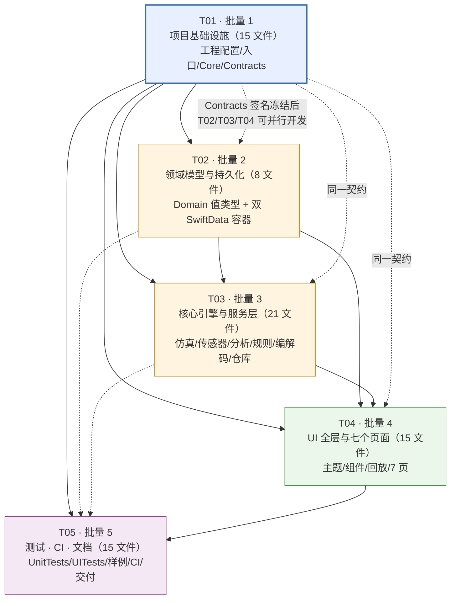

# Campus Run Simulator｜工程实现任务列表

| 项目 | 内容 |
| --- | --- |
| 文档编号 | `03-TaskList` |
| 阶段 | 流水线中间产物：**实现任务分解**；下游交接对象为**工程师** |
| 撰写人 | 高见远（Gao）· 架构师 |
| 上游依赖 | `docs/01-Research-and-PRD.md`（需求基线）、`docs/02-Architecture.md`（架构 / 完整文件清单 / 接口签名 / 调用流程 / 跨文件约定） |
| 文档语言 | 简体中文 |
| 本文范围 | 只做任务分解、依赖关系、验收映射与文件清单速查。**不写实现代码、不写 PRD、不写测试用例正文** |

---

## 0. 使用说明（工程师必读）

1. **一次性落盘**：按 §2 的 T01 → T05 顺序，把 §4 速查表中的 **74 个文件**全部写到磁盘；每个文件的精确相对路径见 `docs/02-Architecture.md` §2.2，职责、关键类型/函数签名、上下层依赖均已逐行给出，可直接照抄。
2. **顶层任务数 = 5**（硬上限，不再拆分）。每个「批量 N」是一个顶层任务，批量内部按功能模块列**子批次**（文件组），子批次是落盘顺序提示，不是独立任务。
3. **T01 必须是项目基础设施**（工程配置 + 入口 + 依赖/约定 + 契约，全部放在第一个任务），这是可编译交付的前提。
4. **依赖为编译层依赖，不是人工阻塞**：T01 落盘后 `Contracts` 的协议签名即冻结，T02 / T03 / T04 可并行按签名开发；T05 最后做集成与验收。
5. **验收点**列给出该批量必须满足的 PRD 验收编号（AC-*）与可测条件；完整验收标准见 PRD §B.14，完整跨文件约定见 `02-Architecture.md` §7。
6. 任何任务中都**不得**实现 PRD §A.4 的 14 条禁止项；合规守卫（§7.12 的 12 条铁律）优先于功能便利。

---

## 1. 任务总览

| 批量 | 任务名 | 文件数 | 依赖 | 优先级 | 核心产出 |
| --- | --- | --- | --- | --- | --- |
| **T01** | 批量 1 · 项目基础设施与全局约定 | 15 | 无 | P0 | 可 `xcodebuild` 识别的完整 Xcode 工程骨架、权限配置、Core 约定、冻结的契约协议 |
| **T02** | 批量 2 · 领域模型与持久化 | 8 | T01 | P0 | §B.8 全部 15 类值实体、双独立 SwiftData 容器与迁移策略 |
| **T03** | 批量 3 · 核心引擎与服务层 | 21 | T01、T02 | P0 | 仿真引擎 I1–I10、真实记录链路、规则、编解码、仓库、分析 |
| **T04** | 批量 4 · UI 全层与七个页面 | 15 | T01、T02、T03 | P0 | 主题/组件/回放 + PRD §B.6 七个页面，无静态占位与假按钮 |
| **T05** | 批量 5 · 测试、CI 与交付文档 | 15 | T01、T02、T03、T04 | P0 | UnitTests / UITests / GPX 样例 / 双签名路径 CI / README 等 |
| | **合计** | **74** | | | 与 `02-Architecture.md` §2.2 的 F01–F74 一一对应，无遗漏、无占位符 |

**硬约束核对**：顶层任务 5 个（≤5）✅；每个任务 ≥3 个文件 ✅（最少 T02 = 8）；按功能模块/层次分组、不按单文件拆分 ✅；配置文件全部集中在 T01 ✅；T01 为项目基础设施 ✅；依赖尽量收敛到 T01 ✅（见 §3 说明）。

---

## 2. 任务列表（按实现顺序）

### T01 · 批量 1：项目基础设施与全局约定

| 项 | 内容 |
| --- | --- |
| **任务 ID** | T01 |
| **任务名** | 项目基础设施（Xcode 工程 + 构建配置 + 权限 + 入口 + 全局约定 + 契约协议） |
| **依赖** | 无 |
| **优先级** | P0（第一优先级，其余全部依赖它） |
| **文件数** | 15 |

**涉及文件（按子批次）**

| 子批次 | 模块 | 文件（F 编号 → 精确路径） |
| --- | --- | --- |
| 1.1 | Xcode 工程与构建配置（7） | F01 `CampusRunSimulator.xcodeproj/project.pbxproj`<br/>F02 `CampusRunSimulator.xcodeproj/xcshareddata/xcschemes/CampusRunSimulator.xcscheme`<br/>F03 `Config/App.xcconfig`<br/>F04 `CampusRunSimulator/Resources/Info.plist`<br/>F05 `CampusRunSimulator/Resources/CampusRunSimulator.entitlements`<br/>F06 `CampusRunSimulator/Resources/Assets.xcassets/Contents.json`<br/>F07 `CampusRunSimulator/Resources/Assets.xcassets/AppIcon.appiconset/Contents.json` |
| 1.2 | App 入口与根视图（2） | F08 `CampusRunSimulator/App/CampusRunSimulatorApp.swift`<br/>F09 `CampusRunSimulator/RootView.swift` |
| 1.3 | Core 基础约定（4） | F10 `CampusRunSimulator/Core/DataOrigin.swift`<br/>F11 `CampusRunSimulator/Core/Units.swift`<br/>F12 `CampusRunSimulator/Core/AppConstants.swift`<br/>F13 `CampusRunSimulator/Core/AuditLogger.swift` |
| 1.4 | Contracts 契约层（2） | F22 `CampusRunSimulator/Contracts/SimulationContracts.swift`<br/>F23 `CampusRunSimulator/Contracts/SensorContracts.swift` |

**落盘顺序**：1.1（工程/配置先行）→ 1.3（Core 常量与错误被所有层引用）→ 1.4（契约签名冻结）→ 1.2（入口注入容器与路由）。

**关键约束**
- `project.pbxproj`：`objectVersion = 77`、`PBXProject.compatibilityVersion = "Xcode 16"`；3 个 `PBXFileSystemSynchronizedRootGroup`（G_APP / G_TEST / G_UITEST）；每个 `PBXNativeTarget.fileSystemSynchronizedGroups` 引用对应根组；`PBXSourcesBuildPhase.files = ()`（同步组自动纳入）；`XCBuildConfiguration.baseConfigurationReference` 指向 F03；`PBXFileSystemSynchronizedBuildFileExceptionSet` 把 `Info.plist` / `.entitlements` 排除出自动编译，`Assets.xcassets` 保留为资源。完整必需键见 `02-Architecture.md` §1.7。
- 构建设置：`SDKROOT=iphoneos`、`SUPPORTED_PLATFORMS=iphoneos iphonesimulator`、`IPHONEOS_DEPLOYMENT_TARGET=17.0`、`TARGETED_DEVICE_FAMILY=1,2`、`GENERATE_INFOPLIST_FILE=NO`、`CODE_SIGN_ENTITLEMENTS` 指向 F05、`CODE_SIGNING_ALLOWED=NO`（未签名默认路径）；**不写 `compileBitcode`**。
- F04 六键齐全：`NSLocationWhenInUseUsageDescription` / `NSLocationAlwaysAndWhenInUseUsageDescription` / `NSMotionUsageDescription` / `NSHealthShareUsageDescription` / `NSHealthUpdateUsageDescription` / `UIBackgroundModes=[location]` / `ITSAppUsesNonExemptEncryption=NO`。
- F05：`com.apple.developer.healthkit=true` + `com.apple.developer.healthkit.background-delivery=true`；后台定位靠 `UIBackgroundModes`，**不臆造 entitlement 键**。
- F10 `DataOrigin` 为 `enum`、`let` 语义、无转换器；F12 固定文案与 `AppError` 全 22 case 一次写全（§7.7）；F22/F23 **只声明协议与签名，不 import 任何 `Modules/*` 实现**，签名冻结后不得随意改动。
- **零第三方依赖**：不引入 XcodeGen / Tuist / CocoaPods / SPM 包。

**验收点**
| 编号 | 可测条件 |
| --- | --- |
| V1.1 | macOS Runner 上 `xcodebuild -project CampusRunSimulator.xcodeproj -list` 能列出 3 个 target 与 shared scheme；`xcodebuild -version` 有日志输出 |
| V1.2 | `plutil -lint` 对 F04 / F05 / F69 全部通过；Info.plist 六个用途描述键与 `UIBackgroundModes` 存在 |
| V1.3 | `xcodebuild ... CODE_SIGNING_ALLOWED=NO ... clean archive` 成功产出 `.xcarchive/Products/Applications/CampusRunSimulator.app` |
| V1.4 | 全仓 Grep 无第三方依赖声明、无 `URLSession` 上传路径、无禁止词「过检 / 刷成绩 / 上传成绩 / 有效成绩」 |
| V1.5 | `Contracts` 中 `SimulationEngine` / `InvariantValidator` / `LocationProvider` / `MotionProvider` / `HealthKitService` / `GPXCodec` / `RunRepository` / `ReplayController` 等 14 类签名齐全，且 `HealthKitService.write` 文档约束「仅 `.real`」 |
| V1.6 | 部署目标 17.0；Liquid Glass 相关 API 全部集中在 F45（本批量不含 F45，但入口签名须预留 `@available(iOS 26, *)` 双路径） |

---

### T02 · 批量 2：领域模型与持久化

| 项 | 内容 |
| --- | --- |
| **任务 ID** | T02 |
| **任务名** | 领域数据模型（§B.8 全部实体）+ SwiftData 双独立容器与迁移 |
| **依赖** | T01（Core 常量、`DataOrigin`、Contracts 签名） |
| **优先级** | P0 |
| **文件数** | 8 |

**涉及文件（按子批次）**

| 子批次 | 模块 | 文件 |
| --- | --- | --- |
| 2.1 | Domain 值类型（6） | F14 `CampusRunSimulator/Models/Domain/TrackPoint.swift`<br/>F15 `CampusRunSimulator/Models/Domain/RunSession.swift`<br/>F16 `CampusRunSimulator/Models/Domain/RouteModels.swift`<br/>F17 `CampusRunSimulator/Models/Domain/SimulationProfile.swift`<br/>F18 `CampusRunSimulator/Models/Domain/RulePreset.swift`<br/>F19 `CampusRunSimulator/Models/Domain/Reports.swift` |
| 2.2 | 持久化 SwiftData（2） | F20 `CampusRunSimulator/Models/Persistence/PersistedModels.swift`<br/>F21 `CampusRunSimulator/Models/Persistence/ModelContainerFactory.swift` |

**落盘顺序**：2.1 全部值类型 → 2.2 持久化映射与容器。

**关键约束**
- 覆盖 PRD §B.8 的 **15 类实体**：`RunSession`、`TrackPoint`、`Route`、`RoutePoint`、`RouteVersion`、`Waypoint`、`ElevationProfile`、`RulePreset`、`SimulationProfile`、`SimulationPhase`、`ReplayState`、`AppSettings`、`PermissionState`、`ExportRecord`、`ErrorEvent`（按域合并到 6 个文件，不遗漏）。
- 所有记录类实体 `let dataOrigin: DataOrigin`；**无 setter、无 `toReal()`、无跨来源复制**；`RunSession.originChain` 用于「另存副本」保留原链。
- `RulePreset.isHypothetical` 在**初始化器内强制 `true`**，JSON 不能覆盖；`RecordValidity.resultIsScore` / `producesExternalRecord` 固定 `false`；`EvaluationOutcome` 仅三态（`passed/failed/insufficientData`），**类型系统层面不存在 score / grade / record 字段**。
- `Route` / `RoutePoint` / `Waypoint` / `ElevationProfile` **不含 `dataOrigin`**（用户自建中立对象），由引用它的 `RunSession` 决定导出标记；`ElevationSource` 必标来源。
- F20：持久化类统一 `SD` 前缀；`SDMapper.toValue/fromValue`；`@Attribute(.unique) var id`，`sim_` / `real_` 前缀；级联删除策略。
- F21：`makePersistent()` 返回**两个独立 `ModelContainer`**（独立 store URL / 独立 `ModelConfiguration` / 独立 id 空间）；`makeInMemory()` 用 `ModelConfiguration(isStoredInMemoryOnly: true)`；`AppMigrationPlan` 的 stage **禁止任何改写 `dataOrigin` 或合并两容器**；本期不启用 iCloud。

**验收点**
| 编号 | 可测条件 |
| --- | --- |
| V2.1 | §B.8 15 类实体逐项可在代码中定位，字段名与 `02-Architecture.md` §3.2 签名一致 |
| V2.2 | `RunSession.dataOrigin` / `TrackPoint.dataOrigin` 为 `let`，全仓 Grep 无 `dataOrigin =` 赋值语句（除 `init`）、无 `simulated → real` 转换方法 |
| V2.3 | 两个容器 store URL 不同；同字符串 id 在两个域中可共存且不冲突（AC-C7） |
| V2.4 | `ModelContainerFactory.makeInMemory()` 可在 `xcodebuild test -destination 'platform=iOS Simulator,name=iPhone 16'` 下创建成功，不初始化 `CLLocationManager` / `HKHealthStore` / `CMAltimeter` |
| V2.5 | 反序列化 `isHypothetical: false` 的预设 JSON 被拒绝（抛出 `.ruleHypotheticalViolation`） |
| V2.6 | `AppSettings.healthKitWriteEnabled` 默认 `false`，且代码注释明确「仅对 `.real` 生效」 |

---

### T03 · 批量 3：核心引擎与服务层

| 项 | 内容 |
| --- | --- |
| **任务 ID** | T03 |
| **任务名** | 仿真引擎 / 真实记录链路 / 数据处理 / 规则 / 导入导出 / 仓库（全部非 UI 实现） |
| **依赖** | T01（契约签名冻结）、T02（领域模型） |
| **优先级** | P0（项目核心） |
| **文件数** | 21 |

**涉及文件（按子批次，按模块分批）**

| 子批次 | 模块 | 文件 |
| --- | --- | --- |
| 3.1 | 运动仿真引擎（8） | F24 `CampusRunSimulator/Modules/SimulationEngine/SeededRandom.swift`<br/>F25 `CampusRunSimulator/Modules/SimulationEngine/SpeedCurve.swift`<br/>F26 `CampusRunSimulator/Modules/SimulationEngine/PhaseScheduler.swift`<br/>F27 `CampusRunSimulator/Modules/SimulationEngine/RouteArcLength.swift`<br/>F28 `CampusRunSimulator/Modules/SimulationEngine/ElevationSampler.swift`<br/>F29 `CampusRunSimulator/Modules/SimulationEngine/TrackPointAssembler.swift`<br/>F30 `CampusRunSimulator/Modules/SimulationEngine/InvariantValidator.swift`<br/>F31 `CampusRunSimulator/Modules/SimulationEngine/SimulationEngine.swift` |
| 3.2 | 定位与传感器（4，**仅 REAL 链路**） | F32 `CampusRunSimulator/Modules/LocationAndSensors/LocationProvider.swift`<br/>F33 `CampusRunSimulator/Modules/LocationAndSensors/MotionProvider.swift`<br/>F34 `CampusRunSimulator/Modules/LocationAndSensors/HealthKitService.swift`<br/>F35 `CampusRunSimulator/Modules/LocationAndSensors/LiveRunRecorder.swift` |
| 3.3 | 数据处理与分析（2） | F36 `CampusRunSimulator/Modules/DataProcessing/SeriesBuilder.swift`<br/>F37 `CampusRunSimulator/Modules/DataProcessing/AnalysisBuilder.swift` |
| 3.4 | 规则配置（2） | F38 `CampusRunSimulator/Modules/Rules/RuleValidator.swift`<br/>F39 `CampusRunSimulator/Modules/Rules/RuleEvaluator.swift` |
| 3.5 | 导入导出（4） | F40 `CampusRunSimulator/Modules/ImportExport/DataMarker.swift`<br/>F41 `CampusRunSimulator/Modules/ImportExport/GPXCodec.swift`<br/>F42 `CampusRunSimulator/Modules/ImportExport/TabularCodec.swift`<br/>F43 `CampusRunSimulator/Modules/ImportExport/ExportManager.swift` |
| 3.6 | 仓库（1） | F44 `CampusRunSimulator/Modules/Repository/RunRepository.swift` |

> 上表全部为**完整精确路径**，与 `02-Architecture.md` §2.2 及本文 §4 速查表逐条一致，无缩写、无占位符。

**落盘顺序**：3.1（引擎，先 F24→F25/F26→F27/F28→F29→F30→F31）→ 3.2（传感器，先 F32/F33/F34 → F35）→ 3.3 → 3.4 → 3.5 → 3.6（仓库最后，聚合所有写入方）。

**关键约束**
- **唯一真值源**：时间轴 `t`、路线弧长 `s(t)`、速度曲线 `v(t)`、步频曲线 `c(t)`、海拔剖面 `h(s)`、单一随机种子；其余全部由 F29 派生。**禁止任何字段独立随机**。
- 步幅由 `L = 60·v/c` 反算（F29），`Δsteps = c·Δt/60`，累计量由差分累加；不得独立生成。
- **I1–I10 做成可验收校验器**（F30），`InvariantReport.allPassed == false` 时 F31 **拒绝生成**并高亮违规 `InvariantID`，不是警告。
- 同 `SimulationProfile + seed` 逐点逐字段完全一致（F24 唯一随机入口 + 时间相关有界平滑噪声；禁止 `Double.random` / `Int.random` / 逐点白噪声）。
- 6 模型（`steady/interval/accelerate/decelerate/elevation/custom`）+ 5 阶段（`start/steady/accelerate/decelerate/finish`）+ 过渡平滑全部实现。
- F31 **不得 import** `CLLocationManager` / HealthKit / 网络栈；只构造 `CLLocation` **值对象**（PRD §A.1.1 合规基础）；不申请任何权限。
- F33 单位换算：`currentPace` s/m ×1000/60 → min/km；`currentCadence` 步/秒 ×60 → spm；`relativeAltitude` + `h0` → 绝对海拔；不可用时标「不可用」，**不臆造**。
- F34 `write(session:points:)` **首行 `guard session.dataOrigin == .real`**，否则抛 `AppError.simulatedWriteForbidden`；读/写分别申请；读取权限不可判定 → `.unknown`「无数据」；后台 delivery entitlement / `stepCount` hourly 上限 / 模拟器不支持提示 / **必须调用 completion**；`HKWorkoutRouteBuilder` 过滤 `>50 m`、`>3 s`。
- F35 过滤 `horizontalAccuracy > 50 m`、野值剔除、时间戳单调校验、间隔 `>3 s` 标「数据稀疏」**不插值**、中断 `segmentIndex += 1` 且跨段不连线不计距、暂停段不计距、检查点可恢复。
- F41 GPX 1.1：`trk/trkseg/trkpt` + `<ele>`/`<time>`，兼容仅 `rte`/`wpt`；缺字段**分级提示且不臆造**；`trkseg` → `segmentIndex`；`<metadata>`/`<desc>`/`<trk><name>`/`<extensions>` 含 `SIMULATED/REAL` 标记。
- F40/F43 **三重标记**（文件名前缀 + 文件内 metadata/首行/顶层 + UI 徽标元数据）缺一即拒绝导出；**混合来源导出禁止**；每次导出写 `ExportRecord.markersIncluded` 并记 `AuditLogger`（日志不写经纬度）。
- F39 评估前置 `guard session.dataOrigin == .simulated`；输出三态 + 固定免责声明；**不产生分数/成绩**；多预设对比只显示用户自建名称。
- F44 按 `dataOrigin` 强制路由容器；`unclassified()` 隔离脏数据（**绝不默认 real**）；`duplicate` 保留 `originChain`；**不存在 `simulated→real` 方法**。
- 层间依赖单向：`SimulationEngine` 与 `LocationAndSensors` 互不 import；`Persistence` 不 import `Modules/*`；`ImportExport` 不 import `Persistence`。

**验收点**
| 编号 | 可测条件 |
| --- | --- |
| V3.1 | AC-D1/D2/D3/D4/D6：1 Hz × 30 min 仿真导出后外部重算，`v`/配速误差 <0.5%，每点 `L = 60v/c` 误差 <0.5%，`ΣΔsteps·L` 与累计距离偏差 <1%，累计距离偏差 <0.5%，`gain − loss = h_end − h0`，时间戳严格单调 |
| V3.2 | AC-D5：同 `seed` + 同 profile 两次生成，`[TrackPoint]` 逐字段完全一致（浮点全等） |
| V3.3 | AC-D7：I1–I10 逐项输出通过/失败；人为注入矛盾数据（逐项）时**拒绝生成**并给出违规编号 |
| V3.4 | AC-D8：6 种模型均可生成、预览、保存、导出，曲线形态符合 §B.9.1 定义 |
| V3.5 | AC-C3：全仓无 `simulated → HKWorkout / HKWorkoutRoute` 调用路径；F34 的 guard 单元测试可通过 |
| V3.6 | AC-C4：仿真代码路径不含 `CLLocationManager`、不申请定位/HealthKit 权限、不含网络上传 |
| V3.7 | AC-C2/C6、AC-F2/F3：GPX 往返一致（含 `ele`/`time`/多 `trkseg`）；缺 `ele`/`time`/仅 `rte`/非法版本均明确提示且不臆造；规则三态评估含固定免责声明、无分数 |
| V3.8 | AC-F5/F6（真机人工）：后台 30 min 不丢轨迹、遮挡 GPS 后独立 segment 跨段无直线连线；HealthKit 仅用户勾选 + 授权后写入真实 workout + route |
| V3.9 | AC-C8：PRD §A.4 的 14 条禁止项逐条确认未实现 |

---

### T04 · 批量 4：UI 全层与七个页面

| 项 | 内容 |
| --- | --- |
| **任务 ID** | T04 |
| **任务名** | 主题 / 可复用组件 / 轨迹回放 / PRD §B.6 七个页面 |
| **依赖** | T01、T02、T03 |
| **优先级** | P0 |
| **文件数** | 15 |

**涉及文件（按子批次）**

| 子批次 | 模块 | 文件 |
| --- | --- | --- |
| 4.1 | UI 主题（3） | F45 `CampusRunSimulator/UI/Theme/GlassModifier.swift`<br/>F46 `CampusRunSimulator/UI/Theme/OriginBadge.swift`<br/>F47 `CampusRunSimulator/UI/Theme/AppTheme.swift` |
| 4.2 | 可复用 UI 组件（3） | F48 `CampusRunSimulator/UI/Components/MetricCards.swift`<br/>F49 `CampusRunSimulator/UI/Components/RouteMapView.swift`<br/>F50 `CampusRunSimulator/UI/Components/Charts.swift` |
| 4.3 | 轨迹回放（2） | F51 `CampusRunSimulator/UI/Replay/ReplayView.swift`（内含可复用 `ReplayControls`）<br/>F52 `CampusRunSimulator/UI/Replay/ReplayController.swift` |
| 4.4 | 七个页面（7） | F53 `CampusRunSimulator/UI/Pages/HomeView.swift`（①首页总览）<br/>F54 `CampusRunSimulator/UI/Pages/RoutePlanningView.swift`（②地图与路线规划）<br/>F55 `CampusRunSimulator/UI/Pages/SimulationView.swift`（③运动模拟器）<br/>F56 `CampusRunSimulator/UI/Pages/LiveRunView.swift`（④实时运动）<br/>F57 `CampusRunSimulator/UI/Pages/AnalyticsView.swift`（⑤数据分析）<br/>F58 `CampusRunSimulator/UI/Pages/HistoryView.swift`（⑥历史记录）<br/>F59 `CampusRunSimulator/UI/Pages/SettingsView.swift`（⑦设置） |

**落盘顺序**：4.1（主题先行，全部 View 依赖）→ 4.2 → 4.3 → 4.4（按 ①→⑦ 顺序）。

**关键约束**
- **7 个页面严格对应 PRD §B.6.1–B.6.7**；`ReplayView`（F51）为跨页复用页面级子视图，不计入导航顶层 7 页。
- **禁止静态占位与假按钮**（AC-F1）：每个 View 由 `@Observable` ViewModel 驱动，所有控件绑定真实 action 或明确禁用原因；空态/错误态用 F48 真实组件。
- F45 `glassCard(role:interactive:)` 单一入口：`@available(iOS 26, *)` 走 `GlassEffectContainer` + `.glassEffect(.regular, in: Capsule())` + `glassEffectID`；iOS 17–25 走 `.regularMaterial`/`.ultraThinMaterial` + `blur` + 圆角 + 描边 + 阴影；**两路径共享相同 frame / `contentShape` / accessibility / 控件集合，功能等价**（AC-F9）；Reduce Motion 下均禁用形变。
- F46 `OriginBadge`：**文字 + 图标 + `.accessibilityLabel` 三通道，不依赖颜色**；置于玻璃/材质层之上（z-order），高对比、不被模糊遮挡；错误态下不得消失。
- F49 MapKit SwiftUI：`Map` / `MapReader` / `MapPolyline` / `MapStyle`；`MKPolylineRenderer.strokeEnd` 做渐进绘制；选点/拖点/撤销重做均真实生效；**不依赖不存在的高程数值 API**；`MKDirections` 节流失败降级手工连线。
- F50 Swift Charts 4 类曲线（配速/步频/步幅/海拔）+ 海拔剖面 + 联动游标 + 时间/距离轴 + 降采样；**SIMULATED/REAL 不得无标记混画**（如需对比必须双标签 + 双通道文字 + 图例）。
- F51 回放：播放/暂停/继续/快进/倍速 0.5×–8×/拖动定位**全部真实生效**；地图位置与数值游标严格对应同一时间戳（AC-F4）；常驻来源徽标（R-06）。
- ③页顶常驻「测试数据 / SIMULATED」+ 页脚固定合规文案；④页常驻「真实记录」且视觉明确区分、**无虚拟定位入口、无 SIMULATED→HealthKit 路径**；⑤评估结果页固定免责声明；⑥**默认两分区**，禁止「全部记录」混排成绩单，禁止 `simulated→real` 转换入口；⑦低版本 Liquid Glass 显示「当前系统不支持，已启用兼容外观」而非隐藏/禁用。
- **UI 层不得直接 import HealthKit / `CLLocationManager` 实现细节**，一切经 `Contracts`。
- 深色模式、动态类型（最大字号下 SIMULATED 文字不截断）、提高对比度、Reduce Motion 全页面通过（AC-F10/AC-F12）。

**验收点**
| 编号 | 可测条件 |
| --- | --- |
| V4.1 | AC-C1：遍历 7 页 + 所有弹窗 + 所有错误态，100% 可见来源文字标记且 VoiceOver 可读 |
| V4.2 | AC-F1：7 页所有控件无静态占位、无假按钮，每个触发真实动作或明确禁用原因 |
| V4.3 | AC-F4：回放播放/暂停/继续/快进/倍速/拖动全部生效，地图位置与数值游标同一时间戳 |
| V4.4 | AC-F7：4 类曲线同源联动，区间统计正确，SIMULATED/REAL 不无标记混画 |
| V4.5 | AC-F9：iOS 26 与 iOS 17 各跑一遍完整功能用例，功能等价、无崩溃、无功能缺失 |
| V4.6 | AC-F10/F12：深色/动态类型/Reduce Motion 全页面通过；§B.13.3 共 15 类错误态逐条有文案与可操作出口 |
| V4.7 | AC-C7：历史记录默认两分区，无混排成绩单，无 `simulated → real` 转换入口 |

---

### T05 · 批量 5：测试、CI 与交付文档

| 项 | 内容 |
| --- | --- |
| **任务 ID** | T05 |
| **任务名** | UnitTests / UITests / GPX 测试样例 / 双签名路径 CI / 仓库文档，并完成集成验收 |
| **依赖** | T01（工程骨架）、T02、T03、T04（被测代码） |
| **优先级** | P0 |
| **文件数** | 15 |

**涉及文件（按子批次）**

| 子批次 | 模块 | 文件 |
| --- | --- | --- |
| 5.1 | UnitTests（5） | F60 `CampusRunSimulatorTests/SimulationEngineTests.swift`<br/>F61 `CampusRunSimulatorTests/InvariantValidatorTests.swift`<br/>F62 `CampusRunSimulatorTests/CodecTests.swift`<br/>F63 `CampusRunSimulatorTests/RuleEvaluatorTests.swift`<br/>F64 `CampusRunSimulatorTests/RepositoryIsolationTests.swift` |
| 5.2 | UITests（1） | F65 `CampusRunSimulatorUITests/ComplianceMarkingUITests.swift` |
| 5.3 | GPX 测试样例（3） | F66 `CampusRunSimulatorTests/Fixtures/SIMULATED_sample_loop.gpx`<br/>F67 `CampusRunSimulatorTests/Fixtures/sample_missing_ele.gpx`<br/>F68 `CampusRunSimulatorTests/Fixtures/sample_only_rte.gpx` |
| 5.4 | CI 与签名（3） | F69 `ci/ExportOptions.plist`<br/>F70 `ci/scripts/build_unsigned_ipa.sh`<br/>F71 `.github/workflows/ios-build.yml` |
| 5.5 | 仓库文档（3） | F72 `README.md`<br/>F73 `LICENSE`<br/>F74 `CHANGELOG.md` |

**落盘顺序**：5.3（样例先写，测试要读）→ 5.1 → 5.2 → 5.4（CI 串起全部）→ 5.5（最后写，含验收记录）。

**关键约束**
- UnitTests **纯逻辑**：SwiftData 用 `ModelContainerFactory.makeInMemory()`，不初始化 `CLLocationManager` / `HKHealthStore` / `CMAltimeter`，不依赖真机；可在 `xcodebuild test -destination 'platform=iOS Simulator,name=iPhone 16'` 下执行。
- UITests（XCUITest）CI **可选运行**（`if: inputs.runUITests`）；真机后台 30 min（AC-F5）不在 CI 覆盖，须人工验收。
- F66 文件名带 `SIMULATED_` 前缀且文件内三重标记齐全；F67 缺 `<ele>` 与部分 `<time>`；F68 仅 `<rte>`/`<wpt>` 无 `<trk>`（另含非法 version 段）。
- **签名路径 A（默认，未签名 IPA）**：`xcodebuild ... CODE_SIGNING_ALLOWED=NO CODE_SIGNING_REQUIRED=NO CODE_SIGN_IDENTITY="" DEVELOPMENT_TEAM="" clean archive` → `mkdir -p build/Payload && cp -R <.app> build/Payload/` → `zip -qry CampusRunSimulator-unsigned.ipa Payload` → **`test -s ... || exit 1`** → `unzip -l` 校验 `Payload/CampusRunSimulator.app/Info.plist`。
- **签名路径 B（可选，已签名）**：Secrets `CERTIFICATE_P12` / `CERTIFICATE_PASSWORD` / `PROVISIONING_PROFILE` / `KEYCHAIN_PASSWORD` → 临时 keychain + profile 安装 → `xcodebuild -exportArchive -exportOptionsPlist ci/ExportOptions.plist` → **同样 `test -s` 门禁**。两条路径在 F71 中为**互斥 job / `if` 分支**，不得混用；Secret 缺失时明确跳过并输出原因，不得回退冒充已签名产物。
- F71 必须输出 `xcodebuild -version`，Xcode 版本选择用仓库变量 `XCODE_VERSION` + `xcode-select -s`（**不引入第三方 setup-xcode Action**）；`plutil -lint` 校验 F04/F05/F69；禁止词 Grep 扫描（AC-C5 辅助）；上传 artifact。
- F72 README 含合规声明、Q1=17.0 结论、构建/CI 复现命令、未签名 IPA 安装说明、目录结构、真机验收清单；F74 记录 ADR（Q1 / 双容器 / 同步根组 / 签名双路径）与真机验收结果。
- **本地 Linux 无 Xcode，全部编译验证以 GitHub Actions 构建为准**（见 `02-Architecture.md` §8.3）；首次 CI 失败以 `xcodebuild` 日志修正 F01/F02/F03，**不得回头修改 PRD 或合规约束**。

**验收点**
| 编号 | 可测条件 |
| --- | --- |
| V5.1 | `xcodebuild test -destination 'platform=iOS Simulator,name=iPhone 16' -only-testing:CampusRunSimulatorTests` 全部通过（AC-D1–D8、AC-C2/C3/C6/C7） |
| V5.2 | CI job A 通过：`xcodebuild -version` 有日志、archive 成功、IPA **真实存在且非空**（`test -s`）、`unzip -l` 有 Info.plist、artifact 上传成功 |
| V5.3 | CI job B（手动触发）在 4 个 Secrets 齐备时产出已签名 IPA 并通过 `test -s`；Secret 缺失时明确跳过 |
| V5.4 | AC-C1–C8 / AC-D1–D8 / AC-F1–F12 全表在 §5 映射矩阵中均有对应任务与文件，无悬空验收项 |
| V5.5 | `plutil -lint` 对全部 plist 通过；全仓零第三方依赖声明 |

---

## 3. 任务依赖图



> **依赖说明**：实线为编译层依赖（下层类型必须先存在），虚线为「契约先于实现、可并行」的松耦合关系。T01 完成后 `Contracts` 协议签名冻结，T02（模型）、T03（实现）、T04（UI 视图模型可先用协议 mock）可并行推进，避免过长的人工线性等待；T05 必须最后做集成。**不存在跨批量的循环依赖**。

---

## 4. 文件清单速查表（**精确 74 个文件**，工程师照此落盘）

> 每条给出完整精确相对路径（相对仓库根 `/workspace/CampusRunSimulator/`）与一句话职责。详细职责、关键类型/函数签名、上下层依赖见 `02-Architecture.md` §2.2。

### T01（15）

| # | 完整路径 | 职责 |
| --- | --- | --- |
| F01 | `CampusRunSimulator.xcodeproj/project.pbxproj` | 手写 Xcode 16 工程，同步根组 + 3 target |
| F02 | `CampusRunSimulator.xcodeproj/xcshareddata/xcschemes/CampusRunSimulator.xcscheme` | shared scheme（archive/test） |
| F03 | `Config/App.xcconfig` | 共用构建设置唯一来源 |
| F04 | `CampusRunSimulator/Resources/Info.plist` | 6 个用途描述 + 后台模式 + 加密豁免 |
| F05 | `CampusRunSimulator/Resources/CampusRunSimulator.entitlements` | HealthKit + 后台 delivery entitlement |
| F06 | `CampusRunSimulator/Resources/Assets.xcassets/Contents.json` | Asset catalog 根 |
| F07 | `CampusRunSimulator/Resources/Assets.xcassets/AppIcon.appiconset/Contents.json` | App 图标占位 |
| F08 | `CampusRunSimulator/App/CampusRunSimulatorApp.swift` | `@main` 入口 + AppDelegate + 双容器注入 |
| F09 | `CampusRunSimulator/RootView.swift` | TabView / 路由根 / 首次合规确认 |
| F10 | `CampusRunSimulator/Core/DataOrigin.swift` | 来源枚举、id 前缀、三重标记定义 |
| F11 | `CampusRunSimulator/Core/Units.swift` | 单位量纲换算 + 格式化/数值/CLLocation 扩展 |
| F12 | `CampusRunSimulator/Core/AppConstants.swift` | 常量、固定文案、`AppError`、审计格式 |
| F13 | `CampusRunSimulator/Core/AuditLogger.swift` | OSLog 结构化日志（不写经纬度） |
| F22 | `CampusRunSimulator/Contracts/SimulationContracts.swift` | 仿真侧全部协议 |
| F23 | `CampusRunSimulator/Contracts/SensorContracts.swift` | 传感器/健康/规则/导出协议 |

### T02（8）

| # | 完整路径 | 职责 |
| --- | --- | --- |
| F14 | `CampusRunSimulator/Models/Domain/TrackPoint.swift` | `TrackPoint` / `GeoPoint` / `QualityFlag` |
| F15 | `CampusRunSimulator/Models/Domain/RunSession.swift` | `RunSession` / `ReplayState` / `ExportRecord` / `ErrorEvent` |
| F16 | `CampusRunSimulator/Models/Domain/RouteModels.swift` | `Route` / `RoutePoint` / `RouteVersion` / `Waypoint` / `ElevationProfile` |
| F17 | `CampusRunSimulator/Models/Domain/SimulationProfile.swift` | `SimulationProfile` / `SimulationPhase` / 6 模型 / 5 阶段枚举 |
| F18 | `CampusRunSimulator/Models/Domain/RulePreset.swift` | §B.7.2 全字段 + `WaypointPolicy` / `RecordValidity` / 三态 |
| F19 | `CampusRunSimulator/Models/Domain/Reports.swift` | 一致性/评估/质量报告 + `AppSettings` / `PermissionState` |
| F20 | `CampusRunSimulator/Models/Persistence/PersistedModels.swift` | `SD*` @Model 全套 + `SDMapper` |
| F21 | `CampusRunSimulator/Models/Persistence/ModelContainerFactory.swift` | 双独立容器 + in-memory + `AppMigrationPlan` |

### T03（21）

| # | 完整路径 | 职责 |
| --- | --- | --- |
| F24 | `CampusRunSimulator/Modules/SimulationEngine/SeededRandom.swift` | 唯一随机入口 + 有界时间相关平滑噪声 |
| F25 | `CampusRunSimulator/Modules/SimulationEngine/SpeedCurve.swift` | 6 种速度模型 `v(t)` + 自定义曲线 |
| F26 | `CampusRunSimulator/Modules/SimulationEngine/PhaseScheduler.swift` | 5 阶段编排 + 过渡 + 步频曲线 `c(t)` |
| F27 | `CampusRunSimulator/Modules/SimulationEngine/RouteArcLength.swift` | 弧长参数化 + Haversine + bearing |
| F28 | `CampusRunSimulator/Modules/SimulationEngine/ElevationSampler.swift` | `h(s)` 剖面 + 误差模型 + gain/loss 死区 |
| F29 | `CampusRunSimulator/Modules/SimulationEngine/TrackPointAssembler.swift` | 全部派生量唯一出口（`L=60v/c`） |
| F30 | `CampusRunSimulator/Modules/SimulationEngine/InvariantValidator.swift` | I1–I10 校验器，失败拒绝 |
| F31 | `CampusRunSimulator/Modules/SimulationEngine/SimulationEngine.swift` | 引擎编排 actor（无传感器/网络依赖） |
| F32 | `CampusRunSimulator/Modules/LocationAndSensors/LocationProvider.swift` | `CLLocationManager` 封装 + 后台 + 自动暂停 |
| F33 | `CampusRunSimulator/Modules/LocationAndSensors/MotionProvider.swift` | `CMPedometer`/`CMAltimeter`/`CMMotionActivity` + 单位换算 |
| F34 | `CampusRunSimulator/Modules/LocationAndSensors/HealthKitService.swift` | 读/写分别授权 + `guard .real` 写入守卫 |
| F35 | `CampusRunSimulator/Modules/LocationAndSensors/LiveRunRecorder.swift` | 真实记录编排 + `TrackFilter` + segment + 中断恢复 |
| F36 | `CampusRunSimulator/Modules/DataProcessing/SeriesBuilder.swift` | 4 类曲线序列 / 轴切换 / 降采样 / 联动游标 |
| F37 | `CampusRunSimulator/Modules/DataProcessing/AnalysisBuilder.swift` | 分段统计 + 一致性/数据质量报告 |
| F38 | `CampusRunSimulator/Modules/Rules/RuleValidator.swift` | 参数/JSON 校验 + 预设 CRUD |
| F39 | `CampusRunSimulator/Modules/Rules/RuleEvaluator.swift` | 三态评估 + 多预设对比（无分数） |
| F40 | `CampusRunSimulator/Modules/ImportExport/DataMarker.swift` | 三重标记生成与校验 |
| F41 | `CampusRunSimulator/Modules/ImportExport/GPXCodec.swift` | GPX 1.1 编解码 + 容错 + 扩展字段 |
| F42 | `CampusRunSimulator/Modules/ImportExport/TabularCodec.swift` | CSV + JSON 编解码（含预设 JSON） |
| F43 | `CampusRunSimulator/Modules/ImportExport/ExportManager.swift` | 单一来源守卫 + 导出审计 |
| F44 | `CampusRunSimulator/Modules/Repository/RunRepository.swift` | 双存储域路由 + CRUD + 脏数据隔离 |

### T04（15）

| # | 完整路径 | 职责 |
| --- | --- | --- |
| F45 | `CampusRunSimulator/UI/Theme/GlassModifier.swift` | Liquid Glass `@available(iOS 26,*)` 双路径 + 回退 |
| F46 | `CampusRunSimulator/UI/Theme/OriginBadge.swift` | 常驻来源徽标（文字+图标+VoiceOver） |
| F47 | `CampusRunSimulator/UI/Theme/AppTheme.swift` | 深浅色/动态类型/Reduce Motion/无障碍 |
| F48 | `CampusRunSimulator/UI/Components/MetricCards.swift` | 数值卡片 / 空态 / 错误态 / 合规横幅 |
| F49 | `CampusRunSimulator/UI/Components/RouteMapView.swift` | MapKit SwiftUI 地图 + 选点 + 渐进绘制 |
| F50 | `CampusRunSimulator/UI/Components/Charts.swift` | Swift Charts 4 曲线 + 海拔剖面 + 联动游标 |
| F51 | `CampusRunSimulator/UI/Replay/ReplayView.swift` | 回放页级视图（内含可复用 `ReplayControls`） |
| F52 | `CampusRunSimulator/UI/Replay/ReplayController.swift` | 回放时间轴/倍速/游标 `@MainActor` |
| F53 | `CampusRunSimulator/UI/Pages/HomeView.swift` | ① 首页总览 |
| F54 | `CampusRunSimulator/UI/Pages/RoutePlanningView.swift` | ② 地图与路线规划 |
| F55 | `CampusRunSimulator/UI/Pages/SimulationView.swift` | ③ 运动模拟器 |
| F56 | `CampusRunSimulator/UI/Pages/LiveRunView.swift` | ④ 实时运动（真实记录） |
| F57 | `CampusRunSimulator/UI/Pages/AnalyticsView.swift` | ⑤ 数据分析 |
| F58 | `CampusRunSimulator/UI/Pages/HistoryView.swift` | ⑥ 历史记录（两分区） |
| F59 | `CampusRunSimulator/UI/Pages/SettingsView.swift` | ⑦ 设置 |

### T05（15）

| # | 完整路径 | 职责 |
| --- | --- | --- |
| F60 | `CampusRunSimulatorTests/SimulationEngineTests.swift` | 复现 / 6 模型 / 单位 / 步幅反算 |
| F61 | `CampusRunSimulatorTests/InvariantValidatorTests.swift` | I1–I10 + 注入矛盾拒绝 |
| F62 | `CampusRunSimulatorTests/CodecTests.swift` | GPX/CSV/JSON 往返 + 三重标记 + 容错 |
| F63 | `CampusRunSimulatorTests/RuleEvaluatorTests.swift` | 三态 / 无分数 / 假设值强制 |
| F64 | `CampusRunSimulatorTests/RepositoryIsolationTests.swift` | 双容器隔离 / origin 不可变 / 无 HK 路径 |
| F65 | `CampusRunSimulatorUITests/ComplianceMarkingUITests.swift` | 7 页标记 / VoiceOver / 无假按钮 |
| F66 | `CampusRunSimulatorTests/Fixtures/SIMULATED_sample_loop.gpx` | 正常 GPX 1.1 基准（含 ele/time、多 trkseg、标记） |
| F67 | `CampusRunSimulatorTests/Fixtures/sample_missing_ele.gpx` | 缺 ele / 部分缺 time 容错样例 |
| F68 | `CampusRunSimulatorTests/Fixtures/sample_only_rte.gpx` | 仅 rte/wpt、非法 version 容错样例 |
| F69 | `ci/ExportOptions.plist` | 签名路径 B 导出配置 |
| F70 | `ci/scripts/build_unsigned_ipa.sh` | 签名路径 A：archive → Payload → zip → IPA 门禁 |
| F71 | `.github/workflows/ios-build.yml` | 双签名路径 CI + Xcode 版本 + 单元测试 + artifact |
| F72 | `README.md` | 合规声明 / 构建复现 / 真机验收清单 |
| F73 | `LICENSE` | 许可证 + 不得用于作弊声明 |
| F74 | `CHANGELOG.md` | 版本 / ADR / 验收记录 |

> **计数核对**：T01 = 15、T02 = 8、T03 = 21、T04 = 15、T05 = 15，**合计 74 个文件**（F01–F74 连续无缺号）。本次架构阶段已产出的 `docs/02-Architecture.md`、`docs/03-TaskList.md`、`docs/class-diagram.mermaid`、`docs/sequence-diagram.mermaid` 与上游 `docs/01-Research-and-PRD.md` **不计入**该 74。

---

## 5. 验收标准 → 任务 / 文件映射矩阵

| 验收编号 | 归属任务 | 主要文件 | 关键条件 |
| --- | --- | --- | --- |
| AC-C1 | T04、T05 | F46、F53–F59、F65 | 7 页 + 弹窗 + 错误态 100% 文字标记、VoiceOver 可读 |
| AC-C2 | T03、T05 | F40–F43、F62 | 文件名 + 文件内三重标记 + 免责声明 |
| AC-C3 | T03、T05 | F34、F64 | 无 simulated → HKWorkout/Route 路径 |
| AC-C4 | T01、T03、T05 | F04、F05、F31、F34 | 仿真不申请后台定位、不修改系统定位、不注入第三方 App |
| AC-C5 | T01、T04、T05 | F12、F48、F71 | 无禁止词断言，假设值全标注 |
| AC-C6 | T02、T03 | F18、F38、F39 | 假设值 + 固定免责 + 三态无分数 |
| AC-C7 | T02、T03、T04、T05 | F20/F21/F44/F58/F64 | 双域分区、无 `simulated→real`、独立清除 |
| AC-C8 | T01–T05 | 全部 | §A.4 14 条禁止项逐条未实现 |
| AC-D1 | T03、T05 | F29、F11、F60 | v / 配速误差 <0.5% |
| AC-D2 | T03、T05 | F29、F30、F60 | `L=60v/c` <0.5%；步数×步幅 <1% |
| AC-D3 | T03、T05 | F27、F29、F60 | 累计距离偏差 <0.5% |
| AC-D4 | T03、T05 | F28、F60 | `gain−loss = h_end−h0`，死区生效 |
| AC-D5 | T03、T05 | F24、F31、F60 | 同种子逐字段完全一致 |
| AC-D6 | T03、T05 | F26、F29、F30、F60 | 时间戳严格单调、Δt 恒定、无 Δt=0 |
| AC-D7 | T03、T05 | F30、F31、F61 | I1–I10 逐项输出；注入矛盾拒绝生成 |
| AC-D8 | T03、T04、T05 | F25、F55、F60 | 6 模型生成/预览/保存/导出 |
| AC-F1 | T04、T05 | F48、F53–F59、F65 | 无静态占位 / 假按钮 |
| AC-F2 | T03、T04 | F41、F49、F54 | 路线编辑/版本/GPX 往返一致 |
| AC-F3 | T03、T05 | F41、F62、F67、F68 | GPX 四类容错不臆造 |
| AC-F4 | T04 | F51、F52、F49、F50 | 回放控件全生效、地图与游标同时间戳 |
| AC-F5 | T03（**真机人工**） | F32、F35 | 后台 30 min 不丢轨迹、中断独立 segment |
| AC-F6 | T03（**真机人工**） | F34、F56 | 授权 + 勾选后写入 workout + route |
| AC-F7 | T04 | F36、F50、F57 | 4 曲线联动、不无标记混画 |
| AC-F8 | T03、T04 | F38、F39、F57、F59 | 多预设对比 / JSON 导入导出 / 三态 |
| AC-F9 | T04（**双版本真机**） | F45、F47、F59 | iOS 26 与 17 功能等价 |
| AC-F10 | T04、T05 | F46、F47、F65 | 深色/动态类型/Reduce Motion 全页面 |
| AC-F11 | T02、T03、T05 | F21、F35、F44、F64 | 强杀重启数据完整、写入中断可恢复 |
| AC-F12 | T04、T05 | F48、F12、F56、F59 | §B.13.3 共 15 类错误态全覆盖 |

---

## 6. 依赖包与共享知识速查

| 项 | 结论 | 详见 |
| --- | --- | --- |
| 第三方依赖 | **0 个**（禁 XcodeGen / Tuist / CocoaPods / SPM 第三方包 / 网络 SDK） | `02-Architecture.md` §6 |
| Apple framework | SwiftUI / Foundation / SwiftData / Charts / MapKit / CoreLocation / CoreMotion（含 `CMAltimeter`）/ HealthKit / OSLog / UniformTypeIdentifiers / XCTest / XCUITest | 同上 §6.2 |
| CI 系统工具 | `xcodebuild` / `xcrun` / `xcode-select` / `zip` / `unzip` / `plutil` / `cp` / `mkdir` / `test -s` / `security` / `codesign` / `git` / `grep` | 同上 §6.3 |
| 单位与量纲 | `02-Architecture.md` §7.1（含 s/m→min/km ×1000/60、步/秒→spm ×60、relativeAltitude + h0） | §7.1 |
| 命名 / 种子 / 采样率 / dataOrigin / 三重标记 / `AppError` / SwiftData 命名迁移 / 并发 / 日志审计 / 容差 / 12 条铁律 | 同上 §7.2–§7.12，**工程师必须逐条遵守** | §7 |

---

## 7. 一次性落盘顺序（合并清单，供工程师直接使用）

```text
① T01/1.1  F01 F02 F03 F04 F05 F06 F07
② T01/1.3  F10 F11 F12 F13
③ T01/1.4  F22 F23                 ← 契约签名在此冻结
④ T01/1.2  F08 F09
⑤ T02/2.1  F14 F15 F16 F17 F18 F19
⑥ T02/2.2  F20 F21
⑦ T03/3.1  F24 F25 F26 F27 F28 F29 F30 F31
⑧ T03/3.2  F32 F33 F34 F35
⑨ T03/3.3  F36 F37
⑩ T03/3.4  F38 F39
⑪ T03/3.5  F40 F41 F42 F43
⑫ T03/3.6  F44
⑬ T04/4.1  F45 F46 F47
⑭ T04/4.2  F48 F49 F50
⑮ T04/4.3  F51 F52
⑯ T04/4.4  F53 F54 F55 F56 F57 F58 F59
⑰ T05/5.3  F66 F67 F68
⑱ T05/5.1  F60 F61 F62 F63 F64
⑲ T05/5.2  F65
⑳ T05/5.4  F69 F70 F71
㉑ T05/5.5  F72 F73 F74
```

落盘完成后立即执行 §2/T05 的 V5.1–V5.5 集成验收；**本地 Linux 无法编译验证，最终以 GitHub Actions 的 macOS Runner 构建结果为准**（`02-Architecture.md` §8.3）。

---

> **文档结束。** 本文件与 `docs/02-Architecture.md` 共同构成架构阶段交付。任务分解严格遵守顶层 5 个批量、每任务 ≥3 文件、T01 为项目基础设施、按功能模块分组、依赖单向；任何与 PRD §0 合规红线冲突的实现需退回产品侧重新评审。
